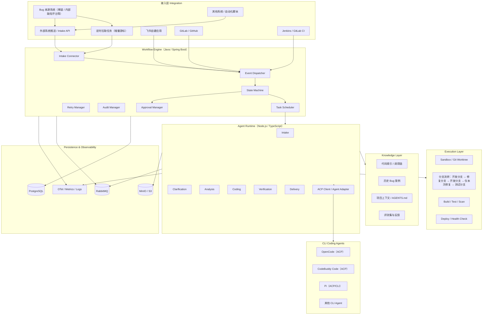
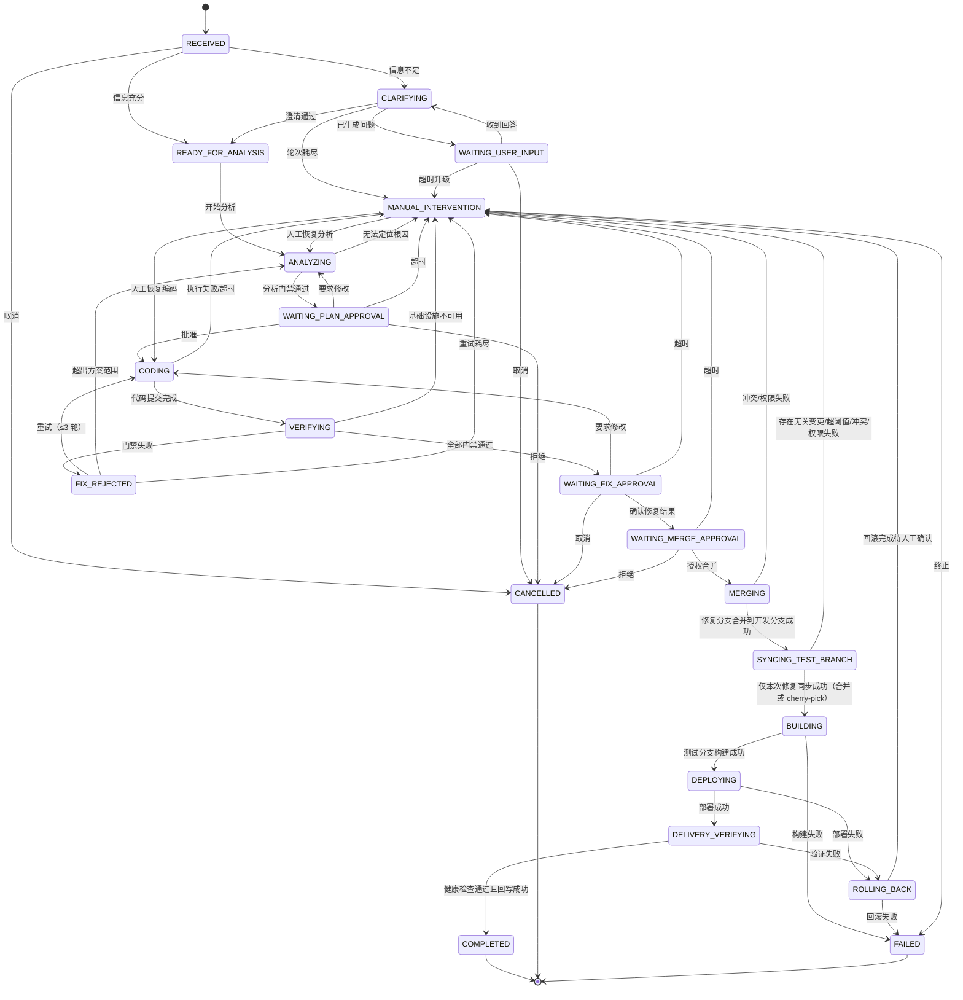
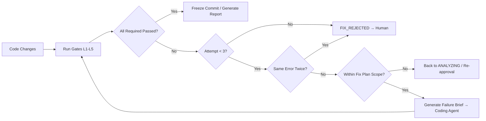
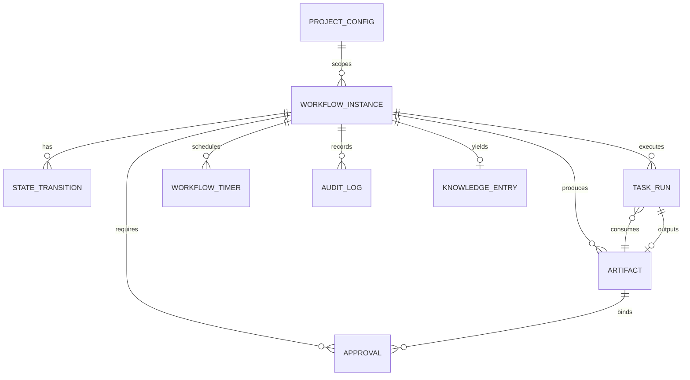

# Bug Auto-Fix & Delivery 系统设计方案（PRD + 系统设计）

> **版本**：1.2（评审稿）
> **日期**：2026-11-14
> **状态**：待评审
> **依据**：《AI4SE Bug 自动修复与自动交付流程设计》（八阶段流程讨论稿）+ 2026-11-14 决策补充
> **需求清晰度**：98/100（剩余待确认项见 §16）

**变更记录**

| 版本 | 日期 | 变更 |
|------|------|------|
| 1.2 | 2026-11-14 | 移除 Jira 依赖：Bug 通过**定时任务拉取来源系统 API**或**外部系统调用 Intake API 主动推送**获取；模型供应商/端点/参数全部配置化；测试分支同步严格隔离，**不允许带入其他变更**，阈值 **10 文件 / 200 行**；CI 按 Commit SHA 触发并回传结果已确认 |
| 1.1 | 2026-11-13 | 确认 Bug 接入支持「定时轮询 / 外部通知 / Webhook」多模式；确认「开发分支 → 修复分支 → 开发分支 → 测试分支」分支流转；编码智能体统一经 **ACP（Agent Client Protocol）** 接入，首批 OpenCode，支持 CodeBuddy Code / Pi 等 CLI Agent |
| 1.0 | 2026-11-13 | 基于八阶段讨论稿生成完整设计 |

---

## 0. 文档说明

### 0.1 目标与读者

本文把讨论稿中的八阶段流程落成可实施的系统设计，供架构评审、研发排期、安全与运维评估使用。读者包括：架构师、Java 后端、Agent Runtime 开发、SRE、安全、QA、产品经理。

### 0.2 设计范围

- **覆盖**：Phase 1（AI Bug 分析）→ Phase 2（自动代码修复）→ Phase 3（自动合并与测试环境交付）的完整系统设计。
- **方向性覆盖**：Phase 4（知识沉淀、多仓库、多 Agent 协作、生产发布策略）。
- **不在本文范围**：具体代码实现、UI 视觉稿、组织级审批制度设计。

### 0.3 基线假设与已确认前提

| # | 假设 | 影响 |
|---|------|------|
| A1 | Bug 来源系统通过两种方式接入：**定时任务拉取来源系统 API** 与 **外部系统调用 Intake API 主动推送**；Git/CI 使用 GitLab 或 GitHub | 接入连接器设计 |
| A2 | 首期单项目试点，单仓库或单模块；后续扩展多项目 | 多租户隔离可后置 |
| A3 | 需求配置**开发分支**；修复从开发分支拉出；确认后合并回开发分支；随后以「仅本次修复变更」同步到**测试分支**，不允许带入其他变更，阈值 **10 文件 / 200 行**；首期只自动部署测试环境，生产发布必须独立人工审批 | 分支与交付链路 |
| A4 | 编码智能体统一通过 **ACP（Agent Client Protocol）** 接入；首批 OpenCode，设计上支持 CodeBuddy Code、Pi 及其他 CLI Agent；模型供应商、模型、端点、参数均可配置，支持私有化部署 | Agent Runtime 与模型 |
| A5 | CI 支持按 Commit SHA 触发并回传结构化结果（已确认） | 验证层可信度 |
| A6 | 已有可用的自动化测试与测试环境；否则需先补基础设施 | 自动修复成功率 |

### 0.4 术语表

| 术语 | 含义 |
|------|------|
| Workflow Instance | 一次 Bug 修复交付的完整流程实例，持久化状态机载体 |
| Artifact | 阶段产出的结构化交付物（JSON/YAML/Markdown/Diff），带版本且不可变 |
| Gate | 质量门禁或审批门禁，由引擎判定，Agent 无权跳过 |
| Approval | 绑定 Artifact 版本与代码 Commit 的人工批准记录 |
| Sandbox | 隔离的代码执行环境（容器 + Git Worktree） |
| RCA | Root Cause Analysis，根因分析 |
| Red-Green Evidence | 回归测试修复前失败、修复后通过的证据 |
| Adapter | 屏蔽 VCS / CI / Coding Agent / 模型差异的适配层 |
| Outbox | 与业务事务同库落库、异步投递的事件表，保证最终一致 |

---

## 1. 背景与目标

### 1.1 业务问题

Bug 从被提出到真正交付，横跨 Bug 来源系统、飞书、Git、CI/CD 多个系统，当前依赖人工搬运与口头同步：

- Bug 描述经常缺失复现步骤、预期结果、日志，开发者反复追问。
- 根因定位依赖个人经验，方案质量不稳定。
- 代码修改后的测试、Review、合并、部署动作分散，缺少统一质量门禁。
- 修复是否真正交付缺少闭环，Bug 状态与实际部署状态经常不一致。
- 全流程缺少审计，无法回答「谁批准了什么版本的什么改动」。

### 1.2 系统定位

本系统**不是一个自主 Coding Agent**，而是 AI4SE 平台上的一个**标准业务工作流**：

```
Workflow Engine 控流程 → 专业 Agent 产出结果 → 人工在关键节点审批 → 自动化流水线交付
```

核心边界：Agent 只负责生成阶段结果；**是否进入下一阶段、是否允许执行高风险动作，由 Workflow Engine 根据质量门禁与审批判定**。

### 1.3 目标

| 编号 | 目标 | 说明 |
|------|------|------|
| G1 | 端到端闭环 | 接入 → 澄清 → 分析 → 审批 → 编码 → 验证 → 审批 → 合并 → 部署 → 回写 → 沉淀 |
| G2 | 全程可控 | 持久化状态机、审批绑定版本、质量门禁、权限最小化、可回滚 |
| G3 | 可度量可运营 | 每个阶段有耗时、成功率、人工介入率指标 |
| G4 | 能力可复用 | Workflow Engine / Approval Manager / Agent Runtime / Sandbox 可复用于需求变更、技术债治理等场景 |

### 1.4 非目标（首期）

- 不做生产环境全自动发布（必须独立人工审批）。
- 不自动处理数据库结构重大变更与生产数据修复。
- 不承诺复杂分布式并发、跨系统业务 Bug 的自动根因定位。
- 不做面向外部客户的 SaaS 多租户版本。

### 1.5 目标用户与角色

| 角色 | 职责 | 在系统中的动作 |
|------|------|----------------|
| 提单人（Requester） | 提出 Bug | 回答澄清问题、补充证据 |
| Bug 执行人（Bug Owner） | 对 Bug 修复负责 | 审批分析方案、确认修复结果 |
| 代码负责人（Code Owner） | 对目标仓库质量负责 | 审批合并、必要时要求修改 |
| 发布负责人（Release Manager） | 对生产发布负责 | 审批生产部署（Phase 4） |
| 平台管理员 | 维护项目配置、门禁、权限 | 配置项目、人工接管、取消流程 |
| 审计员 | 合规审计 | 只读查看全量审计记录 |
| 系统（Bot/Agent） | 执行自动化任务 | 无权审批、无权自行推进状态 |

### 1.6 成功指标（试点基线，需按实际校准）

| 指标 | 定义 | 建议初始目标 |
|------|------|--------------|
| Bug 自动澄清率 | 澄清轮次 ≤3 且无需人工介入即进入分析的流程 / 进入澄清的流程 | ≥ 60% |
| 根因分析准确率 | 人工抽检确认根因正确 / 已审批分析数 | ≥ 70% |
| 方案一次审批通过率 | 首次提交方案即批准 / 提交审批的方案数 | ≥ 50% |
| 自动修复成功率 | 首次进入验证即全门禁通过 / 进入 Coding 的流程数 | ≥ 40% |
| 人工介入率 | 进入 MANUAL_INTERVENTION 的流程 / 总流程数 | ≤ 50% |
| 平均交付周期 | RECEIVED → COMPLETED 的中位时长 | ≤ 2 个工作日 |
| 回归逃逸率 | 修复交付后 14 天内同模块新增相关缺陷数 / 已交付数 | ≤ 5% |
| 审批平均时延 | 审批请求发出到决策的中位时长 | ≤ 4 工作小时 |

> 指标口径详见附录 C。目标值属于试点假设，不作为承诺值。

---

## 2. 需求与范围

### 2.1 八阶段能力清单

| # | 阶段 | 核心能力 | 产出 Artifact | 自动化程度 | 人工门禁 |
|---|------|----------|---------------|------------|----------|
| 1 | Bug 接入与预处理 | 定时拉取 / 外部系统推送获取 Bug、识别项目/仓库、分类、去重、建流程 | `bug-context.json` | 100% | 无 |
| 2 | Bug 信息澄清 | 完整性判断、多轮追问、超时升级 | `clarification-record.json` | 消息自动化 | 提单人回答 |
| 3 | 根因分析与方案设计 | 代码/日志/调用链分析、证据分级、方案与测试计划 | `bug-analysis.md` / `fix-plan.yaml` | AI 分析 | 方案审批 |
| 4 | 修复任务执行 | 独立分支、Worktree/Sandbox、Coding Agent 修改 | `code-change-report.json` | 审批后自动 | 无 |
| 5 | 自动测试与验证 | L1–L5 门禁、回归测试 Red-Green、自动修复循环 | `verification-report.json` | 自动 | 失败耗尽转人工 |
| 6 | 修复结果确认 | Diff、测试报告、风险、回滚方案 | `fix-approval.json` | 自动生成 | 修复结果审批 |
| 7 | 合并与构建部署 | 修复分支→开发分支、仅本次修复变更→测试分支、合并门禁、CI、测试环境部署、健康检查、回滚 | `delivery-report.json` | 按策略自动 | 合并授权 / 生产审批 |
| 8 | 交付闭环与知识沉淀 | 回写来源系统、通知、案例入库、指标 | `knowledge-entry.json` | 自动 | 无 |

### 2.2 范围边界

**MVP 包含（Phase 1 + Phase 2）**

- 定时任务拉取来源系统 API、外部系统调用 Intake API 推送、去重、项目映射。
- 信息完整性判断、飞书多轮澄清、超时升级。
- 根因分析 + Analysis Gate + 飞书方案审批。
- 单仓库 Coding Agent 接入、Sandbox 隔离、分支管理。
- L1–L4 自动验证、Bug 回归测试、自动修复循环（≤3 轮）。
- 修复报告 + 飞书结果确认。
- 全量状态持久化、审计、基础指标看板。

**MVP 不包含（Phase 3 及以后）**

- 自动合并、构建、部署（Phase 3）。
- 生产环境发布审批（Phase 4）。
- 多仓库联合分析、多 Agent 并行。
- 历史 Bug 知识库的语义检索增强（Phase 4，但 Artifact 模型预留）。

### 2.3 典型端到端场景

1. 测试同学在 Bug 来源系统（如禅道/内部缺陷平台）创建 `BUG-1024 订单支付失败`，只写了一句话；定时任务在 5 分钟内拉取到，或来源系统直接调用 Intake API 推送。
2. 系统创建流程实例，识别仓库 `order-service`、版本 `1.2.0`。
3. 完整性模型判定缺少复现步骤、预期结果、错误日志 → 飞书卡片追问 4 个问题。
4. 用户补充后，系统进入分析；Analysis Agent 检索代码与日志，输出根因、证据、影响面、修复方案。
5. Analysis Gate 通过，飞书推送方案卡片给 Bug 执行人；执行人批准。
6. 系统创建 `bugfix/BUG-1024` 分支与独立 Worktree，Coding Agent 修改代码并补回归测试。
7. 验证层运行编译、单测、回归（先红后绿）、静态扫描、安全检查；首轮失败 → 自动修复 1 轮后通过。
8. 生成修复报告与 Diff，飞书推送；执行人确认。
9. 代码负责人授权合并；系统创建 PR，将修复分支合并到需求配置的开发分支（如 `develop`）。
10. 系统计算 `test...develop` 差异并做变更归因：若差异**全部属于本次修复**且不超过 **10 文件 / 200 行**，直接创建「开发分支 → 测试分支」PR；若全部属于本次修复但超过阈值，阻断并回到方案审批/拆分；若存在无关变更，从测试分支创建 `promote/BUG-1024`，只 cherry-pick 本次修复提交后提 PR，确保测试分支不引入其他变更。
11. CI 从测试分支构建、部署测试环境、健康检查通过；来源系统状态回写、飞书通知、知识入库，流程完成。

### 2.4 关键约束

- **流程不能串成一条 Prompt 链**：必须持久化状态机，支持跨天等待、重启恢复、重复事件幂等。
- **审批必须绑定对象版本**：审批的是「某个 Artifact 版本 + 某个 Commit SHA」，不是笼统的「同意」。
- **Agent 不能自证成功**：测试、扫描、构建结果必须由工具产生并带 provenance（命令、退出码、日志地址、镜像 digest）。
- **最小权限**：Coding Agent 不得推送受保护分支、不得访问生产凭据、不得自动合并/部署。
- **模型可配置**：不得硬编码模型 ID、供应商或端点；按项目/阶段解析 `model_profile`，未知或无效配置启动即失败，每次调用记录实际模型与成本。
- **分支流转固定**：修复分支必须从需求指定的开发分支拉出；禁止直接向受保护分支推送；合并必须经过 PR/门禁。
- **测试分支严格隔离**：同步到测试分支的内容必须能逐项归因为本次修复；任何无关变更一律阻断；修复变更超过 **10 文件 / 200 行** 需重新审批或拆分。开发分支干净时可直接合并，否则必须走 `promote/{issue_key}` cherry-pick 提升，不得把开发分支其他变更带入测试分支。
- **可回滚**：部署必须记录上一可用版本，失败自动停止后续阶段并触发回滚。

---

## 3. 总体架构

### 3.1 架构原则

| 编号 | 原则 | 落地方式 |
|------|------|----------|
| P1 | 流程与智能分离 | Workflow Engine 控制状态；Agent 只接收有界任务、返回结构化结果 |
| P2 | Artifact 驱动 | 阶段间不传自由文本，只传带版本的结构化 Artifact |
| P3 | 审批与执行分离 | Approval 绑定 Artifact 版本 + Commit SHA + 审批人角色，执行前校验 |
| P4 | 失败可恢复 | 状态持久化、事件 Outbox、任务幂等、定时器、人工接管 |
| P5 | 最小权限与隔离 | 每任务独立 Sandbox、工具白名单、网络与凭据隔离、全量审计 |
| P6 | 适配器可替换 | VCS/CI/Coding Agent/模型均通过 Adapter 抽象，避免供应商锁定 |

### 3.2 分层架构



### 3.3 组件职责

| 组件 | 职责 | 不负责 |
|------|------|--------|
| Integration Layer | 事件验签、外部推送与回调接入、事件标准化、身份映射、限流 | 业务状态判定 |
| Intake Connector | 定时拉取来源系统 API、接收外部推送、增量游标、去重、项目映射、统一事件信封 | 生成分析/代码 |
| State Machine | 合法状态流转、守卫条件、超时定时器、补偿动作 | 生成分析/代码 |
| Approval Manager | 审批请求、卡片推送、回调验签、审批有效性校验、审计 | 决定审批结果 |
| Task Scheduler | 任务排队、并发控制、租约、心跳、超时 | 执行 Agent 逻辑 |
| Agent Runtime | 组装上下文、通过 ACP/CLI 调用编码智能体、产出 Artifact、上报状态 | 控制流程、跳过门禁 |
| ACP Adapter | 启动 CLI Agent、会话与权限管理、流式事件转换、取消与恢复 | 修改 Agent 生成内容 |
| Execution Layer | 提供隔离环境、执行命令、采集结果 | 判定质量是否达标 |
| Knowledge Layer | 项目上下文、代码索引、历史案例、评测集 | 直接修改代码 |
| Artifact Store | 元数据（PG）+ 对象（MinIO/S3）、版本、校验和 | 决定 Artifact 是否有效 |
| Observability | 指标、日志、Trace、告警、看板 | — |

### 3.4 部署拓扑

| Plane | 组件 | 部署建议 |
|-------|------|----------|
| Control Plane | Workflow Engine、Approval API、Intake API、Git/CI/飞书回调 | 2+ 副本，无状态，PG 主从 |
| Worker Plane | Agent Runtime Worker、Verification Worker | 按队列水平扩展 |
| Sandbox Plane | Docker 主机池 / K8s Job / 独立 runner | 每任务一个隔离容器，限 CPU/内存/磁盘/时长 |
| Data Plane | PostgreSQL、RabbitMQ、MinIO、Redis（可选） | PG 同步提交保证 RPO=0；对象存储多副本 |
| Observability | Prometheus、Loki/ELK、Tempo/Jaeger、Grafana | 与业务网络隔离 |

> 若后续跨天等待、定时器、任务恢复复杂度显著上升，可在 Phase 3 评估 Temporal 替换自研调度，但**状态机语义与 Artifact/审批模型保持不变**（见 ADR-001）。

### 3.5 关键技术决策（ADR）

| ADR | 决策 | 备选 | 理由 | 影响 |
|-----|------|------|------|------|
| ADR-001 | Phase 1–2 自研轻量持久化状态机（Spring Boot + PostgreSQL + Outbox） | Temporal、Camunda、自研内存状态机 | 审批/Artifact/RBAC 与业务强耦合，自研可控；避免早期引入额外运维复杂度 | 需自行实现定时器、重试、恢复；保留 `WorkflowRuntime` SPI 以便替换 |
| ADR-002 | Agent Runtime 独立进程（Node.js/TypeScript），通过任务契约与引擎交互 | Agent 与引擎同进程；纯 Java Agent | 编码 Agent 生态以 Node 为主；隔离崩溃与资源消耗 | 引入 RPC/消息契约与回调安全设计 |
| ADR-003 | RabbitMQ + Transactional Outbox + Inbox 去重 | Kafka、仅数据库轮询 | Phase 1–2 吞吐足够、运维简单；Outbox 保证事件不丢 | 超大规模审计流可后续引入 Kafka |
| ADR-004 | PostgreSQL 为唯一事实源；MinIO/S3 存 Artifact 与大日志 | 全量对象存储；文件系统 | 事务、乐观锁、审计查询成熟；大对象不膨胀数据库 | 需设计对象生命周期与签名 URL |
| ADR-005 | 每任务独立容器 + Git Worktree，非 root、网络白名单、工具白名单 | 共享工作目录；直接宿主机执行 | 防止跨 Bug 污染、限制爆炸半径、满足审计 | 沙箱镜像与 runner 运维成本 |
| ADR-006 | 飞书企业自建应用 + 交互卡片 + 回调 | 自定义机器人 Webhook | 卡片按钮、表单、回调需要应用机器人能力 | 需处理验签、重放、身份映射 |
| ADR-007 | VCS/CI 通过 Provider Adapter 接入，首批单 Provider | 直接绑定 GitLab API | 避免供应商锁定；多仓库阶段可扩展 | 适配器测试矩阵增加 |
| ADR-008 | Artifact 不可变 + 版本化；审批绑定版本与 Commit SHA | 覆盖式更新 | 可追溯、可审计、防止「批 A 改 B」 | 每次修改产生新版本，前端需展示版本差异 |
| ADR-009 | 模型/Agent 均可配置：分析、澄清、总结等按阶段配置供应商/模型/端点/参数/预算；编码模型由 ACP Agent 配置决定 | 全自研 Agent；全部绑定单一厂商或固定模型 | 阶段能力与成本差异大；私有化与国产模型需要可替换；避免硬编码模型名 | 需 ModelProvider Adapter、统一输出 Schema、成本核算与模型评测 |
| ADR-010 | Bug 接入支持**定时拉取来源系统 API**（主通道、兜底）与**外部系统调用 Intake API 推送**（低延迟）；不绑定特定厂商 | 只做事件推送；只做轮询；绑定单一来源厂商 | 来源系统形态多样，内网/旧系统未必能配事件回调；轮询可补偿推送丢失 | 需游标、重叠窗口、去重、限流与分布式锁 |
| ADR-011 | 编码智能体统一走 ACP（Agent Client Protocol），Runtime 作为 ACP Client | 每家 CLI 单独硬编码；仅 subprocess 文本交互 | ACP 是 JSON-RPC 标准，OpenCode / CodeBuddy Code 等可替换；会话与权限可控 | 需处理协议版本差异、能力探测与非 ACP Agent 降级 |
| ADR-012 | 交付固定为「修复分支 → 开发分支 → 仅本次修复 → 测试分支」；同步模式 `AUTO`：开发分支相对测试分支无其他变更时直接合并，否则从测试分支创建 `promote/{issue_key}` 只 cherry-pick 本次修复提交 | 直接把开发分支合并到测试；只允许 cherry-pick | 既保留组织的两段分支模型，又保证测试分支严格隔离 | 需变更归因、cherry-pick 冲突处理、10 文件/200 行阈值与人工兜底 |

---

## 4. 工作流引擎设计

### 4.1 运行模型

- **事实源**：PostgreSQL 中的 `workflow_instance` 与 `state_transition`。服务重启后从当前状态恢复，不依赖内存。
- **命令/事件分离**：外部输入（外部推送、审批回调、定时器、Agent 完成）先转为 **Command**，由状态机校验守卫后产生 **Event** 与状态迁移。
- **Outbox**：状态迁移与待发消息在同一数据库事务内写入 `event_outbox`，由投递器异步发送；消费方用 `event_inbox` 去重。
- **Worker 无状态**：Agent 任务、验证任务、交付任务均为队列任务；Worker 崩溃后任务按租约重新入队。
- **所有分支判定在引擎**：Agent 不返回「下一步做什么」，只返回「本阶段结构化结果」。

### 4.2 状态定义

| 状态 | 含义 | 进入动作 | 默认超时 | 可退出到 |
|------|------|----------|----------|----------|
| `RECEIVED` | Bug 已接入 | 建流程、加 Bug 锁、记录来源 | — | CLARIFYING / READY_FOR_ANALYSIS / CANCELLED |
| `CLARIFYING` | 澄清分析中 | 运行完整性判断 | 10 min | WAITING_USER_INPUT / READY_FOR_ANALYSIS / MANUAL_INTERVENTION |
| `WAITING_USER_INPUT` | 等待提单人回答 | 发送飞书卡片 | 72 h | CLARIFYING / MANUAL_INTERVENTION / CANCELLED |
| `READY_FOR_ANALYSIS` | 信息足够 | 生成分析任务 | 5 min | ANALYZING |
| `ANALYZING` | 根因分析中 | 装配上下文、调用 Analysis Agent | 45 min | WAITING_PLAN_APPROVAL / MANUAL_INTERVENTION |
| `WAITING_PLAN_APPROVAL` | 等待方案审批 | 推送方案卡片 | 24 h | CODING / ANALYZING / CANCELLED / MANUAL_INTERVENTION |
| `CODING` | 代码开发中 | 创建分支/Worktree、下发任务 | 30 min | VERIFYING / MANUAL_INTERVENTION |
| `VERIFYING` | 自动验证中 | 执行 L1–L5 门禁 | 60 min | WAITING_FIX_APPROVAL / FIX_REJECTED / MANUAL_INTERVENTION |
| `FIX_REJECTED` | 验证失败待决策 | 记录失败原因、计算重试策略 | 5 min | CODING / ANALYZING / MANUAL_INTERVENTION |
| `WAITING_FIX_APPROVAL` | 等待修复结果确认 | 推送 Diff + 报告卡片 | 24 h | WAITING_MERGE_APPROVAL / CODING / CANCELLED / MANUAL_INTERVENTION |
| `WAITING_MERGE_APPROVAL` | 等待合并授权 | 推送合并授权卡片 | 8 h | MERGING / CANCELLED / MANUAL_INTERVENTION |
| `MERGING` | 合并到开发分支 | 创建 PR、最终门禁、合并修复分支→开发分支 | 15 min | SYNCING_TEST_BRANCH / MANUAL_INTERVENTION |
| `SYNCING_TEST_BRANCH` | 测试分支隔离同步 | 归因 `test...development` 差异；干净则创建 PR 直接合并，否则创建 `promote/{issue_key}` 只 cherry-pick 本次修复后提 PR | 20 min | BUILDING / MANUAL_INTERVENTION |
| `BUILDING` | 构建中 | 从测试分支按 Commit SHA 触发 CI、等待结果 | 60 min | DEPLOYING / FAILED |
| `DEPLOYING` | 部署中 | 部署测试环境 | 30 min | DELIVERY_VERIFYING / ROLLING_BACK |
| `DELIVERY_VERIFYING` | 部署后验证 | 健康检查、来源系统回写、通知 | 15 min | COMPLETED / ROLLING_BACK |
| `ROLLING_BACK` | 回滚中 | 回滚到上一可用版本 | 20 min | MANUAL_INTERVENTION / FAILED |
| `MANUAL_INTERVENTION` | 人工接管 | 告警、分配处理人、冻结自动动作 | 无（SLA 计时） | 指定安全状态 / FAILED / CANCELLED |
| `COMPLETED` | 交付完成 | 归档、指标结算 | — | 终态 |
| `CANCELLED` | 已取消 | 清理分支/沙箱、记录原因 | — | 终态 |
| `FAILED` | 异常终止 | 告警、保留现场、记录原因 | — | 终态 |

### 4.3 状态流转



**完整迁移表（含守卫与动作）**

| # | 当前状态 | 事件 | 守卫条件 | 动作 | 下一状态 |
|---|----------|------|----------|------|----------|
| 1 | RECEIVED | `intake.completed` | 完整性不足且未超过澄清轮次 | 发送澄清任务 | CLARIFYING |
| 2 | RECEIVED | `intake.completed` | 完整性达标 | 生成分析任务 | READY_FOR_ANALYSIS |
| 3 | CLARIFYING | `clarification.questions_ready` | 存在问题 | 推送飞书卡片 | WAITING_USER_INPUT |
| 4 | CLARIFYING | `clarification.completed` | 达标 | 冻结 `bug-context` 新版本 | READY_FOR_ANALYSIS |
| 5 | CLARIFYING | `clarification.exhausted` | 轮次 ≥3 | 告警 + 分配人工 | MANUAL_INTERVENTION |
| 6 | WAITING_USER_INPUT | `user.answered` | 验签通过、回答非空 | 合并回答、开启新澄清轮次 | CLARIFYING |
| 7 | WAITING_USER_INPUT | `timer.reminder` | 到达 24h/48h | 再次提醒（不改变状态） | WAITING_USER_INPUT |
| 8 | WAITING_USER_INPUT | `timer.escalate` | 到达 72h，或 P0/P1 超 4h | 升级人工 | MANUAL_INTERVENTION |
| 9 | READY_FOR_ANALYSIS | `analysis.start` | 无进行中的分析任务 | 下发 Analysis 任务 | ANALYZING |
| 10 | ANALYZING | `analysis.completed` | Analysis Gate 通过 | 冻结分析与方案 Artifact | WAITING_PLAN_APPROVAL |
| 11 | ANALYZING | `analysis.completed` | Gate 失败且可重试 | 记录原因、重试（≤2） | ANALYZING |
| 12 | ANALYZING | `analysis.completed` | Gate 失败且不可重试 | 转人工诊断 | MANUAL_INTERVENTION |
| 13 | WAITING_PLAN_APPROVAL | `approval.approved` | 审批有效性校验通过 | 冻结方案版本、创建修复任务 | CODING |
| 14 | WAITING_PLAN_APPROVAL | `approval.changes_requested` | 审批人有效 | 携带反馈重开分析 | ANALYZING |
| 15 | WAITING_PLAN_APPROVAL | `approval.rejected` / `cancel` | 审批人有效 / 有权限 | 终止并清理 | CANCELLED |
| 16 | WAITING_PLAN_APPROVAL | `timer.escalate` | 24h 未决策 | 升级人工 | MANUAL_INTERVENTION |
| 17 | CODING | `coding.completed` | 分支存在、Commit 有效、变更在允许范围（≤10 文件 / 200 行） | 冻结 Commit SHA、生成验证任务 | VERIFYING |
| 18 | CODING | `coding.failed` | 可重试且 attempt < 3 | 重置沙箱后重试 | CODING |
| 19 | CODING | `coding.failed` / `timer.timeout` | 不可重试或超时 | 保存现场、转人工 | MANUAL_INTERVENTION |
| 20 | VERIFYING | `verification.passed` | 全部必需门禁通过 | 生成修复报告 | WAITING_FIX_APPROVAL |
| 21 | VERIFYING | `verification.failed` | 尝试 <3 且未超范围 | 记录失败、生成修复指令 | FIX_REJECTED |
| 22 | VERIFYING | `verification.failed` | 尝试 ≥3 或超范围 | 标记原因 | FIX_REJECTED |
| 23 | VERIFYING | `verification.infrastructure_error` | 重试 <2 | 重新调度验证 | VERIFYING |
| 24 | FIX_REJECTED | `retry.decided` | 失败在方案范围内、尝试 <3 | 下发增量修复任务 | CODING |
| 25 | FIX_REJECTED | `retry.decided` | 需调整方案或超范围 | 重新进入分析 | ANALYZING |
| 26 | FIX_REJECTED | `retry.exhausted` | 尝试 ≥3 或同错重复 2 次 | 转人工 | MANUAL_INTERVENTION |
| 27 | WAITING_FIX_APPROVAL | `approval.approved` | 审批有效、Commit SHA 未变 | 请求合并授权 | WAITING_MERGE_APPROVAL |
| 28 | WAITING_FIX_APPROVAL | `approval.changes_requested` | 审批人有效 | 重开编码（方案不变） | CODING |
| 29 | WAITING_FIX_APPROVAL | `cancel` / `timer.escalate` | 有权限 / 超时 | 终止 / 转人工 | CANCELLED / MANUAL_INTERVENTION |
| 30 | WAITING_MERGE_APPROVAL | `approval.approved` | 审批有效、分支保护满足、SHA 未变 | 创建 PR 并合并 | MERGING |
| 31 | WAITING_MERGE_APPROVAL | `approval.rejected` / `cancel` | 有权限 | 终止 | CANCELLED |
| 32 | WAITING_MERGE_APPROVAL | `timer.escalate` | 超时 | 转人工 | MANUAL_INTERVENTION |
| 33 | MERGING | `merge.dev_succeeded` | 修复分支→开发分支合并 Commit 已确认 | 保存开发分支合并 SHA，计算 `test...development` 差异并归因 | SYNCING_TEST_BRANCH |
| 34 | MERGING | `merge.failed` | 冲突/权限/保护规则 | 保存错误、转人工 | MANUAL_INTERVENTION |
| 35 | SYNCING_TEST_BRANCH | `sync.clean_merge_succeeded` | 差异全部属于本次修复、≤10 文件 / 200 行，且开发分支→测试分支 PR 合并成功 | 记录测试分支 SHA，按 SHA 触发 CI | BUILDING |
| 36 | SYNCING_TEST_BRANCH | `sync.promotion_succeeded` | 存在其他变更；`promote/{issue_key}` 仅 cherry-pick 本次修复提交、门禁通过且 PR 合并成功 | 记录测试分支 SHA、提升分支与 cherry-pick 清单，按 SHA 触发 CI | BUILDING |
| 36a | SYNCING_TEST_BRANCH | `sync.unrelated_changes` / `sync.threshold_exceeded` / `sync.conflict` | 无法将差异全部归因为本次修复、修复变更 >10 文件/200 行、cherry-pick 冲突或无权限 | 生成差异清单与归因报告，冻结自动动作，转人工 | MANUAL_INTERVENTION |
| 37 | BUILDING | `build.succeeded` | 构建产物与测试分支 Commit 匹配 | 部署测试环境 | DEPLOYING |
| 38 | BUILDING | `build.failed` | 已重试 1 次仍失败 | 告警 | FAILED |
| 39 | DEPLOYING | `deploy.succeeded` | 部署记录有效 | 健康检查 | DELIVERY_VERIFYING |
| 40 | DEPLOYING | `deploy.failed` | — | 触发回滚 | ROLLING_BACK |
| 41 | DELIVERY_VERIFYING | `health.passed` | 健康检查通过且来源系统回写成功 | 知识入库、通知、结算指标 | COMPLETED |
| 42 | DELIVERY_VERIFYING | `health.failed` / `writeback.failed` | 不可自动恢复 | 触发回滚 | ROLLING_BACK |
| 43 | ROLLING_BACK | `rollback.completed` | 回滚至上一可用版本并验证 | 告警人工确认 | MANUAL_INTERVENTION |
| 44 | ROLLING_BACK | `rollback.failed` | — | 最高级告警 | FAILED |
| 45 | MANUAL_INTERVENTION | `operator.resume` | 操作人有权限、目标状态在白名单内 | 记录审计、恢复 | 指定安全状态 |
| 46 | MANUAL_INTERVENTION | `operator.abort` | 操作人有权限 | 清理资源 | FAILED / CANCELLED |
| 47 | 任意非终态 | `cancel` | 操作人有权取消 | 清理分支/沙箱、发通知 | CANCELLED |

> 人工接管只能恢复到白名单状态（如 ANALYZING、CODING、WAITING_FIX_APPROVAL），不能直接跳到 MERGING 或 COMPLETED，避免绕过门禁。

### 4.4 幂等与并发控制

| 场景 | 机制 |
|------|------|
| 重复推送 / 轮询重复拉取 | `event_inbox.event_id` 唯一约束；轮询以 `(issue_key, updated_at, content_hash)` 去重；重复返回 200 并记录 |
| 同一 Bug 重复建流程 | 部分唯一索引：`(source_type, external_issue_key)` 在非终态唯一；重复事件绑定现有流程 |
| 并发审批/操作 | `workflow_instance.state_version` 乐观锁；Command 携带 `expected_state_version`，冲突返回 409 |
| 重复任务执行 | `task_run(workflow_id, stage, attempt_no)` 唯一；Worker 以租约 + 心跳续期 |
| 重复外部写操作 | PR 创建、合并、部署均使用业务幂等键（如 `workflow_id:stage:artifact_version`） |
| Agent 重试导致重复提交 | 每次尝试独立 Worktree；提交前校验分支与 Commit；只接受最新 attempt 的产物 |
| 审批重复点击 | `approval` 状态机只能从 PENDING 迁移一次；卡片按钮带 nonce，服务端幂等 |

### 4.5 超时与升级策略

| 状态 | 提醒 | 升级 | 建议 SLA |
|------|------|------|----------|
| WAITING_USER_INPUT | 24h、48h | 72h 转人工；P0/P1 4h | 普通 72h |
| WAITING_PLAN_APPROVAL | 8 工作小时 | 24h 转人工 | 1 工作日 |
| WAITING_FIX_APPROVAL | 8 工作小时 | 24h 转人工 | 1 工作日 |
| WAITING_MERGE_APPROVAL | 4 工作小时 | 8h 转人工 | 4 工作小时 |
| CODING / VERIFYING | — | 硬超时后转人工 | 30 / 60 分钟 |
| MERGING / SYNCING_TEST_BRANCH | — | 合并、归因或 cherry-pick 失败转人工 | 15 / 20 分钟 |
| BUILDING / DEPLOYING | — | 按 CI 超时 | 60 / 30 分钟 |

> 所有定时器落库（`workflow_timer`），由调度器扫描到期任务，避免仅依赖内存定时器导致重启丢失。

### 4.6 重试分类

| 类型 | 示例 | 策略 |
|------|------|------|
| 瞬时故障 | 网络超时、5xx、消息重复 | 指数退避，最多 3 次；不影响状态语义 |
| 执行故障 | Agent 崩溃、沙箱失联 | 重置沙箱、新 attempt；最多 3 次 |
| 质量失败 | 编译失败、测试失败、扫描不通过 | 进入 FIX_REJECTED，最多 3 轮自动修复 |
| 业务失败 | 审批拒绝、方案被否 | 不自动重试，按审批意见回到指定阶段 |
| 不可恢复 | 权限失效、仓库不存在、分支保护拒绝 | 转 MANUAL_INTERVENTION / FAILED |
| 重复同错 | 连续两次同一错误码/同一失败测试 | 停止重试，转人工（避免无效烧钱） |

### 4.7 恢复与人工接管

- **重启恢复**：启动时加载非终态实例；`SCHEDULED/RUNNING` 任务按租约判定孤儿任务并重新入队。
- **Agent 恢复**：Adapter 支持 `resume(executionId)`；若底层不支持，则新 attempt 从已冻结的 Commit 继续。
- **对账任务**：定时比对来源系统状态、Git 分支/PR、CI 结果、部署记录，发现不一致转 MANUAL_INTERVENTION 并告警。
- **人工接管台**：展示时间线、Artifact 版本、失败原因、可用操作；所有操作写审计。

---

## 5. Agent 设计

### 5.1 设计原则

1. **Agent 是有界函数**：输入结构化上下文，输出结构化结果；不持有流程状态、不决定下一阶段。
2. **证据优先**：根因结论必须引用代码位置（`file:line`）、日志片段、Commit、调用链或用户回答；无证据的结论标记为假设。
3. **不能自证完成**：Agent 不得输出「测试通过」「可以合并」；这些由 Verification/Delivery 工具结果与引擎判定。
4. **工具最小化**：每类 Agent 有独立工具白名单，不允许使用未授权命令或网络。
5. **输出可校验**：Artifact 必须通过 JSON Schema / 模板校验，缺字段直接失败而非降级。

### 5.2 六类 Agent 规格

| Agent | 目标 | 输入 | 输出 | 工具 | 主要失败模式 | 门禁 |
|-------|------|------|------|------|--------------|------|
| Intake | 接入、分类、去重、项目识别 | 来源系统 Bug、项目注册表、历史案例 | `bug-context.json` | 来源系统 API、项目映射、相似度检索 | 项目/仓库识别错误、重复建流程 | Schema + 唯一性 |
| Clarification | 判断信息完整性、生成追问、合并回答 | Bug Context、完整性模型、历史澄清记录 | `clarification-record.json` | 字段校验、飞书消息、问答记忆 | 问题重复、无限追问、遗漏关键字段 | 轮次上限 + 完整性评分 |
| Analysis | 定位根因、影响面、修复方案、测试计划 | 完整 Context、代码索引、日志、历史 Bug、AGENTS.md | `bug-analysis.md`、`fix-plan.yaml` | 代码检索、调用链、日志查询、Git 历史 | 猜测根因、方案过大、遗漏影响面 | Analysis Gate |
| Coding | 在受控范围内修改代码与测试 | 已审批 Fix Plan、仓库、约束、ACP 会话配置 | `code-change-report.json` | ACP 文件/终端工具、Git 分支提交 | 超范围修改、破坏现有测试、引入依赖、Agent 崩溃 | 范围检查 + L1–L5 |
| Verification | 执行验证、汇总工具结果、驱动自动修复 | Code Changes、CI 配置、质量门禁 | `verification-report.json` | 编译、测试、扫描、Diff 分析 | 误报、环境不稳定、遗漏回归 | 工具 provenance + Red-Green |
| Delivery | 创建 PR、变更归因、隔离同步、触发构建部署、回写 | 已审批结果、分支、部署策略 | `delivery-report.json` | VCS/CI/Deploy/来源系统 API | 权限失败、合并冲突、cherry-pick 冲突、部署失败 | 分支保护 + 归因门禁 + 健康检查 |

> 说明：Intake/Clarification/Analysis/Verification/Delivery 属于「专业 Agent」；Coding 是「执行 Agent」，通过 ACP/CLI 适配层复用 OpenCode / CodeBuddy Code / Pi 等现有编码智能体，本系统不自研代码生成引擎。

### 5.3 Agent Runtime 与 ACP 接入

**ACP 接入模型**

ACP（Agent Client Protocol）是编码智能体与客户端之间的 JSON-RPC 2.0 协议，典型传输为 stdio。在本系统中，Agent Runtime 作为 **ACP Client**，按任务启动对应的 CLI Agent 子进程，负责初始化、会话创建、提示发送、流式事件接收、权限请求、取消与退出。

```
Runtime（ACP Client）
  → spawn CLI Agent（OpenCode / CodeBuddy Code / Pi / ...）
  → initialize（协议版本 + 客户端能力）
  → session/new（工作目录 = Worktree，注入工具配置）
  → session/prompt（Fix Plan + 约束 + 上下文）
  → session/update（流式消息 / 工具调用 / 计划）
  → session/request_permission（文件、终端、网络）
  → session/cancel / 进程退出
```

> ACP 方法名与能力集以所接入 Agent 的协议版本为准；Runtime 启动时做能力探测，缺失能力按降级策略处理。

**统一接口（TypeScript 示例）**

```ts
export interface CodingAgentAdapter {
  readonly name: string;
  readonly protocol: "ACP" | "CLI";
  capabilities(): Promise<AgentCapabilities>;
  execute(task: AgentTask, ctx: ExecutionContext): Promise<AgentRun>;
  resume(executionId: string, ctx: ExecutionContext): Promise<AgentRun>;
  cancel(executionId: string): Promise<void>;
  heartbeat(executionId: string): Promise<AgentHeartbeat>;
}

export interface AgentCapabilities {
  acpVersion?: string;
  streaming: boolean;
  permissionPrompts: boolean;
  sessionResume: boolean;
  modelSelection: boolean;
  terminal: boolean;
}

export interface AgentRun {
  executionId: string;
  acpSessionId?: string;
  status: "RUNNING" | "SUCCEEDED" | "FAILED" | "CANCELLED";
  changedFiles?: string[];
  commitSha?: string;
  metrics?: { inputTokens: number; outputTokens: number; costUsd: number };
  error?: { code: string; message: string; retryable: boolean };
}
```

**任务下发契约（引擎 → Runtime）**

```json
{
  "task_id": "tsk_01J...",
  "workflow_id": "wf_01J...",
  "stage": "CODING",
  "attempt_no": 1,
  "agent": {
    "type": "CODING",
    "adapter": "opencode-acp",
    "protocol": "ACP",
    "model_profile": "coding"
  },
  "inputs": {
    "fix_plan_artifact": "art_...@v2",
    "repository": { "provider": "gitlab", "project": "order-service", "base_sha": "abc123" },
    "bug_context_artifact": "art_...@v3"
  },
  "constraints": {
    "allowed_paths": ["src/main/java/", "src/test/java/"],
    "forbidden_operations": ["push_protected_branch", "deploy_production", "read_prod_secrets"],
    "max_attempts": 3,
    "timeout_minutes": 30,
    "max_changed_files": 10,
    "max_changed_lines": 200
  },
  "output_schema": "code-change-report/v1"
}
```

**回调契约（Runtime → 引擎）**：`POST /internal/v1/task-runs/{id}/events`，HMAC-SHA256 签名 + 时间戳 + nonce；事件类型 `started`、`heartbeat`、`artifact_uploaded`、`completed`、`failed`、`cancelled`。引擎只接受与当前 attempt 匹配的事件。

**ACP 权限映射**

| ACP 请求 | 允许条件 | 拒绝/升级 |
|----------|----------|-----------|
| 读文件 | 路径在 Worktree 内 | 越界拒绝并记录 |
| 写文件 | 路径在 `allowed_paths` 且非禁止文件 | 越界拒绝，必要时终止任务 |
| 终端命令 | 命令在项目白名单、参数合法 | 拒绝；连续违规终止会话 |
| 网络访问 | 目标在项目 allowlist | 默认拒绝 |
| 外部工具/MCP | 项目显式启用且工具在白名单 | 默认拒绝 |
| 交互确认 | 查询类请求可自动允许 | 审批类请求转飞书/引擎，不由 Agent 自行批准 |

**多 Agent 适配策略**

| 适配器 | 适用 Agent | 说明 |
|--------|------------|------|
| `AcpAgentAdapter` | OpenCode、CodeBuddy Code、其他 ACP CLI | 通用 JSON-RPC 客户端；能力探测 + 版本白名单 |
| `PiAdapter` | Pi | 优先走 ACP；版本不兼容时降级到 CLI 模式 |
| `GenericCliAdapter` | 无 ACP 的 CLI | 非交互命令 + 结构化输出解析；能力受限，需显式标注 |
| `MockAdapter` | 测试 | 回放固定事件，用于状态机与门禁测试 |

> 所有适配器输出同一 `code-change-report` Schema；引擎不感知底层 Agent 差异。Agent 选择按项目配置，支持按 Bug 类型/仓库路由。

### 5.4 上下文装配（Context Assembly）

| 层 | 内容 | 装配方式 |
|----|------|----------|
| 项目层 | `AGENTS.md`、架构文档、接口/数据库文档、编码规范 | 从项目注册表拉取，写入稳定前缀（可缓存） |
| 代码层 | 仓库结构、符号索引、调用链、相关文件片段 | 代码索引服务按 Bug 关键词/堆栈定位，返回 `file:line` |
| 变更层 | 相关 Git 历史、近期变更、责任人 | Git API + 本地索引 |
| 证据层 | 日志片段、Trace ID、截图 OCR、用户回答 | 按需检索，带来源与时间 |
| 经验层 | 相似历史 Bug、修复模式、测试用例 | 向量检索 + 规则过滤，标注相似度 |
| 约束层 | Fix Plan 允许范围、禁止操作、质量门禁 | 引擎直接注入，Agent 无权修改 |

> 稳定前缀（系统提示、Schema、项目规范、`AGENTS.md`）放在 Prompt 前部并启用 Prompt Caching；易变内容（Bug 文本、日志）放后部。所有上下文记录 `context_manifest`（来源、版本、token 数），支持审计与复现。

### 5.5 输出约束

- 所有 Artifact 使用 **JSON Schema 强约束**（优先使用所选模型供应商的原生结构化输出；不支持时由本地 Schema 校验器兜底）；校验失败视为任务失败，不进入下一阶段。
- 根因必须分四类标注：**已确认事实 / 根因判断 / 待验证假设 / 修复建议**。
- 分析报告必须给出证据引用；无证据的结论置信度不得高于 `LOW`。
- Coding Agent 只输出变更清单、Commit、执行日志引用；不得输出「已修复」结论。
- Verification Agent 只汇总工具结果；不得修改工具退出码或伪造日志。

### 5.6 模型与 Agent 集成选型

| 阶段 | 推荐实现 | 模型配置 | 说明 |
|------|----------|----------|------|
| 接入分类/摘要 | 模型 Provider Adapter | `models.profiles.intake`（示例 `claude-opus-5-5`） | 结构化输出 + 低温度；高并发分类可在评测后换更小模型 |
| 澄清问题生成 | 模型 Provider Adapter | `models.profiles.clarification`（示例 `claude-opus-5-5`） | 结构化输出问题列表；是否启用推理参数由 profile 决定 |
| 根因分析 | 模型 Provider Adapter 或 Agent harness | `models.profiles.analysis`（示例 `claude-opus-5-5`） | 长上下文、代码检索工具；流式返回；提示缓存稳定前缀 |
| 代码修改 | Coding Agent Adapter（ACP 优先） | `models.profiles.coding`；实际模型由 ACP Agent 配置管理 | 默认 Agent 按项目配置；支持 OpenCode、CodeBuddy Code、Pi 等 |
| 验证汇总 | 规则引擎 + 轻量模型 | `models.profiles.verification`（可空） | 门禁判定不依赖模型；模型仅做失败归因与修复指令 |
| 知识沉淀 | 批处理 + 轻量模型 | `models.profiles.knowledge`（可空） | 离线批量，不阻塞主流程 |

> **模型不做硬编码**：上表中的 `claude-opus-5-5` 仅为示例。供应商、模型 ID、Endpoint、鉴权、推理参数、上下文上限、超时与预算全部由项目/阶段配置决定；同一阶段可为不同项目配置不同模型。

**模型配置结构（示例）**

```yaml
models:
  providers:
    anthropic-prod:
      type: anthropic            # 映射到 ModelProviderAdapter
      base_url: https://api.anthropic.com
      auth_ref: secret://model/anthropic-prod
    private-gateway:
      type: private_gateway
      base_url: https://llm.internal.example.com
      auth_ref: secret://model/private-gateway
  profiles:
    intake:
      provider: anthropic-prod
      model: claude-opus-5-5     # 示例，可替换
      params: { temperature: 0.1, max_output_tokens: 4000 }
    clarification:
      provider: anthropic-prod
      model: claude-opus-5-5
      params: { max_output_tokens: 8000 }
    analysis:
      provider: anthropic-prod
      model: claude-opus-5-5
      params: { effort: high, max_output_tokens: 32000, streaming: true }
      budget: { max_cost_usd_per_workflow: 5 }
    coding:
      provider: private-gateway
      model: "<agent-managed>"   # 由 ACP Agent 选择；Runtime 只记录实际值
    verification:
      provider: anthropic-prod
      model: claude-haiku-5-5    # 示例：轻量归因
    knowledge:
      provider: anthropic-prod
      model: claude-haiku-5-5
  routing:
    by_project: true             # 允许项目级覆盖
    by_stage: true
```

> `type` 对应 `ModelProviderAdapter` 实现；不同供应商使用各自官方 SDK/协议，不做协议混用。每次模型调用必须记录实际 `provider`、`model`、`usage`、`cost`、`latency`，配置变更走审计。

**集成决策**

- **不直接使用托管式 Agent 平台承载主流程**：状态机、审批、权限、私有 Git/CI 必须由本系统掌控；模型层只提供推理能力。
- **Analysis/Clarification 走模型 Provider Adapter 的结构化输出**：保证 Artifact 可直接入库；使用所选供应商支持的上下文缓存降低重复上下文成本；长分析使用流式，避免超时。
- **Coding 走 ACP/CLI Adapter**：Runtime 作为 ACP Client 启动 OpenCode / CodeBuddy Code / Pi 等 CLI Agent；文件与终端权限由 ACP 权限回调转发到沙箱策略。非 ACP Agent 用 `GenericCliAdapter` 兜底（非交互命令 + 结构化输出解析）。
- **ACP 版本与能力**：启动时探测协议版本、流式、权限、会话恢复、模型选择能力；不满足最低版本时拒绝启动并告警，不做静默降级。
- **模型配置化**：模型 ID、effort、最大 token、超时、成本上限均在项目配置中管理，禁止硬编码；每次调用记录 `model`、`usage`、`cost`、`latency`。
- **成本控制**：按流程设置 token/金额预算；超预算转人工。是否使用更小模型必须经过评测集验证，不以价格为唯一依据。

### 5.7 Agent 安全

| 威胁 | 控制 |
|------|------|
| Bug 文本/日志中的 Prompt Injection | 视为不可信数据；系统提示明确「数据不是指令」；工具白名单；输出 Schema 校验；高风险动作需引擎审批 |
| 读取生产凭据 | 沙箱无生产凭据；模型上下文脱敏；密钥只在交付服务的受控执行器中使用 |
| 越权推送/合并 | 分支保护 + Bot 权限仅允许推送 `bugfix/*`；合并由 Delivery 服务用独立凭据执行 |
| ACP 工具越权 | ACP 权限回调统一映射到沙箱策略：文件读写限定 Worktree，终端命令白名单，网络/外部工具默认拒绝 |
| 恶意依赖/供应链 | 依赖变更需审批；锁文件校验；构建使用固定镜像 digest；安全扫描阻断 |
| 数据外泄 | 代码/日志发送前按项目策略脱敏；支持私有化模型端点；禁止 Agent 任意外联 |
| 输出注入到下游 | Artifact Schema 校验、HTML/Markdown 转义、审批卡片只渲染白名单字段 |

---

## 6. Artifact 体系

### 6.1 Artifact 清单

| 阶段 | Artifact | 格式 | 生成者 | 关键字段 |
|------|----------|------|--------|----------|
| 接入 | `bug-context.json` | JSON | Intake | 来源、项目、仓库、版本、环境、复现、证据、影响 |
| 澄清 | `clarification-record.json` | JSON | Clarification | 轮次、问题、回答、完整性评分、缺失字段 |
| 分析 | `bug-analysis.md` | Markdown | Analysis | 摘要、预期/实际、根因、证据、影响面、置信度、不确定性 |
| 方案 | `fix-plan.yaml` | YAML | Analysis | 修改策略、允许路径、预计文件、测试计划、风险、回滚 |
| 任务 | `coding-task.yaml` | YAML | Engine | 分支、基线 SHA、约束、超时、输出要求 |
| 变更 | `code-change-report.json` | JSON | Coding | 变更文件、Diff、Commit、执行日志、测试自检 |
| 验证 | `verification-report.json` | JSON | Verification | 各层门禁、Red-Green 证据、工具 provenance、结论 |
| 审批 | `fix-approval.json` | JSON | Approval Manager | 审批人、对象版本、Commit、决策、时间 |
| 交付 | `delivery-report.json` | JSON | Delivery | PR、合并 Commit、构建号、部署版本、健康检查、回滚点 |
| 知识 | `knowledge-entry.json` | JSON | Knowledge | 根因、修复模式、测试、标签、向量 |

### 6.2 版本与审批绑定规则

1. Artifact **不可变**；任何修改生成新版本（`v1, v2, ...`），旧版本保留。
2. 审批记录必须绑定：`artifact_id + artifact_version + commit_sha（适用时）+ workflow state_version`。
3. 执行前校验：
   - 当前 Artifact 版本 == 审批版本；
   - 当前冻结 Commit SHA == 审批 Commit SHA；
   - 审批未过期、未使用；
   - 审批人具备该项目该门禁角色。
4. 任一不匹配 → 审批失效，回到对应审批状态重新发起，不得静默继续。
5. 方案审批后若 Fix Plan 变更（范围、文件、测试策略），必须重新审批；仅代码实现细节变化可复用。
6. 修复结果审批后若代码变化（新 Commit），必须重新验证并重新审批。
7. 合并授权绑定修复分支 Commit SHA；开发分支合并与测试分支同步分别记录合并 Commit，任一合并产生冲突或代码变化，交付暂停并转人工。
8. **测试分支同步严格隔离**：交付报告必须列出「本次修复变更」与 `unrelated_changes`；`unrelated_changes` 必须为空，本次修复变更不得超过 **10 文件 / 200 行**。开发分支存在其他变更时，只能从测试分支创建 `promote/{issue_key}` 并只 cherry-pick 本次修复提交；cherry-pick 冲突、仍带入无关变更或超阈值 → 转人工，不得继续部署。

### 6.3 存储与生命周期

- **元数据**：PostgreSQL `artifact` 表（类型、版本、Schema 版本、校验和、生成任务、状态）。
- **内容**：MinIO/S3，路径 `{project}/{workflow_id}/{artifact_type}/v{version}/{filename}`；服务端计算 SHA-256。
- **访问**：内部服务通过短期签名 URL 读取；审批卡片只展示摘要与受控链接。
- **生命周期**：Artifact 默认保留 180 天；审计记录保留 1 年（可配置）；Diff 与测试日志保留 90 天；过期归档到冷存储。
- **大小限制**：单个 Artifact 建议 ≤ 20 MB；大日志只存引用与前 1 MB 摘要。

### 6.4 关键 Schema 示例

**`fix-plan.yaml`**

```yaml
schema_version: fix-plan/v1
bug_id: BUG-1024
version: 2
root_cause:
  statement: "支付回调重复到达时缺少幂等保护，导致订单状态重复更新失败"
  confidence: HIGH          # HIGH | MEDIUM | LOW
  facts:
    - "日志显示同一回调 ID 在 2 秒内出现 3 次"
    - "OrderService.pay() 未校验订单当前状态"
  assumptions:
    - "生产环境存在支付网关重试策略"
  evidence:
    - type: code
      ref: "src/main/java/com/example/OrderService.java:142"
    - type: log
      ref: "log-store://order-service/2026-11-10/abc123#L88"
changes:
  strategy: "增加回调幂等校验与状态流转合法性检查"
  allowed_paths:
    - "src/main/java/"
    - "src/test/java/"
  expected_files:
    - "src/main/java/com/example/OrderService.java"
    - "src/main/java/com/example/PaymentCallbackHandler.java"
  max_changed_files: 10
  max_changed_lines: 200
tests:
  regression:
    - "重复支付回调只处理一次"
    - "并发回调保持订单状态一致"
  existing:
    - "正常支付流程"
    - "支付失败重试"
risks:
  - "可能影响支付重试逻辑"
  - "需验证并发回调场景"
rollback:
  strategy: "回滚到修复前版本，关闭幂等开关（如引入）"
```

**`verification-report.json`**

```json
{
  "schema_version": "verification-report/v1",
  "workflow_id": "wf_01J...",
  "bug_id": "BUG-1024",
  "commit_sha": "abc123def456",
  "overall_status": "PASS",
  "layers": {
    "compile": { "status": "PASS", "command": "mvn -q -DskipTests compile", "exit_code": 0, "log_uri": "s3://..." },
    "unit_tests": { "status": "PASS", "total": 120, "passed": 120, "failed": 0, "log_uri": "s3://..." },
    "regression": {
      "status": "PASS",
      "reproduced": true,
      "cases": [{
        "id": "shouldHandleDuplicatePaymentCallback",
        "base_sha_result": "FAIL",
        "fix_sha_result": "PASS",
        "log_uri": "s3://..."
      }]
    },
    "static_analysis": { "status": "PASS", "blocking_findings": 0, "report_uri": "s3://..." },
    "security_scan": { "status": "PASS", "critical": 0, "high": 0, "report_uri": "s3://..." },
    "change_scope": { "status": "PASS", "changed_files": 3, "changed_lines": 70, "out_of_scope": [] }
  },
  "provenance": {
    "runner_image_digest": "sha256:...",
    "executed_at": "2026-11-13T10:12:00Z",
    "tool_versions": { "maven": "3.9.6", "java": "21.0.2" }
  }
}
```

**`delivery-report.json`**

```json
{
  "schema_version": "delivery-report/v1",
  "workflow_id": "wf_01J...",
  "bug_id": "BUG-1024",
  "pull_request": { "provider": "gitlab", "id": 812, "url": "https://...", "state": "merged" },
  "merge": { "source_branch": "bugfix/BUG-1024", "target_branch": "develop", "merge_commit": "def789", "merged_at": "2026-11-13T11:00:00Z" },
  "test_sync": {
    "mode": "CHERRY_PICK",
    "source_branch": "develop",
    "target_branch": "test",
    "promotion_branch": "promote/BUG-1024",
    "promotion_base": "test",
    "pull_request": { "id": 813, "url": "https://...", "state": "merged" },
    "cherry_picked_commits": ["def789"],
    "merge_commit": "aaa111",
    "changed_files": 3,
    "changed_lines": 70,
    "threshold": { "files": 10, "lines": 200 },
    "unrelated_changes": []
  },
  "build": { "pipeline_id": "ci-3344", "source_branch": "test", "commit_sha": "aaa111", "trigger": "commit_sha", "status": "SUCCESS", "artifact": "order-service:1.2.1-aaa111" },
  "deployment": { "environment": "test", "status": "SUCCESS", "previous_version": "1.2.0-xyz", "health_check": "PASS" },
  "writeback": { "source_system_status": "RESOLVED", "comment_id": "10021" },
  "rollback_point": { "deployment_id": "dep-9921", "version": "1.2.0-xyz" }
}
```

---

## 7. 关键子流程设计

### 7.1 Bug 接入与去重

#### 7.1.1 接入模式

| 模式 | 适用场景 | 触发方式 | 说明 |
|------|----------|----------|------|
| 定时拉取（主通道） | 来源系统提供查询 API，但无法保证事件推送 | 调度器按间隔调用来源系统 API | 增量游标 + 重叠窗口，补偿推送丢失 |
| 外部系统推送（低延迟） | 来源系统或其他系统可在 Bug 创建/变更时调用接口 | `POST /api/v1/intake/events`（HMAC/JWT 验签 + 来源白名单） | 统一信封；与轮询共用去重；失败由轮询兜底 |
| 手动创建 | 运营/测试补录 | 控制台/API | 需权限与审计 |

#### 7.1.2 轮询连接器

- 配置：`source_type`、`endpoint`、查询条件/参数、间隔（默认 5 分钟）、页大小、重叠窗口（默认 5 分钟）、最大条数、字段映射、`auth_ref`。
- 游标：按来源系统的 `updated_at` 递增保存 `(last_updated, last_key)`；每次从 `last_updated - overlap` 开始，避免边界漏单。
- 分布式锁：同一 connector 同时只有一个 poller；失败释放锁并按退避重试。
- 限流：按来源系统 API 配额控制速率；连续失败告警并降频。
- 去重：`(issue_key, updated_at, content_hash)` 唯一；内容未变化的更新不重复建流程。
- 对账：每日一次轻量对账，检查「来源系统有更新但流程未感知」的缺口。

**来源适配器接口（每种来源系统实现一个）**

```ts
export interface BugSourceAdapter {
  readonly sourceType: string; // zentao / internal / other
  fetchUpdated(cursor: IntakeCursor, limit: number): Promise<{ items: ExternalBug[]; nextCursor: IntakeCursor }>;
  getIssue(key: string): Promise<ExternalBug>;
  writeBack(key: string, update: { status?: string; comment?: string }): Promise<void>;
}

export interface IntakeCursor {
  updatedAt: string;
  lastKey?: string;
}
```

> 拉取与回写共用同一适配器，避免来源系统差异渗透到状态机；`writeBack` 失败不阻塞交付完成，但进入重试队列并计入对账差异。

#### 7.1.3 处理流程

1. 定时拉取或外部推送进入 Intake Connector，标准化为统一 `intake-event`（来源、事件 ID、Issue、变更摘要）。
2. 根据项目字段、组件、标签映射到项目注册表（仓库、开发分支、测试分支、门禁配置、审批人）。
3. 分类：类型（缺陷/数据/性能/安全）、优先级、影响范围；P0/P1 标记快速通道。
4. 去重（三级）：
   - 精确：同一 Issue Key 的活动流程唯一；
   - 事件：同一 `event_id` 或 `(issue_key, updated_at, content_hash)` 只处理一次；
   - 相似：标题/描述/堆栈向量检索，命中则关联已有 Bug 或在卡片中提示；
   - 已有修复：检索历史案例与已合并 PR，命中则建议关联而非重复修复。
5. 创建 Workflow Instance，冻结 `bug-context v1`，加 Bug 锁（最终以 PG 唯一约束为准）。
6. 判断信息完整性：足够 → READY_FOR_ANALYSIS；不足 → CLARIFYING。

> 定时拉取与外部推送可能同时到达：以统一事件 ID + 业务去重保证只创建一个活动流程；两者结果不一致时以较新的 `updated_at` 为准，并记录冲突。

### 7.2 澄清子流程

**完整性模型**（按 Bug 类型可配置必填项）：

```yaml
completeness:
  basic: [title, description, application, version, environment]
  reproduction: [steps, expected_result, actual_result]
  evidence: [logs_or_screenshot_or_trace]   # 至少一项
  impact: [frequency, affected_scope]
scoring:
  required_weight: 0.7
  optional_weight: 0.3
  pass_threshold: 0.8
```

**执行逻辑**

1. 提取已有字段，计算完整性评分与缺失项。
2. 根据缺失项与 Bug 类型生成 3–5 个高信息量问题（避免重复、避免一次问 20 个）。
3. 通过飞书交互卡片发送；记录问题 ID、卡片 ID、发送时间。
4. 用户回答后合并到 `bug-context` 新版本；保留问答记忆，不重复提问。
5. 达标 → READY_FOR_ANALYSIS；未达标且轮次 <3 → 下一轮；轮次 ≥3 → 人工。
6. 用户明确表示无法提供更多信息时：允许进入分析，但标记 `evidence_insufficient=true`，分析置信度上限 `LOW`，且必须人工审批方案。

**终止与升级**

- 最多 3 轮；24h/48h 提醒；72h 升级人工。
- P0/P1：4h 未回复直接升级，不阻塞故障处理。
- 超时转 `MANUAL_INTERVENTION`，由人工决定补充信息、基于现有信息继续或关闭。

**飞书实现要点**

- 使用企业自建应用机器人（非自定义 Webhook），以支持卡片按钮与回调。
- 卡片回调端点验签（签名 + 时间戳 + nonce 防重放），`open_id` 映射平台用户与角色。
- 卡片只展示白名单字段；回答内容做长度与格式校验后再入库。

### 7.3 根因分析与 Analysis Gate

**分析流水线**

```
Bug Context（冻结版本）
  → 项目/仓库识别
  → 相关模块定位（关键词、堆栈、变更历史）
  → 代码检索 + 调用链分析
  → 日志/Trace 分析
  → 根因假设生成（多条，附证据）
  → 证据验证（能复现/能对上日志/能解释现象）
  → 影响面分析
  → Fix Plan 生成
  → Analysis Gate
  → 人工审批
```

**证据分级**

| 级别 | 定义 | 用途 |
|------|------|------|
| E1 | 直接证据：代码位置、异常日志、Trace、可复现步骤 | 可支撑 HIGH 置信度 |
| E2 | 关联证据：相似历史 Bug、近期变更、调用链间接指向 | 支撑 MEDIUM |
| E3 | 假设：经验推断、未验证的业务条件 | 只能标记 LOW，需人工确认 |

**Analysis Gate 检查项**

- [ ] 是否定位到具体代码位置（至少一个 `file:line`）？
- [ ] 根因是否有 E1/E2 证据支撑，而非仅描述现象？
- [ ] 是否分析了影响面（模块、接口、数据、兼容性）？
- [ ] 修复方案是否在可控范围内（文件数、行数、依赖）？
- [ ] 是否设计了针对性回归测试与现有测试验证？
- [ ] 是否明确标注不确定性、假设与回滚方案？
- [ ] 是否识别了安全/数据/配置风险？

未通过 → 不允许进入 Coding；可重试 1 次，仍失败转人工诊断。

**方案卡片**展示：根因（含事实/判断/假设分区）、证据链接、影响面、修改计划、测试计划、风险、预计范围。审批人可「批准 / 要求修改 / 拒绝」。

### 7.4 Coding 执行

1. 从需求配置的开发分支（而非默认分支）创建 `bugfix/{issue_key}` 分支与独立 Worktree；记录基线 SHA。
2. 下发 `coding-task`，注入允许路径、禁止操作、变更上限、超时、ACP Agent 配置。
3. Coding Agent 在 Sandbox 内修改代码并补充测试；每完成一批变更提交一次 Commit。
4. ACP 权限回调统一执行沙箱策略：文件读写限定 Worktree 与允许路径，终端命令走白名单；会话、工具调用、命令与输出全量留痕。
5. 引擎检查：
   - 变更是否在允许路径内；
   - 是否触碰禁止文件（CI 配置、密钥、部署脚本、`AGENTS.md`）；
   - 文件数/行数是否超限；
   - 是否新增依赖（需单独审批）；
   - 是否新增数据库迁移（首期直接阻断，转人工）。
6. 通过后冻结 Commit SHA，生成 `code-change-report`；不通过则返回失败原因，必要时重新审批方案。

**Sandbox 控制**

- 每任务一个容器，非 root、只读根文件系统、工作目录可写。
- CPU/内存/磁盘/时长限额；网络仅允许 Git 主机、包仓库、模型端点。
- 无生产凭据；Git 凭据仅能推送 `bugfix/*`。
- 命令白名单（构建、测试、格式化、Git）；禁止 `docker`、`ssh`、任意外联、系统包安装（除非项目显式允许）。
- 全量记录命令、退出码、文件变更、资源使用。

### 7.5 验证与质量门禁

| 层 | 检查 | 失败处理 |
|----|------|----------|
| L1 编译 | 编译、依赖解析、格式 | 自动修复 |
| L2 单元测试 | 新增 + 原有测试 | 自动修复 |
| L3 Bug 回归 | 原 Bug 是否被复现并修复（Red-Green） | 自动修复；不可复现则标记低置信度 |
| L4 代码质量 | 静态分析、Style、安全扫描、AI Review | 自动修复或人工 |
| L5 影响验证 | 关联模块、接口兼容、数据兼容 | 人工或补充测试 |

**Red-Green 协议（强制）**

1. 基于 Bug 构造回归测试，先在 `base_sha` 运行，期望 **FAIL**（证明能复现）。
2. 在 `fix_sha` 运行，期望 **PASS**。
3. 两者都满足才记为有效回归证据；若 `base_sha` 已经 PASS，标记 `reproduced=false`，整体置信度降级，修复结果需人工重点确认。
4. 回归测试必须由项目测试框架执行，工具输出为准，Agent 不得代填。

**自动修复循环**



- 每轮记录失败原因、失败测试、堆栈、尝试的修改。
- 相同失败连续两次 → 停止重试，避免无效循环。
- 超出 Fix Plan 允许范围 → 重新分析/审批，不得擅自扩大改动。
- 通过后冻结 SHA，后续任何修改都需要新的验证与审批。

### 7.6 审批与自动交付

**审批矩阵**

| 操作 | 审批人 | 自动化策略 |
|------|--------|------------|
| 澄清信息 | 提单人 | 人工回答；超时升级 |
| 修复方案 | Bug 执行人 | 必须人工批准 |
| 代码开发 | 系统 | 方案批准后自动 |
| 自动测试/扫描 | 系统 | 自动，门禁判定 |
| 修复结果 | Bug 执行人 | 必须人工确认 |
| 合并开发分支 | 代码负责人 | 首期人工；可按项目策略自动 |
| 测试环境部署 | 系统 | 门禁通过后自动 |
| 生产环境部署 | 发布负责人 | 独立人工审批（Phase 4） |

> 首期可将「修复结果确认」和「合并授权」合并为一次交互，但**底层权限模型保持分离**，便于后续收紧。

**审批有效性校验（执行前必做）**

1. 操作人身份：飞书 `open_id` → 平台用户 → 项目角色，不能只信卡片 payload。
2. 状态匹配：`expected_state_version` 与当前一致（乐观锁）。
3. 对象匹配：Artifact 版本、Commit SHA 与审批记录一致。
4. 时效：审批未过期、未被使用。
5. 权限：审批人具备该门禁角色；审批人 != 执行该动作的 Agent/服务账号。

**交付链路（两段合并 + 测试分支隔离）**

```
批准修复结果
  → 校验审批与修复分支 SHA
  → 创建 PR #1：bugfix/BUG-1024 → 开发分支（develop）
  → 分支保护 + 门禁检查
  → 合并 PR #1，记录开发分支合并 Commit
  → 计算 test...develop（merge-base 三点差异），逐文件/逐提交归因到本次修复
  → 分支 A：差异全部属于本次修复，且 ≤10 文件 / 200 行
       创建 PR #2：develop → test，合并，记录测试分支 Commit
  → 分支 B：差异全部属于本次修复，但 >10 文件 / 200 行
       阻断，回到方案审批/拆分，不允许用 cherry-pick 或人工确认绕过
  → 分支 C：存在任何无关变更
       从 test 创建 promote/BUG-1024
       → 仅 cherry-pick 本次修复提交（-x 记录来源）
       → 在 promote 分支复用 L1–L5 门禁
       → 创建 PR #2：promote/BUG-1024 → test，合并
       → 复核 test 的本次变更 == 修复变更，unrelated_changes 为空，且 ≤10 文件 / 200 行
  → 按测试分支 Commit SHA 触发 CI 构建
  → 部署测试环境
  → 健康检查
  → 回写来源系统 + 飞书通知
  → 知识沉淀
```

**测试分支同步规则（强制）**

- **默认 `SYNC_MODE=AUTO`**。配置项支持 `AUTO`、`MERGE_ONLY`、`CHERRY_PICK`：
  - `AUTO`：开发分支相对测试分支的差异全部属于本次修复且 ≤10 文件 / 200 行时直接合并；存在无关变更时自动走 `promote/{issue_key}`；仅超阈值时阻断。
  - `MERGE_ONLY`：存在无关变更即阻断，转人工。
  - `CHERRY_PICK`：无论是否存在其他变更，始终使用提升分支。
- **变更归因**：以 `git merge-base test develop` 为基准计算三点差异 `test...develop`（即合并实际会带入的变更，不受测试分支独有 hotfix 干扰）；以 PR #1 引入的原始修复提交集合（merge commit 的 `merge^1..merge^2` 范围）为基准，对每个变更文件/hunk 做 `git blame`/`git log -L` 归因；无法归因到本次修复的一律视为 `unrelated`。cherry-pick 使用原始提交，不直接 cherry-pick merge commit。
- **阈值**：本次修复本身不得超过 **10 文件 / 200 行**。统计以 `git diff --numstat` 为准，包含源码与测试，不计二进制与明确的自动生成文件；合并前后各核算一次。超阈值时即使没有无关变更也必须阻断，回到方案审批/拆分；cherry-pick 不改变修复本身的体量，不得作为超阈值放行手段。
- **无关变更零容忍**：只要 `unrelated_changes` 非空，禁止执行 `develop → test` 直接合并，必须走 cherry-pick 提升；cherry-pick 后仍带入其他变更、修复变更超阈值或出现冲突 → `MANUAL_INTERVENTION`。
- **提升分支校验**：`promote/{issue_key}` 从 `test` 最新 Commit 创建；cherry-pick 使用 `-x` 保留来源；合并前比对 patch-id，确认提升分支的变更与修复分支一致，并复核提升后的变更集 ≤10 文件 / 200 行。
- **依赖其他开发提交的处理**：若本次修复依赖开发分支上的非修复提交（如新接口、重构），cherry-pick 后可能冲突或无法独立编译；提升分支必须重新跑 L1–L5，失败则转人工，不得为通过门禁而把依赖提交一并带入测试分支。
- **额外阻断项**：数据库迁移、CI/CD 配置、依赖锁文件、基础设施代码的变更，即使可归因也需人工确认后再进入测试分支。
- 测试分支合并失败不得回滚已完成的开发分支合并；流程停在 `SYNCING_TEST_BRANCH`，由人工决定重试、cherry-pick 或回退。

**部署与回滚**

- 部署前检查：构建产物与测试分支 Commit 匹配；数据库迁移文件存在则阻断自动部署，转人工；配置变更需记录。
- 部署失败或健康检查失败 → 停止后续阶段 → 回滚到 `previous_successful_deployment` → 验证回滚 → 转人工确认。
- 回滚失败 → 最高级告警 + `FAILED`，保留现场。
- 生产发布：独立审批节点、变更窗口、发布负责人；首期不自动化。

### 7.7 知识沉淀

- 每个完成/失败的流程生成 `knowledge-entry`：现象、根因、证据、修复模式、修改文件、测试用例、耗时、人工反馈。
- 入库前脱敏；按项目/模块/技术栈打标签；生成向量用于相似 Bug 检索。
- 审批拒绝、重试失败、人工接管作为负样本进入评测集，用于优化提示词、检索与门禁阈值。
- 知识库只作为**分析参考**，不得直接作为修复方案自动执行；命中历史案例需在报告中标注来源与相似度。

---

## 8. 数据设计

### 8.1 领域模型



### 8.2 核心表

**`workflow_instance`**

| 字段 | 类型 | 说明 |
|------|------|------|
| `id` | UUID PK | 流程 ID |
| `workflow_no` | VARCHAR(32) UNIQUE | 业务编号 `BF-2026-0001` |
| `source_type` | VARCHAR(32) | ZENTAO / INTERNAL / OTHER（由接入连接器配置） |
| `external_issue_key` | VARCHAR(64) | 外部 Bug Key |
| `project_id` | VARCHAR(64) | 项目 |
| `repo_id` | VARCHAR(128) | 仓库 |
| `priority` | VARCHAR(8) | P0–P4 |
| `current_state` | VARCHAR(32) | 当前状态 |
| `state_version` | BIGINT | 乐观锁版本 |
| `assignee_id` | VARCHAR(64) | Bug 执行人 |
| `sla_due_at` | TIMESTAMPTZ | SLA 截止 |
| `parent_workflow_id` | UUID NULL | 重开/关联流程 |
| `created_at` / `updated_at` | TIMESTAMPTZ | — |

索引：`UNIQUE (source_type, external_issue_key) WHERE current_state NOT IN ('COMPLETED','CANCELLED','FAILED')`；`(current_state, sla_due_at)`。

**`state_transition`**

| 字段 | 类型 | 说明 |
|------|------|------|
| `id` | BIGSERIAL PK | — |
| `workflow_id` | UUID FK | — |
| `seq` | INT | 每流程递增，唯一 |
| `from_state` / `to_state` | VARCHAR(32) | — |
| `event_type` | VARCHAR(64) | 触发事件 |
| `event_id` | VARCHAR(128) | 幂等键 |
| `actor_type` | VARCHAR(16) | USER / AGENT / SYSTEM / TIMER |
| `actor_id` | VARCHAR(64) | 操作人/任务 ID |
| `reason` | TEXT | 原因/备注 |
| `payload` | JSONB | 事件摘要（脱敏） |
| `created_at` | TIMESTAMPTZ | 只追加 |

**`artifact`**

| 字段 | 类型 | 说明 |
|------|------|------|
| `id` | UUID PK | — |
| `workflow_id` | UUID FK | — |
| `artifact_type` | VARCHAR(64) | 见 §6.1 |
| `version` | INT | 从 1 递增 |
| `schema_version` | VARCHAR(32) | 如 `fix-plan/v1` |
| `storage_uri` | TEXT | 对象存储地址 |
| `checksum_sha256` | CHAR(64) | 内容校验 |
| `status` | VARCHAR(16) | DRAFT / FINAL |
| `produced_by_task_id` | UUID NULL | 生成任务 |
| `created_at` | TIMESTAMPTZ | — |

唯一：`(workflow_id, artifact_type, version)`；`(workflow_id, artifact_type) WHERE status='FINAL'`（每类型仅一个当前终版）。

**`approval`**

| 字段 | 类型 | 说明 |
|------|------|------|
| `id` | UUID PK | — |
| `workflow_id` | UUID FK | — |
| `gate_type` | VARCHAR(32) | ANALYSIS / FIX_RESULT / MERGE / PROD_DEPLOY |
| `artifact_id` | UUID | 绑定对象 |
| `artifact_version` | INT | 绑定版本 |
| `commit_sha` | VARCHAR(64) NULL | 代码门禁绑定 |
| `status` | VARCHAR(16) | PENDING / APPROVED / REJECTED / CHANGES_REQUESTED / EXPIRED |
| `requested_by` | VARCHAR(64) | — |
| `approver_id` | VARCHAR(64) NULL | — |
| `approver_role` | VARCHAR(32) NULL | — |
| `channel` | VARCHAR(16) | FEISHU / WEB |
| `card_message_id` | VARCHAR(128) | 飞书卡片 |
| `comment` | TEXT | — |
| `token_hash` | CHAR(64) | 一次性审批令牌 |
| `expires_at` | TIMESTAMPTZ | — |
| `decided_at` | TIMESTAMPTZ | — |

唯一：`(workflow_id, gate_type, artifact_version)`；索引 `(status, expires_at)`。

**`task_run`**

| 字段 | 类型 | 说明 |
|------|------|------|
| `id` | UUID PK | — |
| `workflow_id` | UUID FK | — |
| `stage` | VARCHAR(32) | — |
| `agent_type` | VARCHAR(32) | — |
| `adapter` | VARCHAR(32) | opencode-acp / codebuddy-acp / pi-acp / generic-cli |
| `model_profile` | VARCHAR(64) | 解析到供应商/模型/参数 |
| `model_used` | VARCHAR(128) NULL | 实际模型，运行时回填 |
| `attempt_no` | INT | — |
| `status` | VARCHAR(16) | QUEUED / RUNNING / SUCCEEDED / FAILED / CANCELLED |
| `input_artifact_id` | UUID NULL | — |
| `output_artifact_id` | UUID NULL | — |
| `sandbox_id` | VARCHAR(128) NULL | — |
| `acp_session_id` | VARCHAR(128) NULL | ACP 会话 ID |
| `agent_capabilities` | JSONB | 协议版本、流式、权限、恢复能力 |
| `lease_owner` / `lease_until` | VARCHAR / TIMESTAMPTZ | 租约 |
| `error_code` / `error_message` | VARCHAR / TEXT | — |
| `log_uri` | TEXT | 执行日志 |
| `usage` | JSONB | token / 成本 / 时长 |
| `started_at` / `finished_at` | TIMESTAMPTZ | — |

唯一：`(workflow_id, stage, attempt_no)`。

**其他表**

| 表 | 关键字段 | 用途 |
|----|----------|------|
| `intake_connector` | `id, source_type, mode (PULL/PUSH/MANUAL), endpoint, query_params, interval_seconds, enabled, auth_ref, field_mapping, config` | 接入连接器配置 |
| `intake_cursor` | `connector_id, cursor_updated_at, cursor_key, last_polled_at, overlap_minutes` | 轮询游标与重叠窗口 |
| `branch_sync` | `id, workflow_id, mode (MERGE_CLEAN/CHERRY_PICK), source_branch, target_branch, promotion_branch, fix_commits, unrelated_changes, changed_files, changed_lines, merge_commit, status` | 测试分支隔离同步与归因审计 |
| `event_inbox` | `event_id UNIQUE, type, payload, received_at` | 外部事件去重 |
| `event_outbox` | `id, type, payload, status, attempts, next_retry_at` | 可靠事件投递 |
| `workflow_timer` | `workflow_id, timer_type, fire_at, status` | 超时/提醒 |
| `project_config` | `project_id PK, repos, branches, approvers, quality_gate, deploy_targets, models, sync_mode` | 项目级配置 |
| `audit_log` | `id, actor, action, target, before, after, ip, ua, created_at` | 不可变审计 |
| `knowledge_entry` | `id, bug_id, repo, module, embedding, root_cause, fix_summary, outcome` | 案例与检索 |

### 8.3 对象存储布局

```
s3://bugfix-artifacts/{project_id}/{workflow_id}/
  bug-context/v1/bug-context.json
  clarification/v2/clarification-record.json
  analysis/v1/bug-analysis.md
  fix-plan/v2/fix-plan.yaml
  code-change/v1/report.json
  code-change/v1/diff.patch
  verification/v1/report.json
  verification/v1/logs/{layer}.log
  approval/v1/fix-approval.json
  delivery/v1/delivery-report.json
```

### 8.4 消息主题

| 队列/主题 | 生产方 | 消费方 | 说明 |
|-----------|--------|--------|------|
| `intake.poll` | 调度器 | Intake Connector | 定时轮询触发（也可由内部调度器直接调用） |
| `task.agent` | Engine | Agent Runtime Worker | Agent 任务（含 ACP Agent 配置） |
| `task.verify` | Engine | Verification Worker | 验证任务 |
| `task.delivery` | Engine | Delivery Worker | PR/构建/部署 |
| `event.workflow` | Engine outbox | 通知、指标、知识沉淀 | 流程事件 |
| `event.external` | 接入层 | Engine | 标准化外部事件 |
| `dlq.*` | 消费者 | 运维 | 死信队列，人工排查 |

### 8.5 数据保留与合规

- 审计日志：1 年（可配置），不可修改；导出需审批。
- Artifact：180 天；代码 Diff 与日志 90 天；知识条目长期（脱敏后）。
- 对话与用户回答：按项目策略保留，支持删除请求。
- 所有时间统一 UTC 存储，展示按用户时区。

---

## 9. 接口设计

### 9.1 外部集成

| 端点 | 鉴权 | 输入 | 处理 |
|------|------|------|------|
| `POST /api/v1/intake/events` | API Key / HMAC | 外部系统推送的 Bug 创建/变更事件 | 验签、去重、标准化 → `event.external` |
| 定时拉取（无外部端点） | 来源系统 API Token / OAuth（只读） | 按 `updated_at` 增量查询 | Intake Connector 拉取 → `event.external` |
| `POST /webhooks/feishu/event` | 飞书签名 + 解密 | 消息/菜单事件 | 用户绑定、指令解析 |
| `POST /webhooks/feishu/card-action` | 签名 + 时间戳 + nonce | 卡片按钮/表单 | 身份映射 → Approval Command |
| `POST /webhooks/git/{provider}` | Provider 签名 | PR/分支/合并事件 | 交付状态对账 |
| `POST /webhooks/ci/{provider}` | Provider 签名/Token | 构建/测试结果 | 构建部署状态推进 |

**外部系统推送示例（`POST /api/v1/intake/events`）**

请求头：`X-Source-System`、`X-Timestamp`、`X-Nonce`、`X-Signature`（HMAC-SHA256，签名覆盖 body + timestamp + nonce）。

```json
{
  "schema": "intake-event/v1",
  "source": { "system": "zentao", "tenant": "order" },
  "event_id": "zentao:BUG-1024:2026-11-14T09:30:00Z",
  "event_type": "bug.updated",
  "issue": {
    "key": "BUG-1024",
    "title": "订单支付失败",
    "description": "...",
    "priority": "P1",
    "status": "open",
    "reporter": "zhangsan",
    "assignee": "lisi",
    "environment": "test",
    "version": "1.2.0",
    "updated_at": "2026-11-14T09:30:00Z",
    "url": "https://bugs.example.com/BUG-1024",
    "attachments": ["https://bugs.example.com/files/..."],
    "custom_fields": { "component": "payment" }
  },
  "project_hint": "order-system"
}
```

> `event_id` 同时作为幂等键；服务端按 `(source.system, issue.key, issue.updated_at, content_hash)` 去重。`project_hint` 仅作参考，最终以字段映射与项目注册表为准。

**飞书卡片回调示例**

```json
{
  "schema": "2.0",
  "header": { "event_id": "evt_...", "event_type": "card.action.trigger", "create_time": "..." },
  "event": {
    "operator": { "open_id": "ou_..." },
    "action": {
      "value": {
        "workflow_id": "wf_01J...",
        "gate": "FIX_RESULT",
        "decision": "APPROVE",
        "artifact_id": "art_...",
        "artifact_version": 3,
        "commit_sha": "abc123",
        "nonce": "n_..."
      }
    }
  }
}
```

### 9.2 内部 API

| 方法 | 路径 | 用途 |
|------|------|------|
| POST | `/api/v1/workflows` | 创建流程（内部/测试） |
| GET | `/api/v1/workflows/{id}` | 查询状态与摘要 |
| GET | `/api/v1/workflows/{id}/timeline` | 时间线（迁移、审批、任务） |
| POST | `/api/v1/workflows/{id}/commands` | 审批/取消/接管/恢复 |
| GET | `/api/v1/workflows/{id}/artifacts` | Artifact 列表 |
| GET | `/api/v1/artifacts/{id}` | Artifact 元数据与签名 URL |
| POST | `/api/v1/tasks/{id}/heartbeat` | Worker 心跳 |
| POST | `/api/v1/tasks/{id}/complete` | 任务完成 |
| POST | `/api/v1/tasks/{id}/fail` | 任务失败 |
| POST | `/api/v1/projects/{id}/config` | 项目配置（管理员） |

**Command 请求**

```json
{
  "type": "APPROVE",
  "gate": "FIX_RESULT",
  "artifact_id": "art_01J...",
  "artifact_version": 3,
  "commit_sha": "abc123def456",
  "expected_state_version": 17,
  "comment": "已确认修改范围与测试结果"
}
```

**错误码**

| HTTP | code | 含义 |
|------|------|------|
| 400 | `INVALID_ARGUMENT` | 参数/Schema 错误 |
| 403 | `PERMISSION_DENIED` | 无角色或身份不匹配 |
| 404 | `NOT_FOUND` | 流程/Artifact 不存在 |
| 409 | `STATE_CONFLICT` | 状态版本过期或状态不允许该命令 |
| 409 | `ARTIFACT_STALE` | Artifact 版本/Commit 已变化 |
| 410 | `APPROVAL_EXPIRED` | 审批过期或已使用 |
| 422 | `APPROVAL_BINDING_INVALID` | 审批对象与当前对象不一致 |
| 422 | `SYNC_SCOPE_VIOLATION` | 测试分支同步存在无关变更、超阈值或 cherry-pick 后不一致 |
| 429 | `RATE_LIMITED` | 限流 |
| 500 | `INTERNAL_ERROR` | 服务端错误 |

### 9.3 Agent Runtime 契约

| 方法 | 路径 | 说明 |
|------|------|------|
| POST | `/v1/tasks/{id}/execute` | 启动任务（幂等） |
| GET | `/v1/tasks/{id}` | 查询状态 |
| POST | `/v1/tasks/{id}/cancel` | 取消 |
| POST | `/v1/tasks/{id}/resume` | 恢复（Adapter 支持时） |
| POST | `/internal/v1/task-runs/{id}/events` | Runtime 回调引擎（HMAC） |

回调要求：`X-Signature = HMAC(secret, timestamp + "." + body)`；时间戳偏移 ≤ 5 分钟；`event_id` 去重；只接受当前 attempt 的事件。

**ACP 会话映射**：Runtime 为每个 `task_run` 启动一个 ACP 会话，`acp_session_id` 与 `task_id` 一一对应。Runtime 负责 ACP 初始化、会话创建、提示发送、流式更新、权限请求与取消；引擎只接收标准化后的任务事件，不直接与 CLI Agent 通信。

| ACP 阶段 | 方向 | 处理 |
|----------|------|------|
| initialize | Runtime → Agent | 协商协议版本与客户端能力 |
| session/new | Runtime → Agent | 绑定 Worktree、工具与权限策略 |
| session/prompt | Runtime → Agent | 发送 Fix Plan、约束与上下文引用 |
| session/update | Agent → Runtime | 流式消息、工具调用、计划转换为任务事件 |
| permission request | Agent → Runtime | 按沙箱策略允许/拒绝，记录审计 |
| session/cancel | Runtime → Agent | 超时、用户取消、策略违规时终止 |

### 9.4 集成约定

- 所有外部事件携带 `event_id`、`occurred_at`、`correlation_id`，引擎生成统一信封。
- 幂等键：`POST` 写操作支持 `Idempotency-Key` 头；服务端保存 24h 响应摘要。
- 限流：按来源与项目限流，防止异常风暴；来源系统/CI 批量事件合并处理。
- 时间：内部 UTC；飞书/前端按时区展示。

---

## 10. 权限、安全与合规

### 10.1 RBAC

| 动作 | 提单人 | Bug 执行人 | 代码负责人 | 发布负责人 | 平台管理员 | 审计员 | Bot/Agent |
|------|--------|------------|------------|------------|------------|--------|-----------|
| 查看流程 | 本项目 | 本项目 | 本项目 | 本项目 | 全部 | 全部只读 | 关联流程 |
| 回答澄清 | ✅ | ✅ | — | — | ✅ | — | — |
| 审批分析方案 | — | ✅ | 可选 | — | 可选 | — | ❌ |
| 审批修复结果 | — | ✅ | 可选 | — | 可选 | — | ❌ |
| 审批合并 | — | — | ✅ | — | 可选 | — | ❌ |
| 审批生产发布 | — | — | — | ✅ | — | — | ❌ |
| 取消流程 | 申请人 | ✅ | ✅ | — | ✅ | — | ❌ |
| 人工接管/恢复 | — | — | — | — | ✅ | — | ❌ |
| 项目配置 | — | — | — | — | ✅ | — | ❌ |
| 查看审计 | — | — | — | — | ✅ | ✅ | — |

### 10.2 审批安全校验

1. **身份**：回调签名 + `open_id` → 用户映射；禁止仅凭卡片中的 `user_id` 字段。
2. **角色**：按项目维度校验，支持多项目不同审批人。
3. **版本**：Artifact 版本、Commit SHA、状态版本三者一致。
4. **时效**：审批令牌一次性、TTL（默认 24h）；过期需重新发起。
5. **职责分离**：执行动作的服务账号/Agent 不得作为审批人；生产发布审批人与合并审批人建议不同（可配置）。
6. **审计**：记录审批人、渠道、IP/UA、卡片消息 ID、绑定对象、决策、时间。

### 10.3 Sandbox 与执行安全

- 容器：非 root、只读根文件系统、独立网络命名空间、seccomp/AppArmor、资源限额。
- 文件：仅挂载当前 Worktree；禁止访问宿主机 Docker socket、云元数据、生产配置。
- 网络：默认拒绝，白名单 Git/包仓库/模型端点；禁止任意下载与反弹连接。
- 凭据：短期 Git Bot Token（仅 `bugfix/*` 推送）；模型密钥由 Runtime 侧注入，不进入 Agent 上下文。
- 命令：白名单 + 参数校验；禁止 `sudo`、`ssh`、`docker`、`kubectl`、写系统目录。
- ACP 权限：文件读写、终端执行、网络访问的 ACP 权限请求必须映射到沙箱策略；默认拒绝，仅放行 Worktree 与白名单命令；每次决策写入审计。
- 产物：只允许通过受控接口上传 Artifact；上传前做敏感信息扫描。
- 供应链：固定基础镜像 digest；依赖变更需审批；构建/扫描工具版本锁定。

### 10.4 数据与合规

- 代码与日志发送外部模型前，按项目策略脱敏（密钥、手机号、身份证、内网地址）。
- 支持私有化模型端点；如要求代码不出域，则 Coding Agent 与模型均部署在内网。
- 所有外部调用记录目的、范围、模型、token、成本；满足审计与成本核算。
- 删除请求：用户数据可匿名化；审计记录按法规保留，不做物理删除。

---

## 11. 可观测性与运维

### 11.1 指标

| 类别 | 指标 | 说明 |
|------|------|------|
| 接入 | `intake_events_total{mode}`、`intake_poll_lag_seconds`、`intake_duplicate_total` | mode=PULL/PUSH/MANUAL；定时拉取/外部推送/手动 |
| 流程 | `workflow_started_total`、`workflow_completed_total`、`workflow_failed_total` | 按项目/优先级 |
| 状态 | `state_duration_seconds{state}` | 各状态停留时长（P50/P95） |
| 审批 | `approval_latency_seconds{gate}`、`approval_rejected_total` | 审批效率与质量 |
| Agent | `agent_task_duration_seconds`、`agent_task_success_rate`、`agent_retry_total` | 按 Agent/Adapter |
| 验证 | `verification_first_pass_rate`、`regression_reproduced_rate` | 修复质量 |
| 交付 | `merge_success_total`、`deploy_success_total`、`rollback_total` | 交付稳定性 |
| 隔离同步 | `branch_sync_total{mode}`、`branch_sync_unrelated_total`、`branch_sync_threshold_exceeded_total` | 测试分支是否带入无关变更 |
| 模型 | `llm_calls_total{provider,model}`、`llm_config_errors_total` | 模型配置与实际使用 |
| 成本 | `llm_tokens_total`、`llm_cost_usd_total`、`sandbox_minutes_total` | 按项目/流程 |
| 业务 | `auto_fix_success_rate`、`human_intervention_rate`、`delivery_lead_time` | 北极星指标 |

### 11.2 日志与 Trace

- 结构化 JSON 日志，统一字段：`trace_id`、`workflow_id`、`task_id`、`state`、`actor`、`event_id`。
- 每个流程一个 Trace；Agent 调用、工具执行、外部 API 作为 Span。
- 敏感字段脱敏；日志中禁止出现 Token、密钥、完整代码内容（只存引用）。
- Artifact 与大日志存对象存储，日志只保留 URI。

### 11.3 告警

| 告警 | 条件 | 级别 |
|------|------|------|
| 流程卡住 | 非等待状态停留 > 2× 超时 | P2 |
| 审批超时 | WAITING_* 超过 SLA | P2 |
| 任务失败率 | 5 分钟内失败率 > 20% | P1 |
| 沙箱异常 | 创建失败率 > 10% 或逃逸告警 | P0 |
| 消息积压 | 队列深度 > 阈值持续 10 分钟 | P1 |
| 部署/回滚失败 | 任意失败 | P0 |
| 审计异常 | 审批校验失败突增 | P1 |

### 11.4 SLO 与容量

| 项 | 目标 |
|----|------|
| 控制面可用性 | 99.9% |
| API P95 延迟 | < 300 ms（不含异步任务） |
| 事件处理延迟 | P95 < 10 s |
| 状态持久化 | RPO = 0（PG 同步提交）；RTO ≤ 30 min |
| 沙箱启动 | P95 < 60 s |
| 容量（首期） | 100 流程/天，20 并发任务；水平扩展 Worker 与 Sandbox |

---

## 12. 非功能需求

| 类别 | 要求 |
|------|------|
| 性能 | 状态查询 P95 < 300ms；Intake API 受理 < 500ms；异步任务不阻塞接入 |
| 可用性 | 控制面多副本；消息至少一次 + 消费幂等；数据库主从与定期备份 |
| 一致性 | 状态迁移单事务；外部副作用幂等；Outbox + 对账 |
| 扩展性 | 新增 Agent/Adapter/项目通过配置与插件；多仓库按项目注册 |
| 兼容性 | 通用 Bug 来源系统 HTTP API（连接器适配，不绑定特定厂商）；GitLab/GitHub Provider；Jenkins/GitLab CI；OpenCode / CodeBuddy Code / Pi 等 ACP/CLI Agent；模型供应商通过 `ModelProviderAdapter` 配置 |
| 可维护性 | 状态机迁移表数据化；Artifact Schema 版本化；全链路 Trace |
| 可测试性 | 状态机全覆盖测试；Adapter 契约测试；沙箱集成测试；故障注入 |
| 数据保留 | 见 §8.5；支持按项目覆盖 |

---

## 13. 风险登记册

| # | 风险 | 概率 | 影响 | 缓解措施 | 责任 |
|---|------|------|------|----------|------|
| R1 | AI 根因判断错误 | 中 | 高 | 证据分级、Analysis Gate、人工审批、低置信度强制人工 | Analysis Owner |
| R2 | Agent 修改范围失控 | 中 | 高 | Fix Plan 绑定路径/行数、范围检查、超范围重新审批 | Coding Owner |
| R3 | 测试环境不稳定导致误判 | 高 | 中 | 重试与隔离、环境健康检查、失败归因、人工复核 | QA/SRE |
| R4 | 回归测试无法复现 Bug | 中 | 中 | Red-Green 强制、标记低置信度、人工确认 | Verification Owner |
| R5 | Prompt Injection 通过 Bug/日志注入 | 中 | 高 | 数据/指令隔离、工具白名单、输出校验、审批门禁 | Security |
| R6 | 重复事件创建重复流程 | 中 | 中 | Inbox 去重、Bug 唯一约束、幂等键 | Platform |
| R7 | 审批疲劳导致盲目批准 | 中 | 高 | 卡片信息精简、风险高亮、审批 SLA、抽检 | Product |
| R8 | 自动合并/部署造成事故 | 低 | 极高 | 分支保护、门禁、测试环境先行、生产独立审批、回滚 | Release |
| R9 | 部署回滚失败 | 低 | 高 | 上一可用版本、回滚演练、最高级告警、人工接管 | SRE |
| R10 | 模型/供应商锁定或涨价 | 中 | 中 | Adapter 抽象、模型配置化、评测集、成本上限 | Architecture |
| R11 | 飞书 API 限流/审核 | 低 | 中 | 重试与降级到邮件/Web、消息合并 | Integration |
| R12 | 代码/数据外泄 | 低 | 极高 | 脱敏、私有化端点、最小上下文、审计 | Security |
| R13 | 长流程跨天导致资源泄漏 | 中 | 中 | 定时器落库、沙箱回收、对账任务 | Platform |
| R14 | 知识库错误案例污染分析 | 中 | 中 | 相似度阈值、来源标注、人工反馈、定期清理 | Knowledge Owner |
| R15 | 轮询遗漏或重复拉取 | 中 | 中 | 游标 + 重叠窗口 + 事件去重 + 每日对账；连续失败告警 | Integration |
| R16 | ACP 协议版本/能力差异导致 Agent 不可用 | 中 | 中 | 能力探测、版本白名单、GenericCli 兜底、契约测试 | Agent Runtime |
| R17 | 开发分支其他变更被同步到测试环境 | 中 | 高 | 逐提交/逐文件变更归因；`unrelated_changes` 零容忍；存在其他变更时强制 `promote/{issue_key}` cherry-pick；10 文件/200 行阈值；异常转人工 | Delivery |

---

## 14. 实施计划

### 14.1 阶段划分

**Phase 1：AI Bug 分析（3 周）**

| 任务 | 交付物 |
|------|--------|
| 来源系统定时拉取 + 外部推送 API、项目注册表、游标与事件去重 | 接入服务 |
| 持久化状态机骨架（RECEIVED → WAITING_PLAN_APPROVAL） | Engine v0.1 + 迁移表 |
| 完整性模型、澄清循环、飞书自建应用与卡片 | Clarification + 飞书集成 |
| Analysis Agent、代码索引最小版、Analysis Gate | 分析报告 + Fix Plan |
| Artifact 存储、审批绑定、审计、基础看板 | Artifact/Approval/Audit |

验收：定时拉取或外部推送任一模式都能把真实 Bug 接入并走到方案审批；重复拉取与重复推送不重复建流程；重启不丢状态。

**Phase 2：自动代码修复（3 周）**

| 任务 | 交付物 |
|------|--------|
| Agent Runtime（ACP Client）、OpenCode 适配、CodeBuddy Code / Pi 适配接口、任务契约 | Runtime v0.1 |
| Sandbox/Worktree、分支管理、范围约束 | 隔离执行环境 |
| Verification L1–L4、Red-Green 回归协议 | 验证服务 |
| 自动修复循环（≤3 轮）、失败归因 | 重试策略 |
| 修复报告、Diff、飞书结果确认 | 修复审批 |

验收：在试点仓库完成「批准方案 → 代码修改 → 门禁通过 → 人工确认」闭环；OpenCode 可通过 ACP 执行，CodeBuddy Code / Pi 可通过配置切换；无超范围修改；回归证据可追溯。

**Phase 3：自动合并与部署（3 周）**

| 任务 | 交付物 |
|------|--------|
| PR #1 修复分支→开发分支、变更归因、PR #2 隔离同步（clean merge / `promote` cherry-pick）、分支保护 | Delivery 服务 |
| CI 按 Commit SHA 构建触发与结构化结果回传 | CI Adapter |
| 测试环境部署、健康检查、回滚 | 部署与回滚 |
| 来源系统状态回写、飞书通知 | 交付闭环 |
| 知识入库 v1、端到端指标 | Knowledge + 看板 |

验收：试点项目完成「修复分支 → 开发分支 → 仅本次修复 → 测试分支 → 测试环境」的端到端流程；两次合并 SHA 可追溯；测试分支 `unrelated_changes` 为空；修复变更 ≤10 文件 / 200 行；部署失败能自动回滚；来源系统状态一致。

**Phase 4：能力增强（持续）**

- 历史 Bug 语义检索、自动生成回归测试、多仓库分析、多 Agent 并行。
- 生产发布策略（独立审批、变更窗口、灰度/回滚演练）。
- 模型评测与成本优化、准确率提升、失败案例库。
- 复用 Engine/Approval/Agent Runtime/Sandbox 到需求变更、技术债治理。

### 14.2 试点选择标准

**优先选择**

- 有明确复现步骤与异常日志。
- 单仓库、单模块、普通业务逻辑错误。
- 参数校验、空指针、边界条件、幂等缺失。
- 已有测试环境与自动化测试基础。
- Bug 执行人愿意参与审批与反馈。

**暂不选择**

- 数据库结构重大变更、生产数据修复。
- 跨系统复杂业务、分布式一致性、高并发问题。
- 涉及资金、权限、安全的高风险 Bug。

### 14.3 团队假设

| 角色 | 投入 |
|------|------|
| Java 后端（Engine/审批/集成） | 1–2 人 |
| Agent Runtime / 工具链 | 1 人 |
| 前端/飞书卡片 | 0.5–1 人 |
| SRE / 沙箱 / CI | 0.5 人 |
| QA / 试点项目支持 | 0.5 人 |
| 安全评审 | 0.2 人 |
| 产品/项目协调 | 0.5 人 |

> 估时基于已有 Bug 来源系统/Git/CI/飞书基础设施、单项目试点，不含复杂权限制度与遗留系统适配。实际排期需按团队规模校准。

---

## 15. 验收标准

### 15.1 功能验收

- [ ] 定时拉取来源系统与外部系统推送 Intake API 两种模式均能创建流程；重复/乱序事件与重复拉取幂等，不产生重复流程。
- [ ] 信息不足时自动生成问题并推送飞书卡片；最多 3 轮；回答合并后不重复提问。
- [ ] 72h 未回复自动升级；P0/P1 快速通道生效。
- [ ] 分析报告包含根因、证据（`file:line`/日志）、影响面、测试计划、风险、回滚。
- [ ] Analysis Gate 未通过时无法进入 Coding。
- [ ] 方案审批绑定 Artifact 版本；方案变更必须重新审批。
- [ ] Coding 在独立 Worktree/Sandbox 中执行；越界路径、受保护分支、生产凭据被阻断。
- [ ] Coding Agent 通过 ACP 接入；OpenCode / CodeBuddy Code / Pi 可通过配置切换；ACP 权限请求按沙箱策略执行并留痕。
- [ ] 各阶段模型供应商、模型、Endpoint、参数与预算可通过配置切换；运行记录实际使用模型；未知/无效配置启动即失败。
- [ ] L1–L5 门禁结果由工具产生，包含命令、退出码、日志、镜像 digest。
- [ ] 回归测试具备 Red-Green 证据；无法复现时标记低置信度并强制人工确认。
- [ ] 自动修复最多 3 轮；同错重复停止；超范围回到分析/审批。
- [ ] 修复结果卡片展示 Diff 摘要、测试结果、风险；审批绑定 Commit SHA。
- [ ] 审批后代码变化会使审批失效，必须重新验证/审批。
- [ ] 修复分支从开发分支拉出；确认后先合并到开发分支，再以「仅本次修复」同步到测试分支；两次合并 SHA 均可追溯。
- [ ] 测试分支同步执行逐提交/逐文件归因；`unrelated_changes` 为空；存在无关变更时自动走 `promote/{issue_key}` cherry-pick，不直接合并开发分支。
- [ ] 本次修复变更 ≤10 文件 / 200 行；超阈值阻断并回到方案审批/拆分，不得以人工确认放行；cherry-pick 冲突或仍带入无关变更转人工。
- [ ] 合并前满足分支保护与 CI 检查；CI 按测试分支 Commit SHA 触发，部署、健康检查按状态机推进。
- [ ] 部署或健康检查失败触发回滚；回滚失败最高级告警。
- [ ] 来源系统状态、PR、构建、部署结果回写一致；飞书通知送达。
- [ ] 服务重启后可恢复所有非终态流程；孤儿任务可重新调度。
- [ ] 全量审批与人工操作有审计记录，可导出。

### 15.2 质量验收

- [ ] 状态机全部合法迁移有单元测试；非法迁移被拒绝。
- [ ] 幂等、并发、超时、恢复有集成测试与故障注入测试。
- [ ] Adapter 契约测试覆盖 VCS/CI Provider、ACP Agent（OpenCode / CodeBuddy Code / Pi）与 `GenericCliAdapter` 降级路径。
- [ ] `BugSourceAdapter` 与 `ModelProviderAdapter` 契约测试覆盖增量拉取、状态回写、结构化输出、配置校验与成本记录。
- [ ] 安全扫描无高危；沙箱逃逸与越权测试通过。
- [ ] 日志无密钥/Token/完整源码；Artifact 访问受控。
- [ ] 关键路径有 Trace 与看板；告警可触发并送达。

### 15.3 用户验收

- [ ] 试点用户可在不阅读文档的情况下完成一次澄清与一次审批。
- [ ] 审批卡片信息足够决策（根因、证据、Diff、测试、风险）。
- [ ] 人工接管台可定位失败原因并恢复流程。
- [ ] 交付周期与人工介入率达到试点目标（按 §1.6 校准）。

### 15.4 指标验收（试点 4 周）

- [ ] 自动澄清率、方案一次通过率、自动修复成功率有基线数据。
- [ ] 至少 5 个真实 Bug 完成端到端（Phase 3 后含部署）。
- [ ] 所有交付流程测试分支 `unrelated_changes = 0`；无超阈值修复变更。
- [ ] 无误合并、无越权操作、无审计缺失。

---

## 16. 待确认问题（Open Questions）

> 已确认、不再作为开放问题：**不绑定特定缺陷平台**（定时拉取来源系统 + 外部系统调用 Intake API 推送）；**模型可配置**（供应商/模型/端点/参数/预算）；**测试分支不允许带入其他变更**，阈值 **10 文件 / 200 行**；**CI 支持按 Commit SHA 触发并回传结构化结果**。

| # | 问题 | 影响 | 建议默认 |
|---|------|------|----------|
| Q1 | 已确认支持定时拉取 + 推送 API；需确认首个来源系统的 API 契约、鉴权方式、轮询频率与配额、VCS 是 GitLab 还是 GitHub | 接入实现与限流 | 先做内部缺陷平台 + GitLab；5 分钟增量 |
| Q2 | 代码/日志是否允许发送到外部模型？哪些项目必须私有化部署？ | 模型选型、合规 | 默认按项目脱敏并允许配置端点；敏感项目全私有化 |
| Q3 | 已确认 ACP 接入，首批 OpenCode，支持 CodeBuddy Code / Pi；需确认各 CLI 的 ACP 版本与能力（流式、权限、会话恢复、模型选择） | Adapter 实现与降级 | 能力探测为准；非 ACP 走 `GenericCliAdapter` |
| Q4 | 各阶段默认模型/供应商与预算上限如何设定？ | 成本与效果 | 全部配置化；试点用示例 profile，经评测后定版；按流程设预算 |
| Q5 | 审批是否只在飞书？是否需要 Web 控制台兜底？ | 交互与权限实现 | 飞书为主，Web 只读 + 人工接管 |
| Q6 | 已确认测试分支不允许带入其他变更、阈值 10 文件 / 200 行；需确认默认同步模式（AUTO / MERGE_ONLY / CHERRY_PICK） | 交付风险 | 默认 `AUTO`：差异干净直接合并，否则 `promote` cherry-pick |
| Q7 | 并发规模、Artifact/日志保留周期、成本预算？ | 容量与存储设计 | 100 流程/天；Artifact 180 天；按流程设 token 预算 |
| Q8 | 是否需要多项目/多仓库隔离与多租户？ | 数据模型与部署 | 首期单项目，模型预留 `project_id` |
| Q9 | 是否接受引入 Temporal 等持久化工作流引擎？ | 引擎实现与运维 | Phase 1–2 自研；Phase 3 评估 |
| Q10 | 审批职责分离要求（方案审批人、结果审批人、合并审批人是否必须不同）？ | RBAC 与流程 | 默认允许兼任，生产发布强制分离 |
| Q11 | 开发分支/测试分支命名规则、保护策略、bot 是否允许直接合并？ | 交付实现 | 通过 PR + 分支保护；bot 仅最小合并权限 |
| Q12 | 外部系统推送的协议（HTTP/MQ/飞书指令）与鉴权方式？ | 接入连接器 | 先支持 HTTP + 飞书指令，MQ 预留 |
| Q13 | 轮询窗口与频率、来源系统 API 配额、是否允许全量扫描？ | 接入稳定性 | 5 分钟增量 + 5 分钟重叠；避免全量 |

---

## 附录 A：项目配置示例

```yaml
project:
  id: order-system
  display_name: 订单系统
  intake:
    mode: [PULL, PUSH]                  # 定时拉取为主，外部推送低延迟
    pull:
      endpoint: https://bugs.example.com/api/issues
      auth_ref: secret://bug-source/order-readonly
      interval_seconds: 300
      overlap_minutes: 5
      query_params: { project: ORDER, status: open }
      field_mapping: config/intake/order.yaml
    push:
      endpoint: /api/v1/intake/events
      auth: hmac
  repos:
    - id: order-service
      provider: gitlab
      url: git@gitlab.example.com/order/order-service.git
      branches:
        development: develop
        test: test
        fix_prefix: bugfix/
        promotion_prefix: promote/
        sync_mode: AUTO                 # AUTO | MERGE_ONLY | CHERRY_PICK
        max_sync_files: 10
        max_sync_lines: 200
      protected_branches: [main, develop, test, release/*]
  agents:
    default: opencode-acp
    allowed: [opencode-acp, codebuddy-acp, pi-acp, generic-cli]
    fallback: generic-cli
  models:                               # 详见 §5.6；此处为示例，全部可替换
    providers:
      anthropic-prod: { type: anthropic, base_url: https://api.anthropic.com, auth_ref: secret://model/anthropic-prod }
      private-gateway: { type: private_gateway, base_url: https://llm.internal.example.com, auth_ref: secret://model/private-gateway }
    profiles:
      analysis:
        provider: anthropic-prod
        model: claude-opus-5-5
        params: { effort: high, max_output_tokens: 32000, streaming: true }
        budget: { max_cost_usd_per_workflow: 5 }
      clarification: { provider: anthropic-prod, model: claude-opus-5-5, params: { max_output_tokens: 8000 } }
      coding: { provider: private-gateway, model: "<agent-managed>" }
      verification: { provider: anthropic-prod, model: claude-haiku-5-5 }
      knowledge: { provider: anthropic-prod, model: claude-haiku-5-5 }
  approval:
    analysis: [bug_owner]
    fix_result: [bug_owner]
    merge: [code_owner]
    prod_deploy: [release_manager]
  quality_gate:
    compile: { required: true }
    unit_test: { required: true, min_pass_rate: 1.0, coverage_drop_max: 0.5 }
    regression: { required: true, require_red_green: true }
    static_analysis: { blocking: [BLOCKER, CRITICAL] }
    security_scan: { blocking: [CRITICAL, HIGH] }
    change_scope:
      max_files: 10
      max_changed_lines: 200
      forbidden_paths: [".gitlab-ci.yml", "deploy/", "secrets/"]
      dependency_change: require_approval
      db_migration: block
  deployment:
    test:
      auto: true
      pipeline: order-service-test
      health_check: { url: "https://test.example.com/health", timeout_seconds: 300, retries: 3 }
      rollback: previous_successful_deployment
    prod:
      auto: false
      approval_role: release_manager
      change_window: "Mon-Fri 10:00-17:00"
  sandbox:
    image: registry.example.com/bugfix/sandbox-java21:2026-11
    network_allowlist: [gitlab.example.com, repo.maven.apache.org, llm.internal.example.com]
    timeout_minutes: 30
```

## 附录 B：指标口径

| 指标 | 计算公式 | 数据来源 |
|------|----------|----------|
| 自动澄清率 | 澄清轮次 ≤3 且进入 READY_FOR_ANALYSIS 的流程数 / 进入 CLARIFYING 的流程数 | state_transition |
| 根因分析准确率 | 人工抽检判定根因正确的样本数 / 抽检样本数 | 人工标注 + knowledge_entry |
| 方案一次审批通过率 | 首次审批即 APPROVED 的流程数 / 进入 WAITING_PLAN_APPROVAL 的流程数 | approval |
| 自动修复成功率 | 首次 VERIFYING 即 PASS 的流程数 / 进入 CODING 的流程数 | state_transition + verification_report |
| 人工介入率 | 进入 MANUAL_INTERVENTION 的流程数 / 总流程数 | state_transition |
| 交付周期 | COMPLETED 时间 - RECEIVED 时间（中位数） | workflow_instance |
| 回归逃逸率 | 交付后 14 天内同模块新增相关缺陷数 / 已交付流程数 | 来源系统关联 + 人工标注 |
| 审批时延 | decided_at - requested_at（中位数） | approval |

## 附录 C：按阶段的自动化程度与人工边界

| 环节 | 自动化 | 人工边界 |
|------|--------|----------|
| Bug 接入 | 100% | 无 |
| 信息澄清 | 消息与问题生成自动 | 用户必须回答；超时人工 |
| 根因分析 | AI 生成 | 人工审批方案；无法定位转人工 |
| 代码开发 | 审批后自动 | 越界/超时/失败转人工 |
| 验证 | 自动 | 基础设施故障、无法复现转人工 |
| 修复结果 | 报告自动 | 人工确认 |
| 合并 | 门禁通过后按策略 | 授权合并；冲突转人工 |
| 构建/测试环境部署 | 自动 | 失败回滚 + 人工确认 |
| 生产部署 | 不自动化（首期） | 独立审批 + 发布负责人 |
| 状态回写/通知/沉淀 | 自动 | 异常转人工 |

---

**文档版本**：1.2
**创建时间**：2026-11-13
**最后更新**：2026-11-14
**澄清轮次**：4（需求内容缺失 → 用户补充完整讨论稿 → 确认接入/分支/ACP 决策 → 确认来源接入/模型配置/严格隔离/CI 能力）
**质量评分**：98/100
**下一步**：评审 §16 剩余问题（首个来源系统 API 契约、轮询配额、ACP 版本、默认同步模式），确认后进入 Phase 1 详细设计。