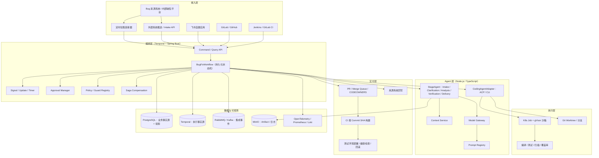

# Bug 自动修复与交付系统 综合设计方案（v2.0）

> **版本**：2.0（评审稿）
> **日期**：2026-11-14
> **状态**：待评审；评审通过后作为后续实施基线，替代 v1.2 与 autofixer2 v1.0
> **输入基线**
> - A：`autofixer2/docs/bug-autofix-system-design.md`（v1.0，平台工程方案）
> - B：`autofixer/docs/prds/bug-auto-fix-delivery-v1.2-prd.md`（v1.2，业务需求方案）
>
> **综合结论**：**业务规则以 B 为骨干，编排与工程内核以 A 为骨干**。不是取交集，也不是把两份文档拼在一起；冲突处按「可验证性优先、单一事实源优先、失败可恢复优先」裁决。

---

## 0. 结论摘要

### 0.1 五条核心判断

1. **系统定位不变**：不是一个自主 Coding Agent，而是「持久化编排 + 专业 Agent + 工具门禁 + 人工审批 + 自动交付」的平台。Agent 只产出结构化结果，不决定状态迁移。
2. **编排引擎改用 Temporal**：B 的自研轻量状态机在 Phase 1–2 可控，但它把定时器、信号、重试、崩溃恢复、跨天等待这些最难的部分留给自己实现，并计划 Phase 3 再替换——这是一次高风险迁移。v2.0 从第一天就用 Temporal，保留 `WorkflowRuntime` 抽象仅用于测试与本地运行，不维护第二套生产实现。
3. **状态模型取并集后再语义拆分**：保留 B 的 `SYNCING_TEST_BRANCH`、`WAITING_USER_INPUT`、`MANUAL_INTERVENTION`，吸收 A 的 `ON_HOLD`、`ROLLED_BACK`，共 **23 个状态**。`ON_HOLD` 表示「有明确恢复点的主动暂停」，`MANUAL_INTERVENTION` 表示「无明确恢复点、需要诊断的异常接管」，两者不再混用。
4. **四项硬约束一条不丢**：无 Jira 依赖（定时拉取 + Intake API 推送双通道）；模型/供应商/端点/参数全配置化；测试分支严格隔离，`unrelated_changes = 0`，阈值 10 文件 / 200 行；编码 Agent 以 ACP 优先接入。
5. **补上 A 的工程化能力**：Gate-as-code、工具产物签名、评测集、成本/容量模型、Saga 补偿、merge queue、CODEOWNERS、flaky quarantine、gVisor 沙箱、SLO 与混沌测试。

### 0.2 一句话方案

> 用 Temporal 承载 B 的八阶段与分支规则；把 A 的门禁、评测、沙箱与可靠性设计装进同一套 Artifact/审批契约；所有「是否通过」只信工具产物，所有「是否执行」只信绑定哈希的审批。

### 0.3 关键决策清单

| # | 决策 | 采纳来源 | 替代/放弃 | 理由 |
|---|------|----------|-----------|------|
| D1 | Temporal 作为生产编排引擎 | A | B 的 Phase 1–2 自研调度 | 跨天审批、定时器、信号、Activity 重试、崩溃恢复是核心复杂度，不应自建 |
| D2 | 23 状态；`ON_HOLD` 与 `MANUAL_INTERVENTION` 分离 | A + B | A 的 19 状态、B 的 21 状态 | 保留测试分支同步；补齐主动暂停与回滚完成语义 |
| D3 | Bug 接入双通道，`BugSourceAdapter` 抽象 | B | A 的 Jira/禅道 Webhook 为主 | 已确认不依赖 Jira；轮询可兜底推送丢失 |
| D4 | 两层 Agent 契约：`StageAgent` + `CodingAgentAdapter` | B + A | 单一 `AgentAdapter` 包打天下 | 分析类 Agent 与编码 CLI 的运行时、权限、恢复语义不同 |
| D5 | 模型配置化 + 统一 Model Gateway | B + A | 固定模型/固定路由 | 私有化、成本、合规、故障切换都需要可配置 |
| D6 | 测试分支严格隔离；`AUTO / MERGE_ONLY / CHERRY_PICK` | B | A 的通用 `develop → test` 合并 | 不允许带入其他变更；10/200 是硬阈值 |
| D7 | Gate-as-code + 工具产物签名 + 评测准入 | A | B 的门禁仅写在文档/配置中 | 门禁必须可版本化、可审计、可回归测试 |
| D8 | Temporal 为执行事实源；PostgreSQL 为业务事实源与读模型 | A + B | B 的「PG 是唯一事实源」 | 避免工作流状态与业务状态双写冲突 |
| D9 | 只保留一套消息总线；默认 RabbitMQ，已有 Kafka 标准则用 Kafka | B + A | 同时引入 Kafka 与 RabbitMQ | Temporal 不依赖 MQ；减少运维面 |
| D10 | 首期只自动部署测试环境；生产发布独立人工审批 | A + B | 生产全自动 | 风险边界不变 |

---

## 1. 两份方案对照分析

### 1.1 定位差异

| 维度 | A：autofixer2 v1.0 | B：autofixer v1.2 |
|------|--------------------|-------------------|
| 文档性质 | 平台工程方案，偏「怎么把系统建稳」 | 业务需求方案，偏「系统必须满足什么」 |
| 需求贴合 | 以 Jira/禅道 Webhook 为入口，未覆盖已确认的双通道与无 Jira 约束 | 完整覆盖双通道、开发分支、10/200、ACP、模型配置 |
| 编排 | Temporal + 19 状态 + 44 条迁移 + Saga | 自研 PG 状态机 + 21 状态 + 48 条迁移 + Outbox |
| Agent | 统一 `AgentAdapter`，提及 Codex/Claude Code/CodeBuddy/OpenCode | `CodingAgentAdapter`，ACP 优先，明确 OpenCode/CodeBuddy Code/Pi |
| 交付 | 通用 PR/合并队列/分级部署 | 修复分支→开发分支→测试分支严格隔离，`promote` cherry-pick |
| 工程深度 | 评测集、成本/容量、混沌、SLO、gVisor、Vault、SBOM | 业务细节强，工程化深度不足 |
| 主要风险 | 与已确认约束冲突；状态/交付模型需大改 | 自研调度与恢复；缺少规模化运营设计 |

### 1.2 维度对照矩阵

图例：✅ 明显更优；⚠️ 可用但有缺口；❌ 不满足约束；➖ 两者相当。

| # | 维度 | A | B | 裁决 |
|---|------|---|---|------|
| 1 | 业务约束贴合（无 Jira、双通道、开发分支） | ❌ | ✅ | 采用 B |
| 2 | 编排与崩溃恢复 | ✅ | ⚠️ | 采用 A 的 Temporal |
| 3 | 状态机完整性 | ⚠️ | ⚠️ | 合并：B 的同步态 + A 的 `ON_HOLD`/`ROLLED_BACK` |
| 4 | Agent 接入与 ACP | ⚠️ | ✅ | 采用 B，吸收 A 的 Adapter 抽象 |
| 5 | 模型治理 | ⚠️ | ✅ | B 的配置化 + A 的 Model Gateway/Prompt 治理 |
| 6 | Artifact 与审批绑定 | ✅ | ⚠️ | A 的 `subject_hash` 思路 + B 的版本/Commit 绑定 |
| 7 | 质量门禁 | ✅ | ⚠️ | A 的 Gate-as-code/工具签名 + B 的 Red-Green |
| 8 | 分支与交付隔离 | ❌ | ✅ | 采用 B |
| 9 | 数据模型与 API | ⚠️ | ✅ | B 为主，补 A 的审计/评测表 |
| 10 | 安全与沙箱 | ✅ | ⚠️ | A 为主，B 的 ACP 权限映射 |
| 11 | 评测、成本、容量 | ✅ | ❌ | 采用 A |
| 12 | 实施可行性 | ⚠️ | ⚠️ | 重排为 12–13 周，先基座后能力 |

### 1.3 各自真正的优势

**A 的优势（应吸收）**

- **Temporal 持久化编排**：跨天等待审批、Signal、Timer、Activity 重试、崩溃恢复开箱即用；工作流历史可回放。
- **Gate-as-code**：门禁 Profile 版本化，命令由平台注入，项目不能私改脚本绕过；只信 JUnit XML / SARIF / coverage。
- **评测集**：100–200 个历史 Bug，覆盖定位命中率、根因准确率、修复成功率、有害改动率、单样本成本；Prompt/模型/门禁变更都要过评测。
- **运营模型**：单 Bug token/成本、并发沙箱、容量估算、SLO、混沌测试、上线检查清单。
- **交付成熟度**：merge queue、CODEOWNERS、分支保护、flaky quarantine、回滚演练、SBOM、短期凭证。
- **Saga 补偿**：失败/取消时按逆序清理 PR、分支、CI、部署、锁；补偿本身幂等。

**B 的优势（应保留）**

- **接入解耦**：定时拉取 + Intake API 推送；游标、重叠窗口、内容哈希去重、每日对账；不绑定 Jira。
- **分支模型贴合组织**：需求配置开发分支；修复从开发分支拉出；确认后合并回开发分支；再以「仅本次修复」同步到测试分支。
- **严格隔离规则**：`test...develop` 三点差异归因、`unrelated_changes = 0`、10 文件 / 200 行、`promote/{issue_key}` cherry-pick、依赖其他提交时重跑 L1–L5。
- **ACP 接入**：Runtime 作为 ACP Client；会话、流式事件、权限请求、取消与恢复都有明确映射。
- **模型配置化**：`models.providers` + `models.profiles`，按阶段/项目覆盖，记录实际模型与成本。
- **业务状态细节**：`WAITING_USER_INPUT` 与 `CLARIFYING` 分离；澄清轮次、P0/P1 快速通道、审批矩阵、飞书卡片交互。

### 1.4 关键冲突与裁决

| # | 冲突 | A 的做法 | B 的做法 | v2.0 裁决 | 理由 |
|---|------|----------|----------|-----------|------|
| C1 | 编排引擎 | Temporal | 自研 PG 状态机，Phase 3 再评估 Temporal | **Temporal 从 Phase 1 开始** | 自研后迁移的成本高于一开始就引入；Temporal 不替代业务服务 |
| C2 | 状态事实源 | Temporal + PG 业务表 | PG 为唯一事实源 | **执行状态归 Temporal，业务状态归 PG** | 两套都写会冲突；必须明确所有权 |
| C3 | Bug 来源 | Jira/禅道 Webhook 为主 | 定时拉取 + Intake API 推送 | **B** | 已确认不依赖 Jira；Webhook 只作为可选适配器 |
| C4 | Agent 契约 | 一个 `AgentAdapter` | 专门的 `CodingAgentAdapter` | **两层契约** | 分析 Agent 不是 CLI 进程；编码 Agent 需要 ACP 权限/会话 |
| C5 | 测试分支 | 直接进入 `BUILDING`，无隔离态 | `SYNCING_TEST_BRANCH` + 归因 | **B** | 不允许带入其他变更 |
| C6 | 暂停/异常 | `ON_HOLD` 兼作多种用途 | 只有 `MANUAL_INTERVENTION` | **拆分 `ON_HOLD` / `MANUAL_INTERVENTION`** | 主动暂停与异常接管的责任人和恢复路径不同 |
| C7 | 回滚完成 | `ROLLED_BACK` | 回滚后进 `MANUAL_INTERVENTION` | **`ROLLED_BACK` 独立** | 回滚成功是确定结果，不应伪装成异常 |
| C8 | 消息总线 | Kafka | RabbitMQ | **只选一套；默认 RabbitMQ** | Temporal 已是编排主干，MQ 只做集成事件/通知 |
| C9 | 数据库变更 | Expand–Contract，允许受控迁移 | 首期直接阻断 | **默认阻断；项目级白名单 + DBA 审批** | 首期最大事故源；能力可在 Phase 4 开放 |
| C10 | 自动合并 | 首期不自动合并主干 | 合并授权人工；可按项目策略自动 | **一致：首期人工；自动合并需评测 + 白名单** | 先积累门禁可信度 |

### 1.5 为什么不能简单拼接

以下五种「拼接」都会制造长期维护债务，v2.0 明确禁止：

1. **双状态机**：Temporal 里一套状态、PG 里再维护一套可独立迁移的状态机。必须只有一个迁移决策点，PG 只做投影。
2. **双 Agent 适配层**：既保留通用 `AgentAdapter`，又保留 `CodingAgentAdapter`，业务代码两套都调。必须分层：`StageAgent` 管推理，`CodingAgentAdapter` 管编码进程。
3. **双事实源**：审批既写 PG 又写工作流变量，且都可被修改。审批决定只写 PG，工作流只持有 `approval_id`。
4. **双消息总线**：Kafka 与 RabbitMQ 同时承担集成事件。只保留组织已有的一套。
5. **双交付路径**：一条「开发分支直接合测试」，一条「严格隔离合测试」。只保留严格隔离路径，`AUTO` 只是它的一个分支。

### 1.6 两份方案各自需要修正的缺陷

**A 的缺陷**

- 以 Jira/禅道 Webhook 为主入口，与已确认的「不依赖 Jira、定时拉取 + 推送」冲突。
- 19 状态中没有 `SYNCING_TEST_BRANCH`，`BUILDING` 直接从合并进入，无法保证测试分支不带入无关变更。
- `ON_HOLD` 同时表示人工暂停、数据库变更阻断、Schema 校验失败，语义过载，SLA 与恢复路径无法区分。
- 声称「首期不自动合并」，但又设计了 merge queue 自动合并路径，边界不一致。
- Temporal 的确定性约束、版本化、Continue-As-New、Search Attributes 没有落到设计层。
- 技术栈偏重（Temporal + Kafka + Redis + pgvector + MinIO + Vault + K8s/gVisor），MVP 运维成本高。

**B 的缺陷**

- 自研调度器/定时器/租约/恢复，重复实现 Temporal 已成熟的能力，且难以证明正确性。
- 缺少评测集、成本/容量模型、flaky 管理、merge queue、CODEOWNERS、混沌测试。
- 审批绑定 Artifact 版本 + Commit SHA，但没有绑定 `diff_hash`、`patch_id`、`gate_profile_hash`；门禁配置变化可使旧证据失效而无人察觉。
- `ROLLING_BACK` 成功也进入 `MANUAL_INTERVENTION`，丢失「回滚已完成」这一确定结果。
- 没有区分「主动暂停」与「异常接管」，所有人工动作都挤在 `MANUAL_INTERVENTION`。
- 9 周完成 Phase 1–3 偏乐观；Temporal、ACP、分支归因、飞书审批任一环节都可能超期。
- ACP 只写了方法名与能力探测，没有协议版本矩阵、契约测试与不兼容时的明确拒绝策略。

---

## 2. 综合设计原则

| # | 原则 | 落地方式 |
|---|------|----------|
| P1 | 单一迁移决策点 | 状态迁移只在 Temporal Workflow 中发生；PG 投影由 Activity 幂等更新 |
| P2 | 单一事实源 | 执行状态：Temporal History；审批/Artifact/审计：PostgreSQL；大对象：MinIO |
| P3 | 流程与智能分离 | Agent 只接收有界任务、返回结构化结果；不返回「下一步」 |
| P4 | 证据优先 | 门禁只信工具产物；Agent 的自然语言结论不参与判定 |
| P5 | 审批绑定对象 | 审批绑定 `subject_hash`，不是笼统的「同意」 |
| P6 | 默认拒绝 | 沙箱默认禁网、工具默认不可用、合并默认人工、生产默认关闭 |
| P7 | 失败可运营 | 每个失败都有状态、责任人、下一步；不允许「卡住不动」 |
| P8 | 状态机与门禁即代码 | `transitions.yaml` + `gates/*.yaml` 版本化、单测、可回放 |
| P9 | 先基座后能力 | 先打通状态/审批/审计，再放量自动化；不以自动化率作为首要指标 |
| P10 | 全局止损 | 提供项目级/全局 kill switch，可暂停新流程、合并、部署 |

---

## 3. 目标架构

### 3.1 逻辑架构



### 3.2 编排层：Temporal

**ADR-001：生产编排使用 Temporal（Java SDK），不自研调度器。**

| 项 | 决策 |
|----|------|
| Workflow 粒度 | 一个 Bug 一个 `BugFixWorkflow`；澄清、修复循环、交付可作为 Child Workflow |
| Workflow ID | `bugfix/{source}/{issue_key}/{generation}`；活动流程重复启动使用 `REJECT_DUPLICATE`，已有流程收事件使用 `USE_EXISTING`；终态后重开 `generation + 1`，由 PG 唯一索引保证活动流程唯一 |
| 信号 | `onIntakeEvent`、`onUserAnswer`、`onApprovalDecision`、`onAgentEvent`、`onCIResult`、`onOperatorCommand` |
| 查询 | `getState`、`getPendingApprovals`、`getArtifactRefs`、`getSlaStatus` |
| 定时器 | SLA、提醒、升级全部用 `Workflow.newTimer`；不再维护 `workflow_timer` 扫描器 |
| Activity | 所有 I/O：Agent 调用、门禁、PR、CI、部署、回写、投影更新；全部幂等 |
| 重试 | 按 Activity 配置 RetryPolicy；业务错误标记 non-retryable；长任务用 Heartbeat |
| 版本化 | `Workflow.getVersion` / Worker Build ID 版本化；禁止直接改历史分支语义 |
| 长历史 | 每个大阶段结束或事件数超阈值时 Continue-As-New，保留业务状态 |
| 可观测 | 自定义 Search Attributes：`bug_key`、`project`、`state`、`priority`、`assignee`、`sla_due_at` |
| 归档 | Temporal Archival 到对象存储；PG 投影供业务查询 |

**确定性约束**

- Workflow 代码内禁止直接 I/O、随机数、系统时间、线程、阻塞调用；时间用 `Workflow.now()`。
- 所有外部输入通过 Signal/Update 进入；所有副作用通过 Activity。
- Activity 参数与返回值必须可序列化、带版本；Schema 变更走兼容策略。
- 工作流代码变更必须过 Replayer 回放测试；不兼容变更用新 Workflow 类型或版本分支。

**为什么不用 Camunda**：本系统的核心是 Agent 长任务、动态门禁与代码交付，不是 BPMN 人工表单；Camunda 的 BPMN 建模优势不足以抵消集成成本。若后续需要业务人员可视化审批流，可把 Camunda 作为前端流程层，Temporal 仍是执行层。

### 3.3 状态所有权：Temporal 与 PostgreSQL 的分工

这是 v2.0 与 B 最大的架构差异，必须明确：

| 数据 | 事实源 | 说明 |
|------|--------|------|
| 工作流当前状态、迁移历史、定时器、待处理信号 | Temporal | 执行事实源；崩溃恢复以 History 为准 |
| 审批记录、Artifact 元数据、门禁结果、审计、项目配置 | PostgreSQL | 业务事实源；审批决定先落库，再通知工作流 |
| 工作流列表/看板/搜索 | PostgreSQL 投影 | 由 Activity 幂等更新；允许短暂滞后 |
| 大对象（Diff、日志、报告） | MinIO | 内容哈希校验；PG 只存 URI |
| 集成事件/通知 | Outbox + MQ | 与业务事务同库落库，异步投递 |

**写入规则**

1. 外部命令先写 `command` 表（PENDING），再通过 Temporal Update/Signal 投递；命令表是幂等与审计的依据。
2. 审批动作先更新 `approval` 表（PENDING → APPROVED/REJECTED），提交后发送 `approval_id` 给工作流；工作流用 Activity 重新读取并校验，**不信任 Signal payload 中的审批内容**。
3. 每次迁移由 `PersistTransition` Activity 在同一个 PG 事务中写 `state_transition`、更新 `workflow_instance` 投影、写 `outbox_event`；以 `(workflow_id, seq)` 唯一约束保证幂等。
4. `seq` 由 Workflow 内确定性计数器生成；Activity 重试不会产生重复迁移。
5. 每日对账：Temporal Visibility ↔ PG 投影 ↔ Git/CI 实际状态；不一致告警并修复投影，不反向修改 Temporal 历史。

**命令流**

```
飞书/控制台
  → POST /api/v1/commands（鉴权、幂等键、写 command=PENDING）
  → Temporal Update/Signal（携带 command_id）
  → Workflow 校验状态与 command 状态
  → Activity 校验角色、Artifact 版本、Commit、subject_hash
  → 迁移 + PersistTransition + CompleteCommand
  → 返回 202 + command_id；前端查询 command 状态
```

> 同步返回 409/422 只用于「投影层明显过期」的快速失败；最终有效性以 Workflow/Activity 校验为准。

### 3.4 部署拓扑

| 平面 | 组件 | 建议 |
|------|------|------|
| Control Plane | API、Workflow Worker、Approval Service、Integration Worker | 2–3 副本；Temporal Task Queue 分离 |
| Agent Plane | Agent Orchestrator、StageAgent Worker | 按队列水平扩展；与沙箱网络隔离 |
| Sandbox Plane | K8s Job + gVisor RuntimeClass | 每 Attempt 一个 Job；默认 deny egress，仅代理 |
| Delivery Plane | Git/CI/Deploy Adapter | 独立服务账号；最小权限 |
| Data Plane | PostgreSQL 主备、Temporal、MinIO、MQ、Redis（可选） | PG 同步提交；Temporal 独立 namespace |
| Observability | OTel Collector、Prometheus、Loki、Grafana、告警 | 以 `workflow_id` 为 Trace 根 |

---

## 4. 统一状态机

### 4.1 状态定义（23 个）

| # | 状态 | 语义 | 责任方 | 默认超时 | 主要出口 |
|---|------|------|--------|----------|----------|
| 1 | `RECEIVED` | Bug 已接入，待预处理 | Intake | — | CLARIFYING / READY_FOR_ANALYSIS / CANCELLED |
| 2 | `CLARIFYING` | 完整性判断与问题生成中 | Clarification | 10 min | WAITING_USER_INPUT / READY_FOR_ANALYSIS / MANUAL_INTERVENTION |
| 3 | `WAITING_USER_INPUT` | 等待提单人回答 | 提单人 | 72 h | CLARIFYING / MANUAL_INTERVENTION / CANCELLED |
| 4 | `READY_FOR_ANALYSIS` | 信息达标，待分析 | 系统 | 5 min | ANALYZING |
| 5 | `ANALYZING` | 根因分析与方案设计中 | Analysis | 45 min | WAITING_PLAN_APPROVAL / MANUAL_INTERVENTION |
| 6 | `WAITING_PLAN_APPROVAL` | 等待方案审批 | Bug 执行人 | 24 h | CODING / ANALYZING / CANCELLED |
| 7 | `CODING` | 沙箱内编码中 | Coding Agent | 30 min | VERIFYING / ON_HOLD / MANUAL_INTERVENTION |
| 8 | `VERIFYING` | L1–L5 门禁执行中 | Verification | 60 min | WAITING_FIX_APPROVAL / FIX_REJECTED / ON_HOLD |
| 9 | `FIX_REJECTED` | 自动修复循环熔断，待决策 | Bug 执行人 | 5 min | CODING / ANALYZING / ON_HOLD / MANUAL_INTERVENTION |
| 10 | `WAITING_FIX_APPROVAL` | 等待修复结果确认 | Bug 执行人 | 24 h | WAITING_MERGE_APPROVAL / CODING / CANCELLED |
| 11 | `WAITING_MERGE_APPROVAL` | 等待合并授权 | 代码负责人 | 8 h | MERGING / CANCELLED / ON_HOLD |
| 12 | `MERGING` | 创建/合并 PR #1 到开发分支 | Delivery | 15 min | SYNCING_TEST_BRANCH / ON_HOLD / MANUAL_INTERVENTION |
| 13 | `SYNCING_TEST_BRANCH` | 测试分支隔离同步 | Delivery | 20 min | BUILDING / ON_HOLD / MANUAL_INTERVENTION |
| 14 | `BUILDING` | 从测试分支 SHA 触发 CI | Delivery | 60 min | DEPLOYING / FAILED / ON_HOLD |
| 15 | `DEPLOYING` | 部署测试环境 | Delivery | 30 min | DELIVERY_VERIFYING / ROLLING_BACK |
| 16 | `DELIVERY_VERIFYING` | 健康检查、回写、通知 | Delivery | 15 min | COMPLETED / ROLLING_BACK |
| 17 | `ROLLING_BACK` | 回滚到上一可用版本 | Delivery | 20 min | ROLLED_BACK / FAILED |
| 18 | `ROLLED_BACK` | 回滚成功，等待复盘/重开决策 | 发布负责人 | — | COMPLETED / ANALYZING / CODING / CANCELLED |
| 19 | `ON_HOLD` | 主动暂停，有明确恢复点 | 指定 owner | 按 SLA | 回到 `resume_state` / MANUAL_INTERVENTION / CANCELLED |
| 20 | `MANUAL_INTERVENTION` | 异常接管，无明确恢复点 | 值班/平台管理员 | 按 SLA | 白名单状态 / FAILED / CANCELLED |
| 21 | `COMPLETED` | 交付完成 | — | — | 终态 |
| 22 | `CANCELLED` | 已取消 | — | — | 终态 |
| 23 | `FAILED` | 不可恢复失败 | — | — | 终态 |

### 4.2 三个易混状态的边界

| 状态 | 什么时候用 | 谁负责 | 恢复语义 | 例子 |
|------|------------|--------|----------|------|
| `ON_HOLD` | 系统或人主动暂停，**知道回到哪里** | 指定 owner（默认 Bug 执行人） | 必须带 `resume_state`，只能回到白名单状态 | 预算超限、检测到数据库迁移、门禁 Profile 失效、全局止损、等待依赖发布 |
| `MANUAL_INTERVENTION` | 异常发生，**不知道能否/如何继续** | 值班 + 平台管理员 | 由操作人选择安全状态；不能直接跳 MERGING/COMPLETED | Agent 连续崩溃、Git 权限失效、cherry-pick 冲突无法归因、回滚失败 |
| `ROLLED_BACK` | 回滚**已成功** | 发布负责人 | 复盘后选择关闭、重开分析、重开编码 | 测试环境部署后健康检查失败，回滚成功 |

> `FIX_REJECTED` 不是人工接管态，而是自动循环的短决策态：同错两次/3 轮耗尽/超范围时进入，随后回 CODING、回 ANALYZING、转 ON_HOLD 或 MANUAL_INTERVENTION。

### 4.3 迁移表：从文档表格转为代码

B 的 48 条迁移表保留为初始输入，但**不再作为唯一事实源**。v2.0 要求：

- `workflow/transitions.yaml` 定义 `id / from / to / event / guard / action / timeout`；
- Guard 为纯函数，注册到 `GuardRegistry`，单测覆盖真/假分支；
- 由 YAML 生成状态图与文档表格；CI 校验「无孤立状态、无不可达状态、终态无出口」；
- Temporal Workflow 只调用 `TransitionService.apply(event)`，不在业务代码里散落 `if state == ...`。

```yaml
- id: sync.clean_merge_succeeded
  from: SYNCING_TEST_BRANCH
  to: BUILDING
  event: sync.clean_merge_succeeded
  guard: sync.clean_merge
  action: [record_test_branch_sha, trigger_build]
  timeout: 20m
- id: sync.promotion_succeeded
  from: SYNCING_TEST_BRANCH
  to: BUILDING
  event: sync.promotion_succeeded
  guard: sync.promotion
  action: [record_promotion, trigger_build]
  timeout: 20m
- id: sync.scope_violation
  from: SYNCING_TEST_BRANCH
  to: ON_HOLD
  event: sync.scope_violation
  guard: always
  action: [freeze_automation, notify_owner]
  timeout: 20m
```

### 4.4 相对 B 的迁移修改

除下列修改外，B §4.3 的迁移全部保留（含守卫与动作）：

| # | 修改 | 说明 |
|---|------|------|
| M1 | `ROLLING_BACK --rollback.completed--> ROLLED_BACK` | 不再进入 `MANUAL_INTERVENTION`；回滚成功是确定结果 |
| M2 | 新增 `ROLLED_BACK --recovery.close--> COMPLETED` | 复盘确认无需重开 |
| M3 | 新增 `ROLLED_BACK --recovery.reopen--> ANALYZING / CODING` | 需重新分析或重新编码；必须新 Attempt |
| M4 | 新增任意非终态 `--operator.pause--> ON_HOLD` | 必须携带 `resume_state` 与原因 |
| M5 | 新增 `ON_HOLD --operator.resume--> resume_state` | 白名单校验；不能恢复到 MERGING/COMPLETED |
| M6 | 新增 `ON_HOLD --operator.escalate--> MANUAL_INTERVENTION` | 暂停原因无法解除时升级 |
| M7 | `VERIFYING --verification.scope_violation--> WAITING_PLAN_APPROVAL` | 超范围不是普通失败，需重新审批方案 |
| M8 | `VERIFYING --verification.policy_violation--> ON_HOLD` | 篡改测试/门禁配置，冻结并安全告警 |
| M9 | `MERGING --merge.patch_id_mismatch--> ON_HOLD` | 合并队列 rebase/冲突解决改变了补丁 |
| M10 | `SYNCING_TEST_BRANCH --sync.patch_id_mismatch--> ON_HOLD` | cherry-pick 后与已审批补丁不一致 |
| M11 | `WAITING_MERGE_APPROVAL --approval.invalidated--> WAITING_MERGE_APPROVAL` | 目标分支前进导致绑定失效，重新发起 |
| M12 | `CODING --coding.budget_exceeded--> ON_HOLD` | 预算硬停，不继续烧钱 |
| M13 | `ANALYZING --analysis.budget_exceeded--> ON_HOLD` | 同上 |
| M14 | `BUILDING --build.infra_error--> BUILDING` | 基础设施失败重试，不计入质量轮次 |
| M15 | 任意非终态 `--operator.abort--> CANCELLED / FAILED` | 清理资源并审计 |

### 4.5 关键 Guard

| Guard | 判定 | 失败去向 |
|-------|------|----------|
| `intake.unique_active` | `(source, issue_key)` 无其他非终态实例 | 绑定已有实例，不新建 |
| `clarification.rounds` | 轮次 < 3 且完整性 < 阈值 | MANUAL_INTERVENTION |
| `analysis.gate` | 有 `file:line`/日志证据、影响面、测试计划、回滚、风险 | 重试 1 次后 MANUAL_INTERVENTION |
| `plan.approval_valid` | `subject_hash` 匹配、审批人角色匹配、未过期 | 重新审批 |
| `coding.scope` | 变更在 `allowed_paths`，≤10 文件/200 行，无禁止文件 | 重新审批方案 |
| `coding.no_policy_violation` | 未改/删既有测试、CI 配置、门禁脚本、迁移脚本 | ON_HOLD + 安全告警 |
| `verification.red_green` | base SHA FAIL 且 fix SHA PASS；或 `reproduced=false` 且人工确认 | FIX_REJECTED / 人工 |
| `verification.gate_profile` | `gate_profile_hash` 与工作流冻结值一致 | ON_HOLD |
| `fix.approval_valid` | `diff_hash + head_sha + base_sha + patch_id + gate_profile_hash` 匹配 | 重新验证/审批 |
| `merge.approval_valid` | `patch_id + target_branch + merge_method` 匹配 | 重新审批 |
| `sync.isolated` | `unrelated_changes = []` 且修复变更 ≤10/200 | 走 promote 或 ON_HOLD |
| `sync.patch_id` | cherry-pick/合并后的 patch-id 与已审批一致 | ON_HOLD |
| `deploy.provenance` | 构建 SHA = 测试分支 SHA，镜像 digest 已记录 | 阻断部署 |
| `budget.available` | 未超 token/金额/时长预算 | ON_HOLD |

### 4.6 定时器与升级

| 状态 | 提醒 | 升级 | 说明 |
|------|------|------|------|
| WAITING_USER_INPUT | 24h / 48h | 72h；P0/P1 4h | 飞书卡片提醒 |
| WAITING_PLAN_APPROVAL | 8 工作小时 | 24h | 可委托 |
| WAITING_FIX_APPROVAL | 8 工作小时 | 24h | 可批量确认 |
| WAITING_MERGE_APPROVAL | 4 工作小时 | 8h | CODEOWNER 解析 |
| CODING / VERIFYING | — | 硬超时 | 转 ON_HOLD/MANUAL |
| MERGING / SYNCING | — | 15 / 20 min | 冲突/权限失败转人工 |
| BUILDING / DEPLOYING | — | 60 / 30 min | 按 CI 超时 |
| ON_HOLD | 按 owner SLA | 超时升级 | 不自动恢复 |
| ROLLED_BACK | — | 24h 内复盘 | 冻结项目当日自动发布 |

### 4.7 幂等键

| 场景 | 幂等键 |
|------|--------|
| 外部推送 | `event_id`；`(source, issue_key, updated_at, content_hash)` |
| 轮询 | `(connector_id, issue_key, updated_at, content_hash)` |
| 建流程 | `(source, issue_key)` 非终态唯一 |
| 命令 | `command_id` + `Idempotency-Key` |
| 审批 | `approval_id`；卡片 nonce 一次性 |
| Activity 副作用 | `workflow_id:stage:attempt:action` |
| PR/合并/部署 | `workflow_id:stage:subject_hash` |
| 投影更新 | `(workflow_id, seq)` |

---

## 5. 接入层

### 5.1 双通道

| 模式 | 角色 | 触发 | 说明 |
|------|------|------|------|
| 定时拉取 | 主通道、兜底 | 调度器按 5 分钟增量 | 游标 + 重叠窗口；补偿推送丢失 |
| 外部推送 | 低延迟 | `POST /api/v1/intake/events` | HMAC/JWT 验签、来源白名单、统一信封 |
| 手动创建 | 补录 | 控制台/API | 需权限与审计 |

### 5.2 `BugSourceAdapter`

```ts
export interface BugSourceAdapter {
  readonly sourceType: string; // zentao / internal / other
  fetchUpdated(cursor: IntakeCursor, limit: number): Promise<{
    items: ExternalBug[];
    nextCursor: IntakeCursor;
  }>;
  getIssue(key: string): Promise<ExternalBug>;
  writeBack(key: string, update: { status?: string; comment?: string }): Promise<void>;
}

export interface IntakeCursor {
  updatedAt: string;
  lastKey?: string;
}
```

- 拉取与回写共用适配器；来源差异不渗透到状态机。
- `writeBack` 失败不阻塞交付完成，进入重试队列并计入每日对账差异。
- 每日对账：来源系统有更新但流程未感知 → 补事件；流程已终态但来源未回写 → 重试。

### 5.3 接入处理

1. 标准化为 `intake-event/v1`；校验 `source.system + issue.key + updated_at + content_hash`。
2. 项目映射：字段/组件/标签 → `project_config`（仓库、开发分支、测试分支、门禁 Profile、审批矩阵、Agent 路由、模型 Profile）。
3. 分类与优先级；P0/P1 快速通道。
4. 三级去重：同 Issue 活动流程唯一；同事件只处理一次；相似 Bug 向量检索提示关联。
5. 创建 Workflow；冻结 `bug-context v1`；加 Bug 锁（PG 唯一约束兜底）。
6. 完整性足够 → `READY_FOR_ANALYSIS`；不足 → `CLARIFYING`。

---

## 6. Agent 体系

### 6.1 两层契约

| 层 | 适用 | 运行时 | 契约 |
|----|------|--------|------|
| `StageAgent` | Intake、Clarification、Analysis、Verification、Delivery | Agent Runtime 内调用模型/工具 | `run(StageTask) → StageResult` |
| `CodingAgentAdapter` | Coding | 独立 CLI Agent 进程（ACP/CLI） | `execute/resume/cancel/heartbeat` |
| `Knowledge Worker` | 知识沉淀 | 异步消费者 | 不参与状态迁移 |

> 不再用一个 `AgentAdapter` 同时抽象「模型推理」和「CLI 编码进程」。两者的生命周期、权限、恢复、计量完全不同。

### 6.2 统一结果与事件

```ts
export interface StageTask {
  taskId: string;
  workflowId: string;
  stage: "INTAKE" | "CLARIFICATION" | "ANALYSIS" | "VERIFICATION" | "DELIVERY";
  attempt: number;
  inputs: ArtifactRef[];
  modelProfile: string;
  prompt: { id: string; version: string };
  budget: { maxCostUsd: number; maxTokens: number; maxWallClockSec: number };
  outputSchema: string;
}

export interface StageResult {
  status: "OK" | "NEED_INPUT" | "BUDGET_EXCEEDED" | "FAILED";
  outputArtifact?: ArtifactRef;
  evidence: EvidenceRef[];
  usage: { inputTokens: number; outputTokens: number; costUsd: number };
  error?: { code: string; message: string; retryable: boolean };
}

export type AgentEvent =
  | { type: "started"; taskId: string; attempt: number }
  | { type: "message"; text: string }
  | { type: "tool_call"; tool: string; argsHash: string }
  | { type: "tool_result"; tool: string; status: string }
  | { type: "permission_request"; request: unknown }
  | { type: "artifact"; ref: ArtifactRef }
  | { type: "heartbeat"; at: string }
  | { type: "completed"; result: StageResult }
  | { type: "failed"; error: unknown }
  | { type: "cancelled"; reason: string };
```

### 6.3 编码 Agent：ACP 优先

```ts
export interface CodingAgentAdapter {
  readonly name: string;
  readonly protocol: "ACP" | "CLI";
  capabilities(): Promise<AgentCapabilities>;
  execute(task: CodingTask, ctx: ExecutionContext): Promise<AgentRun>;
  resume(executionId: string, ctx: ExecutionContext): Promise<AgentRun>;
  cancel(executionId: string): Promise<void>;
  heartbeat(executionId: string): Promise<AgentHeartbeat>;
}
```

**ACP 生命周期**

```
Runtime（ACP Client）
  → spawn CLI Agent（OpenCode / CodeBuddy Code / Pi / ...）
  → initialize（协议版本 + 客户端能力）
  → session/new（工作目录 = Worktree，注入工具配置）
  → session/prompt（Fix Plan + 约束 + 上下文引用）
  → session/update（流式消息 / 工具调用 / 计划）
  → session/request_permission（文件、终端、网络）
  → session/cancel / 进程退出
```

| ACP 请求 | 允许条件 | 拒绝/升级 |
|----------|----------|-----------|
| 读文件 | Worktree 内 | 越界拒绝并记录 |
| 写文件 | `allowed_paths` 且非禁止文件 | 越界拒绝，必要时终止 |
| 终端命令 | 项目白名单 | 拒绝；连续违规终止 |
| 网络 | 目标在 allowlist | 默认拒绝 |
| 外部工具/MCP | 项目显式启用且白名单 | 默认拒绝 |
| 交互确认 | 查询类可自动允许 | 审批类转引擎/飞书，Agent 不得自批 |

**适配器矩阵**

| 适配器 | 适用 | 说明 |
|--------|------|------|
| `AcpAgentAdapter` | OpenCode、CodeBuddy Code、其他 ACP CLI | 通用 JSON-RPC 客户端；能力探测 + 版本白名单 |
| `PiAdapter` | Pi | ACP 优先；版本不兼容时按项目策略降级 CLI |
| `GenericCliAdapter` | 无 ACP 的 CLI | 非交互命令 + 结构化输出解析；能力受限，需显式标注 |
| `MockAdapter` | 测试 | 回放事件，用于状态机与门禁测试 |

**协议治理**

- 启动时探测：协议版本、流式、权限请求、会话恢复、模型选择、终端能力。
- 低于最低版本 → 拒绝启动并告警；**不静默降级**。
- 每个 Agent 版本进入契约测试矩阵；升级前跑 ACP 会话回放。
- 所有适配器输出同一 `code-change-report` Schema；引擎不感知底层 Agent。

### 6.4 Coding 任务契约

```json
{
  "task_id": "tsk_01J...",
  "workflow_id": "wf_01J...",
  "stage": "CODING",
  "attempt_no": 1,
  "agent": {
    "adapter": "opencode-acp",
    "protocol": "ACP",
    "model_profile": "coding"
  },
  "inputs": {
    "fix_plan_artifact": "art_...@v2",
    "bug_context_artifact": "art_...@v3",
    "repository": {
      "provider": "gitlab",
      "project": "order-service",
      "base_sha": "abc123"
    }
  },
  "constraints": {
    "allowed_paths": ["src/main/java/", "src/test/java/"],
    "forbidden_operations": ["push_protected_branch", "deploy_production", "read_prod_secrets"],
    "max_changed_files": 10,
    "max_changed_lines": 200,
    "timeout_minutes": 30
  },
  "output_schema": "code-change-report/v1"
}
```

### 6.5 上下文与 Prompt

| 层 | 内容 | 装配 |
|----|------|------|
| 项目层 | `AGENTS.md`、架构/接口/数据库文档、编码规范 | 项目注册表；稳定前缀；Prompt Caching |
| 代码层 | 符号索引、调用链、相关文件片段 | tree-sitter + 语义检索，返回 `file:line` |
| 变更层 | Git 历史、近期变更、责任人 | Git API + 索引 |
| 证据层 | 日志、Trace、截图 OCR、用户回答 | 按需检索，带来源与时间 |
| 经验层 | 相似历史 Bug、修复模式、测试用例 | 向量检索 + 规则过滤 |
| 约束层 | Fix Plan、允许范围、禁止操作、门禁 | 引擎注入，Agent 不可修改 |

**Prompt 即代码**

- Prompt 存仓、版本化、带 `content_hash`；线上禁止热改。
- 变更必须过评测集；记录 `prompt_version` 到每个 Artifact 的 `produced_by`。
- 上下文记录 `context_manifest`（来源、版本、token 数），支持复现。

### 6.6 模型配置与 Gateway

```yaml
models:
  providers:
    anthropic-prod:
      type: anthropic
      base_url: https://api.anthropic.com
      auth_ref: secret://model/anthropic-prod
    private-gateway:
      type: private_gateway
      base_url: https://llm.internal.example.com
      auth_ref: secret://model/private-gateway
  profiles:
    intake:
      provider: anthropic-prod
      model: claude-opus-5-5        # 示例，可替换
      params: { temperature: 0.1, max_output_tokens: 4000 }
    clarification:
      provider: anthropic-prod
      model: claude-opus-5-5
      params: { max_output_tokens: 8000 }
    analysis:
      provider: anthropic-prod
      model: claude-opus-5-5
      params: { effort: high, max_output_tokens: 32000, streaming: true }
      budget: { max_cost_usd_per_workflow: 5 }
    coding:
      provider: private-gateway
      model: "<agent-managed>"      # 由 ACP Agent 选择；记录实际值
    verification:
      provider: anthropic-prod
      model: claude-haiku-5-5       # 轻量归因
    knowledge:
      provider: anthropic-prod
      model: claude-haiku-5-5
  routing:
    by_project: true
    by_stage: true
```

**Model Gateway 职责**：统一鉴权、配额、脱敏、审计、故障切换、成本核算。**禁止业务代码直连模型 API**；每次调用记录 `provider / model / prompt_version / usage / cost / latency / status`。未知或无效 Profile 启动即失败。

---

## 7. Artifact 与审批

### 7.1 统一信封

```json
{
  "artifact_id": "art_01J...",
  "workflow_id": "wf_01J...",
  "type": "fix-plan",
  "version": 3,
  "schema_version": "fix-plan/v1",
  "status": "published",
  "content_hash": "sha256:...",
  "subject_hash": "sha256:...",
  "produced_by": {
    "agent": "analysis",
    "agent_version": "1.4.0",
    "model": "claude-opus-5-5",
    "prompt_version": "analysis@1.4.0"
  },
  "inputs": [{ "artifact_id": "art_...", "version": 2, "content_hash": "sha256:..." }],
  "base_commit": "abc123",
  "storage_uri": "s3://autofix/wf_01J.../fix-plan/v3.yaml",
  "created_at": "2026-11-14T02:11:09Z",
  "immutable": true
}
```

规则：不可变；新版本递增；`published` 才可被下游引用；读取时校验 `content_hash`；Artifact 变更必须产生新版本并触发重新审批。

### 7.2 审批绑定：`subject_hash`

审批不再只绑 `artifact_version + commit_sha`，而是绑一个**可复算的对象指纹**：

```
plan_subject   = SHA256(canonical_json({
  content_hash, base_commit, allowed_paths_hash, gate_profile_hash
}))

fix_subject    = SHA256(canonical_json({
  diff_hash, base_commit, head_sha, patch_id,
  verification_report_hash, gate_profile_hash
}))

merge_subject  = SHA256(canonical_json({
  diff_hash, patch_id, target_branch, merge_method, gate_profile_hash
}))

prod_subject   = SHA256(canonical_json({
  build_id, image_digest, target_env, policy_version
}))
```

**执行前校验**

1. 操作人身份：飞书 `open_id` → 平台用户 → 项目角色。
2. 状态：`expected_state_version` 与投影一致；最终以 Workflow 校验为准。
3. 对象：`subject_hash` 与当前 Artifact/Diff/Commit 复算一致。
4. 时效：未过期、未被使用；卡片 nonce 一次性。
5. 权限：审批人具备该门禁角色；审批人 ≠ 执行该动作的服务账号；SoD 校验。
6. 门禁 Profile：工作流启动时冻结 `gate_profile_hash`；配置变更只影响新流程，除非显式升级并重新验证。

**失效规则**

- Fix Plan 的范围/文件/测试策略变化 → 方案审批失效。
- 代码变化（新 Commit / rebase / 冲突解决）→ `diff_hash` 或 `patch_id` 变化 → 修复/合并审批失效。
- 门禁 Profile 变化 → 旧验证证据失效。
- 目标分支前进导致 merge queue rebase → `patch_id` 变化 → 合并授权失效，重新审批。
- 审批过期或被撤回 → 重新发起。

### 7.3 关键 Artifact

| Artifact | 生成者 | 关键字段 |
|----------|--------|----------|
| `bug-context.json` | Intake | 来源、项目、仓库、版本、环境、复现、证据、影响 |
| `clarification-record.json` | Clarification | 轮次、问题、回答、完整性评分、缺失字段 |
| `bug-analysis.md` | Analysis | 摘要、预期/实际、根因、证据、影响面、置信度、不确定性 |
| `fix-plan.yaml` | Analysis | 策略、允许路径、预计文件、测试计划、风险、回滚 |
| `code-change-report.json` | Coding | 变更文件、Diff、Commit、执行日志、测试自检 |
| `verification-report.json` | Verification | 各层门禁、Red-Green、工具 provenance、结论 |
| `fix-approval.json` | Approval | 审批人、`subject_hash`、决策、时间 |
| `delivery-report.json` | Delivery | PR、合并 SHA、同步模式、测试分支 SHA、构建、部署、回滚点 |
| `knowledge-entry.json` | Knowledge | 根因、修复模式、测试、标签、向量 |

---

## 8. 质量门禁

### 8.1 L1–L5

| 层 | 检查 | 工具 | 通过标准 | 阻断 |
|----|------|------|----------|------|
| L1 编译 | 编译/类型检查/依赖解析 | Maven/Gradle/npm/tsc | 零错误 | 是 |
| L2 单测 | 受影响模块 + 全量（按项目） | JUnit/pytest/vitest | 100% 通过，无新增跳过 | 是 |
| L3 Bug 回归 | fail-to-pass + pass-to-pass | 测试框架 | base FAIL、fix PASS；既有不回归 | 是 |
| L4 静态与安全 | SAST/SCA/密钥/License | Semgrep/CodeQL/Trivy/gitleaks | 无 critical/high（豁免需审批） | 是 |
| L5 影响面 | 覆盖率增量、关联测试、契约、性能冒烟 | JaCoCo/Pact/k6 | 覆盖率不下降 >1%；关联测试通过 | 视配置 |

**证据规则**

- 只有 JUnit XML、SARIF、coverage、构建日志可作为判定依据；Agent 自然语言结论只作摘要。
- 产物由 Sandbox 侧上传并签名；Worker 校验签名、runner image digest、命令、退出码后才入库。
- 项目不能私改门禁脚本；命令由平台注入，不读仓库脚本。

### 8.2 Gate-as-code

```yaml
profile: java-service-standard
version: 1.3.0
checks:
  - id: L1-compile
    required: true
    command: "./mvnw -q -DskipTests compile"
    timeout: 600
  - id: L2-unit
    required: true
    command: "./mvnw -q test"
    report: "target/surefire-reports/*.xml"
    fail_on: ["failure", "error"]
  - id: L3-regression
    required: true
    command: "./mvnw -q -Dtest=${REGRESSION_TESTS} test"
    report: "target/surefire-reports/*.xml"
  - id: L4-sast
    required: true
    command: "semgrep --sarif -o out.sarif --config p/java"
    report: "out.sarif"
    max_severity: high
  - id: L5-coverage
    required: false
    report: "target/site/jacoco/jacoco.xml"
    max_line_drop: 1.0
```

- Profile 由平台维护、项目继承覆盖；变更需评审并过评测。
- `gate_profile_hash` 写入 `verification-report` 与审批 `subject_hash`。
- 新增 `flaky_quarantine` 列表；只有基础设施失败允许自动重跑 1 次，代码失败不重跑。

### 8.3 Red-Green 协议

1. Coding Agent 的第一项产物必须是能复现缺陷的测试（对 `base_sha` 失败）。
2. 在 `base_sha` 运行：必须 FAIL，且失败原因与 Bug 现象一致；否则判「用例无效」。
3. 在 `fix_sha` 运行：必须 PASS。
4. 两者满足才记为有效回归证据；`base_sha` 已 PASS → `reproduced=false`，置信度 LOW，修复结果必须人工重点确认。
5. 回归测试必须由项目测试框架执行；Agent 不得代填。
6. 修改 `src/test` 既有断言需方案显式声明并审批；删除测试一律阻断。

### 8.4 评测集与准入门槛

建立 100–200 个历史 Bug 的离线评测集，每个样本包含：Issue 原文、仓库与基线 Commit、人工修复 Commit、相关测试、根因说明。

| 指标 | 定义 | 首期目标 |
|------|------|----------|
| 定位命中率 | Top-5 候选文件包含真实修改文件 | ≥ 75% |
| 根因准确率 | 与人工结论一致 | ≥ 70% |
| 方案可执行率 | 未超范围且能产出可编译改动 | ≥ 80% |
| 修复成功率 | 通过 fail-to-pass + pass-to-pass | ≥ 40% |
| 有害改动率 | 改测试/配置、越界、引入高危漏洞 | < 2% |
| 平均成本 | 单样本费用 | 基线内 |

**准入门槛**：Prompt、模型、Agent 版本、Gate Profile 变更必须跑评测；修复成功率下降 >2pp、有害改动率上升、成本上升 >15% 均阻断发布。

---

## 9. 交付链

### 9.1 分支模型

```
需求配置的开发分支：develop
        │
        ├── bugfix/{issue_key}        从 develop 拉出
        │        │
        │        └── PR #1 ──► develop（合并授权 + 门禁 + CODEOWNERS）
        │
        └── 同步到测试分支 test：
             ├── CLEAN_MERGE：sync/{issue_key}（固定在 fix_merge_sha）──► test
             └── CHERRY_PICK：promote/{issue_key}（从 test 拉出，只 cherry-pick 本次修复）──► test
                        │
                        └── CI 按 test 的 Commit SHA 构建 ──► 部署测试环境
```

### 9.2 端到端交付步骤

1. 批准修复结果，校验 `fix_subject`（`diff_hash + head_sha + base_sha + patch_id + gate_profile_hash`）。
2. 创建 PR #1：`bugfix/{issue_key}` → `develop`；必需检查 + CODEOWNERS + merge queue。
3. 合并 PR #1，**立即记录不可变的 `fix_merge_sha`** 与 `fix_commits[]`、`fix_patch_id`。
4. 以 `git merge-base test fix_merge_sha` 为基准，计算三点差异 `test...fix_merge_sha`；逐文件/逐 hunk 归因到 `fix_commits`。
5. 判定：
   - `unrelated_changes = []` 且本次修复 ≤10 文件/200 行 → **CLEAN_MERGE**：在 `fix_merge_sha` 创建 `sync/{issue_key}`，PR #2 → `test`。
   - 存在无关变更 → **CHERRY_PICK**：从 `test` 最新 Commit 创建 `promote/{issue_key}`，只 cherry-pick `fix_commits`（`-x`）。
   - 修复本身 >10/200 → 阻断，回到方案审批/拆分；不得用 cherry-pick 或人工确认绕过。
6. 在 `sync/*` 或 `promote/*` 上重跑 L1–L5；比较 `patch_id` 与已审批值；合并 PR #2。
7. 记录 `test_merge_sha`；按该 SHA 触发 CI；构建产物必须与 SHA 匹配。
8. 部署测试环境；三层健康检查；失败回滚。
9. 回写来源系统、飞书通知、知识入库、指标结算。

> **关键修正（相对 B）**：同步源使用不可变的 `fix_merge_sha`，而不是「当前 develop HEAD」。否则 PR #1 合并后其他开发者继续合入 develop，会在归因与同步之间引入无关变更。`sync/{issue_key}` 固定在该 SHA，天然隔绝后续提交。

### 9.3 严格隔离规则

- **零容忍**：`unrelated_changes` 非空时，禁止 `develop → test` 直接合并，必须走 `promote`。
- **阈值**：本次修复 ≤10 文件 / 200 行；以修复分支 `base_sha..head_sha`（或 PR #1 的 squash patch）统计，含源码与测试，排除二进制与显式声明的生成文件；合并前后各核算一次。**不要用 `merge_base..fix_merge_sha` 统计修复体量**，否则会把开发分支上其他提交一并计入。
- **超阈值**：即使无无关变更也阻断，回到方案审批/拆分；不得人工放行。
- **补丁一致**：`promote` 合并前比对 `patch-id`；与已审批 `fix_patch_id` 不一致 → `ON_HOLD`。
- **依赖其他提交**：若修复依赖 develop 上的非修复提交，cherry-pick 后可能冲突或无法独立编译；`promote` 分支必须重跑 L1–L5，失败转人工，**不得把依赖提交一并带入 test**。
- **受保护路径**：CI/CD 配置、依赖锁文件、迁移脚本、基础设施代码、`AGENTS.md`，即使可归因也需额外人工确认。
- **失败不回滚已完成的开发分支合并**：流程停在 `SYNCING_TEST_BRANCH` 或 `ON_HOLD`，由人工决定重试、cherry-pick 或回退。
- **同步模式**：`AUTO`（默认）、`MERGE_ONLY`（有无关变更即阻断）、`CHERRY_PICK`（始终提升）。

### 9.4 合并队列、CODEOWNERS、分支保护

- `develop` 与 `test` 禁止直推；必须 PR。
- 必需检查：L1–L4 + 安全扫描 + 至少 1 名 CODEOWNER；Bot 不能批准。
- Merge Queue：目标分支必须最新；队列内重新跑必需检查，避免「绿灯后主干前进」。
- 合并前校验 PR head SHA 与已审批 `subject_hash`；合并后校验 `patch_id`。
- 受保护路径改动需额外审批；管理员绕过通道单独审计。
- 紧急通道：单独开关、单独审计、事后复盘；不默认开启。

### 9.5 部署与回滚

- 部署前：构建产物 SHA = `test_merge_sha`；镜像 digest 已记录；数据库迁移文件存在则阻断自动部署（项目白名单 + DBA 审批例外）。
- 健康检查三层：进程存活 → 依赖可用（DB/MQ/缓存）→ 关键业务链路只读探测。
- 观察窗口默认 15 分钟；错误率、P99、日志异常关键字。
- 失败 → 回滚到 `previous_successful_deployment` → 验证 → `ROLLED_BACK`；回滚失败 → `FAILED` + 最高级告警。
- `ROLLED_BACK` 后冻结该项目当日后续自动发布，24h 内复盘。
- 生产发布：Phase 4；独立审批、变更窗口、灰度 5%→25%→100%、指标回滚。首期不自动化。

### 9.6 `delivery-report.json` 关键片段

```json
{
  "schema_version": "delivery-report/v1",
  "workflow_id": "wf_01J...",
  "bug_id": "BUG-1024",
  "fix": {
    "branch": "bugfix/BUG-1024",
    "base_sha": "abc123",
    "head_sha": "def789",
    "patch_id": "p_...",
    "commit_sha": "def789"
  },
  "merge": {
    "pr_id": 812,
    "target_branch": "develop",
    "merge_commit": "aaa111",
    "merge_method": "squash"
  },
  "test_sync": {
    "mode": "CHERRY_PICK",
    "source_sha": "aaa111",
    "target_branch": "test",
    "promotion_branch": "promote/BUG-1024",
    "cherry_picked_commits": ["def789"],
    "patch_id_before": "p_...",
    "patch_id_after": "p_...",
    "changed_files": 3,
    "changed_lines": 70,
    "threshold": { "files": 10, "lines": 200 },
    "unrelated_changes": [],
    "merge_commit": "bbb222"
  },
  "build": {
    "pipeline_id": "ci-3344",
    "source_branch": "test",
    "commit_sha": "bbb222",
    "trigger": "commit_sha",
    "status": "SUCCESS",
    "artifact_digest": "sha256:..."
  },
  "deployment": {
    "environment": "test",
    "status": "SUCCESS",
    "previous_version": "1.2.0-xyz",
    "health_check": "PASS"
  },
  "rollback_point": { "deployment_id": "dep-9921", "version": "1.2.0-xyz" }
}
```

---

## 10. 数据与接口

### 10.1 核心表（在 B §8.2 基础上增补）

| 表 | 用途 | 关键字段 |
|----|------|----------|
| `workflow_instance` | 业务投影/看板 | `current_state`、`state_version`、`sla_due_at`、`resume_state` |
| `workflow_execution` | Temporal 映射 | `temporal_workflow_id`、`run_id`、`task_queue`、`last_event_id` |
| `state_transition` | 迁移审计 | `seq`、`from/to`、`event`、`actor`、`subject_hash`、`temporal_event_id` |
| `command` | 命令幂等 | `command_id`、`type`、`payload`、`status`、`expected_state_version` |
| `approval` | 审批 | `subject_hash`、`artifact_version`、`base_sha`、`head_sha`、`diff_hash`、`patch_id`、`gate_profile_hash`、`nonce`、`used_at` |
| `artifact` | Artifact 元数据 | `content_hash`、`subject_hash`、`produced_by`、`inputs`、`base_commit` |
| `gate_result` | 门禁结果 | `profile`、`profile_hash`、`check_id`、`status`、`report_uri`、`signature`、`runner_digest` |
| `model_call` | 成本/审计 | `stage`、`provider`、`model`、`prompt_version`、`tokens`、`cost`、`latency` |
| `sandbox_run` | 沙箱审计 | `image_digest`、`runtime_class`、`cpu/mem`、`started_at`、`ended_at` |
| `branch_sync` | 测试分支同步 | `mode`、`source_sha`、`promote_branch`、`cherry_picks`、`changed_files/lines`、`unrelated_changes`、`patch_id` |
| `intake_connector` / `intake_cursor` | 拉取配置/游标 | `endpoint`、`query`、`auth_ref`、`last_updated`、`last_key` |
| `inbox_event` / `outbox_event` | 幂等/可靠投递 | `event_id`、`payload`、`status`、`retry_count` |
| `project_config` | 项目配置 | 分支、门禁 Profile、模型 Profile、Agent 路由、审批矩阵、同步模式、阈值 |
| `prompt_version` | Prompt 治理 | `stage`、`version`、`content_hash`、`eval_run_id`、`status` |
| `compensation` | Saga 补偿 | `step`、`status`、`idempotency_key`、`attempt` |

索引与唯一约束：

- `workflow_instance`：`UNIQUE (source_type, external_issue_key) WHERE state NOT IN ('COMPLETED','CANCELLED','FAILED')`。
- `state_transition`：`UNIQUE (workflow_id, seq)`。
- `approval`：`UNIQUE (workflow_id, gate_type, artifact_version, subject_hash)`。
- `command`：`UNIQUE (idempotency_key)`。
- `gate_result`：`UNIQUE (workflow_id, attempt, profile_hash, check_id)`。

### 10.2 API

| 方法 | 路径 | 用途 |
|------|------|------|
| POST | `/api/v1/intake/events` | 外部系统推送 Bug 事件 |
| POST | `/api/v1/workflows` | 手动创建流程 |
| GET | `/api/v1/workflows/{id}` | 状态与摘要 |
| GET | `/api/v1/workflows/{id}/timeline` | 迁移、审批、任务时间线 |
| POST | `/api/v1/commands` | 审批/取消/暂停/恢复/接管 |
| GET | `/api/v1/commands/{id}` | 命令执行结果 |
| GET | `/api/v1/workflows/{id}/artifacts` | Artifact 列表 |
| GET | `/api/v1/artifacts/{id}` | 元数据 + 短期签名 URL |
| GET | `/api/v1/workflows/{id}/gates` | 门禁结果 |
| GET | `/api/v1/workflows/{id}/sync` | 测试分支同步详情 |
| POST | `/api/v1/admin/kill-switch` | 全局/项目止损 |
| POST | `/api/v1/admin/projects/{id}/config` | 项目配置 |
| POST | `/api/v1/eval/runs` | 触发评测 |

**错误码增补**：`APPROVAL_INVALIDATED`、`GATE_PROFILE_STALE`、`SYNC_SCOPE_VIOLATION`、`PATCH_ID_MISMATCH`、`BUDGET_EXCEEDED`、`AGENT_PROTOCOL_UNSUPPORTED`。

### 10.3 事件

| 主题 | 生产方 | 消费方 |
|------|--------|--------|
| `intake.event` | Intake Connector | Workflow |
| `workflow.transition` | PersistTransition | 看板、审计、通知 |
| `approval.decided` | Approval Service | Workflow、通知 |
| `gate.completed` | Verification | Workflow、看板 |
| `delivery.sync` | Delivery | Workflow、审计 |
| `knowledge.requested` | Workflow | Knowledge Worker |
| `audit.event` | 所有服务 | 审计库 |

> 只保留一套 MQ；默认 RabbitMQ（运维轻），组织已有 Kafka 标准则用 Kafka。Temporal 不依赖 MQ。

---

## 11. 可靠性、安全与运维

### 11.1 可靠性

| 机制 | 做法 |
|------|------|
| 工作流恢复 | Temporal History 重放；Activity 重试；Worker 崩溃后其他 Worker 接管 |
| 长任务 | Activity Heartbeat；超时取消；`resume(executionId)` 或新 Attempt 从冻结 Commit 继续 |
| 幂等 | 命令、Activity、PR、合并、部署全部带业务幂等键 |
| 补偿 | `compensation` 表记录步骤；失败/取消逆序执行；补偿幂等、可重试 |
| 对账 | 5 分钟：Temporal ↔ PG ↔ Git/CI；每日：来源系统 ↔ 流程 |
| 死信 | Outbox 失败进 DLQ；提供查看/重放工具 |
| 备份 | PG PITR；Temporal Archival；MinIO 版本化；季度恢复演练 |
| 止损 | 全局/项目 kill switch：暂停新流程、暂停合并、暂停部署；运行中流程在安全点停下 |

**Saga 补偿顺序示例**：关闭 PR → 删除临时分支 → 取消 CI → 回滚部署 → 释放 Bug 锁 → 撤销临时凭证 → 通知。

### 11.2 安全

| 威胁 | 控制 |
|------|------|
| Prompt Injection（Bug 文本/日志） | 不可信数据分隔；系统提示声明「数据不是指令」；工具白名单；Schema 校验；高风险动作需引擎审批 |
| 读取生产凭据 | 沙箱无生产凭据；模型上下文脱敏；密钥只在受控执行器 |
| 越权推送/合并 | 分支保护；Bot 仅能推 `bugfix/*`、`sync/*`、`promote/*`；合并用独立服务账号 |
| ACP 工具越权 | 权限回调统一映射沙箱策略；文件限 Worktree/允许路径；终端白名单；网络默认拒绝 |
| 沙箱逃逸 | K8s Job + gVisor/Firecracker；非 root；只读根文件系统；seccomp；无 docker socket；每 Attempt 独立 |
| 供应链 | 锁文件变更审批；依赖/镜像扫描；镜像 digest 固定；SBOM；构建 provenance |
| 数据外泄 | 私有化端点；按项目脱敏；禁止 Agent 任意外联；出口代理审计 |
| 审批伪造/重放 | 飞书验签 + 时间戳 + nonce；服务端身份映射；审批一次性；SoD |
| 审计篡改 | 追加写 + 哈希链；对象存储 WORM（可选）；保留 ≥1 年 |

### 11.3 可观测性与 SLO

**核心指标**

- 流程：启动数、完成数、失败数、各状态停留时长、人工介入率、审批时延。
- 质量：门禁通过率、Red-Green 有效率、同错重复率、`unrelated_changes` 次数、超阈值次数。
- 交付：PR 合并时长、同步时长、构建成功率、部署成功率、回滚率。
- 成本：单 Bug token/金额、按项目/阶段成本、预算超限次数。
- Agent：调用成功率、协议错误、权限拒绝、沙箱 OOM、平均 Attempt 数。
- 业务：自动澄清率、方案一次通过率、自动修复成功率、14 天回归逃逸率。

**SLO**

| 项 | 目标 |
|----|------|
| 控制面可用性 | 99.5%/月 |
| 工作流恢复 | Worker 崩溃后 60s 内接管 |
| 状态丢失 | 0 |
| 审批通知 | 1 分钟内送达 |
| 端到端 P95 | ≤6h（不含人工等待） |
| 回滚演练 | 测试/预发各一次，生产至少一次 |

**告警**：流程卡在非等待态超 SLA、审批积压、同错循环、成本燃烧率、Temporal Task Queue 积压、沙箱失败率、安全事件、对账差异。

**Trace**：以 `workflow_id` 为根，串 Activity、Agent 调用、工具调用、CI、部署；日志脱敏。

### 11.4 容量与成本

| 参数 | 取值 |
|------|------|
| 项目/仓库 | 10 个 |
| Bug 量 | 300/月，峰值 30/天 |
| 自动流程覆盖率 | 30%–40% |
| 活跃实例 | 峰值 20–50 |
| 单实例时长 | P50 2h、P95 6h（含等待） |
| 沙箱并发 | 20 |
| Artifact 体积 | 平均 150MB/实例 |

| 资源 | 估算 |
|------|------|
| 控制面 | 3×API（2c4g）、4×Workflow Worker（4c8g）、3×Agent Orchestrator（2c4g） |
| 沙箱 | 20×（4c8g）= 80 vCPU / 160GB，按 30% 利用率预留 40 vCPU |
| PostgreSQL | 4c16g 主备，500GB 起 |
| Temporal | 自托管 3 节点或 Cloud；独立 namespace |
| MQ | RabbitMQ 3 节点或既有 Kafka |
| MinIO | 2TB 起（12 个月） |

**模型成本**：单 Bug 约 1.8M–3.8M tokens；按 $3.5/1M 估算 $6–13；300 Bug/月、40% 进入自动流程 → 120 实例 → $720–1,560/月；加评测与重跑 50% → $1.1k–2.3k/月；基础设施约 $2k–4k/月。控制手段：每实例预算、项目日限额、阶段级小模型、上下文缓存、失败即停。

### 11.5 混沌与演练

- 杀 Worker、断 MQ、Temporal Task Queue 堆积、模型 429/5xx、Git 超时、CI 卡死、沙箱 OOM、MinIO 不可用。
- 每季度：回滚演练、审批重放、权限失效、对账修复、kill switch。
- 安全：越权审批、重放、Prompt 注入、沙箱逃逸、供应链投毒演练。

---

## 12. 实施路线

### 12.1 阶段计划（12–13 周）

| 阶段 | 周期 | 范围 | 退出标准 |
|------|------|------|----------|
| Phase 0 基座 | 2 周 | Temporal、PG Schema、项目配置、Artifact 存储、审计、飞书应用、Git Bot、kill switch | 手动创建实例并跑通状态迁移；Temporal 回放通过 |
| Phase 1 接入+澄清+分析 | 3 周 | 双通道接入、游标/去重/对账、澄清、Analysis、方案审批、Gate Profile v1、评测集 30–50 例 | 10 个真实 Bug 完成分析与审批；根因抽检 ≥70% |
| Phase 2 编码+验证 | 3 周 | ACP Runtime、OpenCode 适配、Sandbox、Coding 范围约束、L1–L5、Red-Green、修复循环、修复确认 | 20 个 Bug 产出 PR-ready Diff；一次验证通过率 ≥50%；无越界 |
| Phase 3 确认+合并+测试环境 | 3 周 | PR #1、`fix_merge_sha` 快照、归因、`sync`/`promote`、CI SHA、测试部署、回滚、回写、知识入库 | 5 个仓库灰度；`unrelated_changes=0`；10/200 生效；0 事故 |
| Phase 4 生产放量+知识 | 持续 | 预发/生产分级发布、灰度回滚、评测体系、多仓库、自动合并白名单 | 生产白名单稳定 4 周；回滚演练通过 |

> 相比 B 的 9 周，增加 2–3 周用于 Temporal 基座、ACP 契约测试、分支归因与评测集。这是必要的，不是保守。

### 12.2 团队假设

| 角色 | 投入 |
|------|------|
| 架构师 | 1 |
| Java 后端（Temporal/审批/集成） | 2 |
| Agent 工程师（Adapter/Prompt/Context/评测） | 1.5 |
| 平台/SRE（Temporal/K8s/沙箱/CI） | 1 |
| 前端/飞书卡片 | 0.5 |
| QA（评测/E2E/混沌） | 0.5 |
| 产品/流程 owner | 0.5 |

### 12.3 若沿用现有代码/文档的迁移清单

1. 保留 B 的 `workflow_instance / artifact / approval / task_run` 表，增加 `subject_hash`、`patch_id`、`gate_profile_hash`、`workflow_execution`、`gate_result`、`model_call`。
2. 移除自研 `workflow_timer` 扫描器与租约调度，改为 Temporal Timer/Signal；保留 `WorkflowRuntime` 接口仅用于单测。
3. 把 B §4.3 迁移表导入 `transitions.yaml`，补 M1–M15，生成状态图与单测。
4. 把 B 的 Gate 配置迁为 `gates/*.yaml`；命令由平台注入。
5. 把 `CodingAgentAdapter` 保留；把其他 Agent 从通用 Adapter 中拆出为 `StageAgent`。
6. 把 B 的 `delivery-report` 增加 `source_sha`、`patch_id_before/after`、`sync` 分支与门禁重跑结果。
7. 删除 Jira/JQL 相关适配与文档表述；保留 `BugSourceAdapter`。
8. 将 Kafka 与 RabbitMQ 二选一；Temporal 不依赖 MQ。
9. 增加 kill switch、SLO、混沌测试、评测准入门槛。
10. 把「开发分支 → 测试分支」的直接合并改为 `sync/{issue_key}` 固定 SHA 或 `promote/{issue_key}`。

### 12.4 如果时间不够，砍什么

- 先砍：知识库语义检索、多仓库、生产发布、自动合并、L5 性能冒烟。
- 不能砍：状态机、审批绑定、Artifact 不可变、L1–L4、Red-Green、测试分支隔离、审计、回滚。
- 可降级：代码索引从全量语义检索降为关键词 + 符号索引；澄清从多轮模型降为规则 + 单轮模型；沙箱从 gVisor 降为 hardened Docker（需安全评审）。

---

## 13. 验收标准

### 13.1 功能

- [ ] 定时拉取与外部推送均能创建流程；重复/乱序事件与重复拉取幂等。
- [ ] 澄清最多 3 轮；72h 升级；P0/P1 4h 快速通道。
- [ ] 分析报告包含根因、证据（`file:line`/日志）、影响面、测试计划、风险、回滚。
- [ ] Analysis Gate 未通过不能进入 Coding。
- [ ] 方案审批绑定 `subject_hash`；方案变更必须重新审批。
- [ ] Coding 在独立 Worktree/Sandbox；越界路径、受保护分支、生产凭据被阻断。
- [ ] OpenCode / CodeBuddy Code / Pi 可通过 ACP 配置切换；权限请求按沙箱策略执行并留痕。
- [ ] 模型供应商/模型/Endpoint/参数/预算可配置；运行记录实际模型；无效配置启动失败。
- [ ] L1–L5 结果由工具产生；含命令、退出码、日志、runner digest、签名。
- [ ] Red-Green 证据有效；无法复现标记低置信度并强制人工确认。
- [ ] 自动修复 ≤3 轮；同错两次停止；超范围回到分析/审批。
- [ ] 修复结果审批绑定 `diff_hash + head_sha + base_sha + patch_id + gate_profile_hash`。
- [ ] 审批后代码变化使审批失效，必须重新验证/审批。
- [ ] 修复分支从开发分支拉出；先合并到开发分支，再以仅本次修复同步到测试分支；两次合并 SHA 可追溯。
- [ ] 同步使用固定 `fix_merge_sha`；`unrelated_changes = []`；存在无关变更自动走 `promote`。
- [ ] 修复变更 ≤10 文件 / 200 行；超阈值阻断，不得人工放行。
- [ ] cherry-pick/合并后 `patch_id` 与审批一致；不一致 `ON_HOLD`。
- [ ] 合并前满足分支保护、CODEOWNERS、merge queue；CI 按测试分支 SHA 触发。
- [ ] 部署/健康检查失败自动回滚；回滚成功进入 `ROLLED_BACK`；回滚失败 `FAILED`。
- [ ] 来源系统、PR、构建、部署回写一致；飞书通知送达。
- [ ] 重启后恢复所有非终态流程；Temporal 回放通过；PG 投影可对账修复。
- [ ] kill switch 可暂停新流程/合并/部署；审计可导出。

### 13.2 质量

- [ ] 状态机全部合法迁移有单测；非法迁移被拒绝；无孤立/不可达状态。
- [ ] Temporal 工作流回放测试通过；版本化变更不破坏历史。
- [ ] 幂等、并发、超时、恢复、补偿有集成测试与故障注入。
- [ ] Adapter 契约测试覆盖 VCS/CI、ACP Agent、`GenericCliAdapter` 降级。
- [ ] `BugSourceAdapter` 覆盖增量拉取、回写、游标、重叠窗口。
- [ ] `ModelProviderAdapter` 覆盖结构化输出、配置校验、成本记录。
- [ ] 安全扫描无高危；沙箱逃逸与越权测试通过。
- [ ] 日志无密钥/Token/完整源码；Artifact 访问受控。
- [ ] 关键路径有 Trace、看板、告警。

### 13.3 指标（试点 4 周）

- [ ] 自动澄清率、方案一次通过率、自动修复成功率有基线。
- [ ] 至少 5 个真实 Bug 完成端到端（含测试环境部署）。
- [ ] 所有交付 `unrelated_changes = 0`；无超阈值变更。
- [ ] 无误合并、无越权、无审计缺失。
- [ ] 单 Bug 成本在预算内；无预算失控。

---

## 14. 风险登记册

| # | 风险 | 概率 | 影响 | 缓解 |
|---|------|------|------|------|
| R1 | Temporal 运维复杂/团队不熟 | 中 | 高 | Phase 0 演练；SRE 专职；优先 Temporal Cloud 或成熟自托管方案 |
| R2 | ACP 协议版本不稳定 | 中 | 高 | 版本矩阵、契约测试、能力探测、拒绝静默降级 |
| R3 | 分支归因误判，测试分支带入无关变更 | 中 | 高 | 固定 `fix_merge_sha`、逐 hunk 归因、`unrelated_changes` 零容忍、dry-run |
| R4 | Agent 超范围/篡改测试 | 中 | 高 | 允许路径、10/200、测试改动审批、删除测试阻断、安全告警 |
| R5 | 审批疲劳，流程卡住 | 高 | 中 | 角色解析、委托、批量确认、SLA 提醒、升级 |
| R6 | 成本超预算 | 中 | 中 | 预算硬停、模型路由、缓存、失败即停、项目日限额 |
| R7 | 评测集偏差，指标虚高 | 中 | 中 | 多样样本、holdout、季度刷新、人工抽检 |
| R8 | Flaky 测试导致误判 | 高 | 中 | quarantine、仅基础设施失败重跑、趋势监控 |
| R9 | 合并队列 rebase 改变补丁 | 低 | 高 | `patch_id` 校验、失效重审、merge queue 内重跑 |
| R10 | 数据/代码外泄 | 低 | 高 | 私有化端点、脱敏、出口代理、最小权限 |
| R11 | 范围蔓延，首期做不完 | 高 | 高 | 非目标清单、阶段门禁、砍功能顺序 |
| R12 | 来源系统 API 配额/字段不稳定 | 中 | 中 | 适配器、限流、字段映射配置、对账 |

---

## 15. 待确认问题

| # | 问题 | 影响 | 建议默认 |
|---|------|------|----------|
| Q1 | 首个来源系统的 API 契约、鉴权、配额、轮询频率 | 接入实现 | 内部缺陷平台；5 分钟增量；只读 Token |
| Q2 | VCS 是 GitLab 还是 GitHub；是否支持 merge queue | 交付实现 | GitLab 优先；无 merge queue 时用「最新基线 + 重跑检查」替代 |
| Q3 | K8s 是否可用；是否接受 gVisor | 沙箱 | 有 K8s 则 Job + gVisor；否则 hardened Docker |
| Q4 | Temporal Cloud 还是自托管；数据出境限制 | 编排 | 代码/元数据不出境则 Cloud；否则自托管 |
| Q5 | 模型供应商与私有化端点；哪些项目禁止外部模型 | 模型配置 | 默认私有化；敏感项目强制内网 |
| Q6 | 审批角色如何映射（Bug 执行人/CODEOWNER/发布负责人） | 审批矩阵 | 飞书组织架构 + 项目注册表 |
| Q7 | 测试环境部署方式与回滚能力 | 交付 | 首选 K8s/Argo；否则脚本 + 上一版本镜像 |
| Q8 | 是否允许项目级自动合并；白名单标准 | 放量 | 首期不允许；评测达标后逐项目开启 |
| Q9 | 数据库迁移是否开放白名单 | 安全 | 首期全部阻断；Phase 4 再评估 |
| Q10 | Artifact/审计保留期与合规要求 | 存储 | Artifact 180 天；审计 1 年；可配置 |

---

## 附录 A：项目配置示例

```yaml
project: order-service
repo:
  provider: gitlab
  project: order/order-service
  develop_branch: develop
  test_branch: test
  protected_paths:
    - ".gitlab-ci.yml"
    - "ci/"
    - "pom.xml"
    - "package-lock.json"
    - "db/migration/"
    - "AGENTS.md"

workflow:
  sync_mode: AUTO              # AUTO | MERGE_ONLY | CHERRY_PICK
  max_sync_files: 10
  max_sync_lines: 200
  max_fix_rounds: 3
  max_analysis_retries: 1
  clarification_rounds: 3
  budget:
    max_cost_usd_per_workflow: 20
    max_tokens_per_workflow: 5000000
    max_wall_clock_minutes: 240

gates:
  profile: java-service-standard
  version: 1.3.0
  freeze_at_workflow_start: true

agents:
  coding:
    - name: opencode
      protocol: ACP
      command: ["opencode", "acp"]
      model_profile: coding
      max_concurrency: 8
    - name: codebuddy
      protocol: ACP
      command: ["codebuddy", "acp"]
      model_profile: coding
      max_concurrency: 4
    - name: pi
      protocol: ACP
      command: ["pi", "acp"]
      model_profile: coding
      max_concurrency: 4
  fallback:
    allow_generic_cli: false    # 默认不允许静默降级

approvals:
  plan: [bug_owner]
  fix_result: [bug_owner]
  merge: [code_owner]
  prod_deploy: [release_manager]
  delegation: true
  sod: true

models:
  profiles:
    intake: { provider: anthropic-prod, model: claude-opus-5-5 }
    analysis: { provider: anthropic-prod, model: claude-opus-5-5 }
    verification: { provider: anthropic-prod, model: claude-haiku-5-5 }
    coding: { provider: private-gateway, model: "<agent-managed>" }
```

## 附录 B：需求—设计追溯

| 输入要求 | 来源 | v2.0 落点 |
|----------|------|-----------|
| 不依赖 Jira，定时拉取 + 主动推送 | B §0.3 A1 / §7.1 | §5 双通道、`BugSourceAdapter` |
| 开发分支 → 修复分支 → 开发分支 → 测试分支 | B §0.3 A3 / §7.6 | §9.1–9.3 |
| 不允许带入其他变更，10/200 | B §6.2 / §7.6 | §9.3、`sync.isolated` Guard |
| ACP 接入，首批 OpenCode | B §5.3 | §6.3 |
| 模型可配置 | B §5.6 | §6.6 |
| CI 按 Commit SHA 触发 | B §0.3 A5 | §9.2、`delivery-report.build` |
| Temporal 持久化编排 | A §4.6 / §5 | §3.2 |
| Gate-as-code / 只信工具产物 | A §9.2 | §8.2 |
| 评测集与成本模型 | A §16 / §17 | §8.4、§11.4 |
| Saga 补偿 | A §5.8 | §11.1 |
| merge queue / CODEOWNERS | A §10.2–10.3 | §9.4 |
| `ON_HOLD` / `ROLLED_BACK` | A §5.1 | §4.1–4.2 |
| 审批绑定 hash | A §7.4 + B §6.2 | §7.2 |

## 附录 C：技术选型、依据与替代方案

### C.1 选型原则

1. **先满足硬约束**：无 Jira、ACP、模型可配置、10/200、CI 按 SHA。任何选型不得破坏这五项。
2. **把最难的正确性问题交给成熟组件**：持久化编排、定时器、信号、重试、崩溃恢复交给 Temporal；不自研。
3. **业务规则必须自研**：状态机语义、审批绑定、Artifact 契约、分支隔离、门禁编排是差异化核心，不能外包给 BPM/Agent 平台。
4. **一切可替换**：VCS、CI、Bug 来源、编码 Agent、模型、沙箱运行时都通过 Adapter 隔离；但**不维护第二套生产实现**。
5. **按组织现状落地**：已有 Kafka 就不再引入 RabbitMQ；已有 GitLab CI 就不强行换 GitHub Actions；已有 K8s 才用 gVisor。
6. **先验证再锁定**：Temporal、ACP、gVisor、Gate 工具在 Phase 0 做 spike；不通过则按预设降级路径调整。

### C.2 选型总表

| 层 | 当前选型 | 主要依据 | 主要替代方案 | 何时改选 |
|----|----------|----------|--------------|----------|
| 持久化编排 | **Temporal（Java SDK）** | 跨天审批、Signal、Timer、Activity 重试、崩溃恢复、History 回放；避免自研调度器 | Camunda 8/Zeebe、Spring StateMachine + PG、AWS Step Functions、Netflix Conductor、Argo Workflows、LangGraph | 组织禁止引入 Temporal 集群且只能用云托管状态机；或必须有 BPMN 可视化建模 |
| 业务服务 | **Spring Boot（Java）** | 团队 Java 主力；事务、审批、权限、审计生态成熟；Temporal Java SDK | Quarkus、Go、Node/NestJS | 团队技术栈整体迁移；或需要极低延迟网关 |
| 执行状态 | **Temporal History** | 单一迁移决策点；可回放；崩溃恢复 | PG 事件溯源、Camunda History、EventStoreDB | 不允许 Temporal；或审计要求必须自持全部历史 |
| 业务事实源 | **PostgreSQL** | 事务、JSONB、部分唯一索引、乐观锁、审计查询；与 Outbox 同库 | MySQL、Cassandra、EventStoreDB + 读库 | 组织标准是 MySQL 且 JSON/索引能力可接受；超大规模审计流 |
| 读模型/看板 | **PostgreSQL 投影** | 与业务表同库，易对账；避免额外搜索集群 | Elasticsearch、ClickHouse | 流程量 > 百万/月，或需要复杂全文检索 |
| 消息总线 | **RabbitMQ（默认）；已有 Kafka 则用 Kafka** | Temporal 已承担编排；MQ 只做集成事件/通知；运维轻 | Kafka、Redis Streams、SQS/SNS、仅 Outbox 轮询 | 已有 Kafka 标准；需要事件回放/高吞吐审计流 |
| Agent Runtime | **Node.js / TypeScript** | 编码 Agent 与 ACP 生态以 TS/Node 为主；流式事件与子进程管理成熟 | Python、Java、Go | ACP SDK 在 Python 更成熟；或团队只有 Java 能力 |
| 编码 Agent 协议 | **ACP 优先** | JSON-RPC 标准；会话、流式、权限请求、取消/恢复；多 Agent 可替换 | 直接 CLI + JSON 输出、厂商 SDK、MCP（工具层，不替代 ACP）、OpenHands Runtime | Agent 不支持 ACP 且项目接受受限的 `GenericCliAdapter` |
| 首批编码 Agent | **OpenCode；CodeBuddy Code / Pi 适配** | 已确认首选；ACP 支持；可私有化 | Claude Code、Codex CLI、Gemini CLI、OpenHands | 评测显示某 Agent 在目标仓库成功率显著更高 |
| 模型接入 | **Model Gateway + `models.providers/profiles`** | 统一鉴权、配额、脱敏、审计、故障切换；按阶段/项目配置 | LiteLLM Proxy、Kong AI Gateway、Cloudflare AI Gateway、各厂商 SDK 直连 | 组织已有统一 LLM 网关；或 LiteLLM 能满足审计/私有化要求 |
| Prompt 管理 | **Git 版本化 + Prompt Registry** | 可评审、可回放、可评测；禁止线上热改 | LangSmith、Braintrust、promptfoo、DB 配置 | 需要非研发人员在线编辑；或已有 Prompt 平台 |
| Artifact 存储 | **MinIO / S3** | 不可变对象、版本化、签名 URL；大日志不膨胀 PG | Git LFS、Nexus、PG Large Object、Azure Blob | 已有对象存储标准；或 Artifact 很小可入 PG |
| 沙箱 | **K8s Job + gVisor（首选）；hardened Docker（降级）** | 每 Attempt 隔离；默认禁网；资源限额；比 VM 轻 | Firecracker、Kata Containers、E2B、VM 池、纯 Docker | 多租户/不可信代码要求 VM 级隔离；或无 K8s |
| 质量门禁 | **Gate-as-code YAML + 语言原生工具 + SARIF/JUnit** | 只信工具产物；Profile 版本化；项目不能私改脚本 | SonarQube、Snyk、Checkmarx、CodeClimate | 组织已有统一代码质量平台且能输出 SARIF |
| CI | **GitLab CI / Jenkins（按现有）；Adapter 触发** | 已确认支持按 Commit SHA 触发并回传结构化结果 | GitHub Actions、Argo Workflows、Buildkite | 组织迁移 CI；或需要 K8s 原生流水线 |
| 部署 | **现有 CD；K8s 场景用 Argo CD/Rollouts** | 测试环境自动、生产人工；灰度/回滚能力 | Jenkins Deploy、Spinnaker、Flux | 已有 CD 标准；或无 K8s |
| 审批交互 | **飞书企业自建应用 + 交互卡片** | 卡片按钮/表单/回调；身份映射；移动端可用 | 飞书自定义机器人、企业微信、Slack、Web 控制台 | 组织 IM 不是飞书；或需要复杂表单 |
| 密钥管理 | **Vault 或云 KMS/Secrets Manager** | 短期凭证；Git Bot 与部署账号分离 | K8s Secrets、Sealed Secrets、云 Secret Manager | 组织已有密钥平台 |
| 可观测 | **OpenTelemetry + Prometheus + Loki + Grafana** | 厂商中立；以 `workflow_id` 为 Trace 根 | Datadog、SkyWalking、ELK、New Relic | 组织已有 APM 标准 |
| 评测 | **内部评测 Harness + 100–200 历史 Bug** | 贴合本仓库/本组织；可回放；准入可量化 | SWE-bench、promptfoo、LangSmith、Braintrust、Inspect | 需要行业基准对比；或商业平台能接内部仓库 |
| 止损 | **DB 配置 + Admin API kill switch** | 简单可靠；可项目级/全局；审计 | Unleash、LaunchDarkly、配置中心 | 需要灰度开关/实验平台 |

### C.3 三个最关键选型的深入对比

#### C.3.1 编排：Temporal vs 其他

| 方案 | 优势 | 不选的原因 / 适用条件 |
|------|------|----------------------|
| **Temporal** | Durable Execution；Signal/Timer/重试/恢复；History 回放；多语言 SDK；自托管/Cloud | 需运维集群；Workflow 有确定性约束；团队需学习 |
| Camunda 8 / Zeebe | BPMN 可视化；User Task；业务人员可建模；审计友好 | 以 BPMN 为中心，Agent 长任务/动态门禁集成重；自托管许可与升级成本；适合“审批流为主、Agent 为辅” |
| Spring StateMachine + PG + Outbox | 完全可控；无额外集群；团队熟悉 | 定时器、租约、恢复、重试、信号都要自建；跨天等待与崩溃恢复难以证明正确；B 的原方案 |
| AWS Step Functions | 托管；可视化；与 AWS 集成 | 云锁定；本地开发/私有化弱；长任务与自定义 Worker 集成受限 |
| Netflix Conductor / Orkes | 持久化工作流；JSON DSL；多语言 Worker | 社区/运维成熟度不如 Temporal；复杂补偿与版本化较弱 |
| Argo Workflows | K8s 原生；DAG；适合 CI/批处理 | 不是为跨天人工审批设计；Signal/人工任务弱；适合作为交付执行层而非主引擎 |
| LangGraph | Agent 图编排；checkpoint；interrupt | 库级能力；长事务、定时器、运维、审计需自建；Python 生态为主；适合 Agent 内部循环，不适合作为企业交付主引擎 |
| Airflow / Dagster / Prefect | 调度成熟；数据管道 | 面向批处理/数据编排；不适合长时人工等待与业务状态机 |

**结论**：Temporal 是“长时人工审批 + Agent 长任务 + 外部副作用 + 崩溃恢复”组合下最匹配的通用引擎。若组织完全不能接受 Temporal，退路是 **Camunda 8**（可视化优先）或 **PG 事件溯源 + 自研调度**（可控优先），但都必须保留同一套 `TransitionService` 与 Artifact/审批契约。

#### C.3.2 编码 Agent 接入：ACP vs 其他

| 方案 | 优势 | 不选的原因 / 适用条件 |
|------|------|----------------------|
| **ACP** | 标准 JSON-RPC；会话/流式/权限/取消；多 Agent 可替换；Runtime 作为 Client 可统一审计 | 协议仍在演进；不同 Agent 能力不一致；需版本矩阵与契约测试 |
| 直接 CLI + JSON 输出 | 最简单；任何 Agent 都能接 | 无标准会话/权限；流式与取消弱；每家参数不同；易把 vendor 细节渗入业务 |
| 厂商 SDK | 深度能力；类型安全 | 强锁定；多 Agent 路由困难；升级受厂商节奏控制 |
| MCP | 工具/数据接入标准；生态广 | **不是 Agent-Client 会话协议**；不能替代 ACP；可与 ACP 并用（Agent 通过 MCP 取工具） |
| OpenHands Runtime | 完整 Agent 平台；沙箱/事件流 | 重；Python 为主；与本系统编排/审批模型重叠；适合作为 Adapter 目标而非底座 |
| Claude Code / Codex CLI | 能力强；生态成熟 | 首期未选；可通过 `GenericCliAdapter` 或后续 ACP 适配接入 |

**结论**：ACP 是“多 Agent 可替换 + 权限可控 + 会话可恢复”的最优解；但必须接受它不是完全稳定的标准，因此用 **能力探测 + 版本白名单 + 契约测试 + 拒绝静默降级** 控制风险。MCP 只作为工具层补充，不作为 Agent 接入协议。

#### C.3.3 沙箱：K8s Job + gVisor vs 其他

| 方案 | 隔离强度 | 运维成本 | 适用 |
|------|----------|----------|------|
| **K8s Job + gVisor** | 中高（用户态内核） | 中 | 企业内部、单租户、已有 K8s；首选 |
| Firecracker / Kata Containers | 高（微 VM/VM） | 高 | 多租户、执行不可信代码、合规要求强 |
| hardened Docker | 中低（共享内核） | 低 | 无 K8s、试点期；需 seccomp/非 root/只读根/禁网 |
| E2B 等托管沙箱 | 高 | 低（托管） | 允许代码出企业边界；否则不适用 |
| VM 池 | 高 | 高 | 极强隔离、低频任务；启动慢 |
| 无沙箱/宿主机 | 无 | 最低 | 禁止；不可接受 |

**结论**：默认 K8s Job + gVisor；没有 K8s 时用 hardened Docker，但必须通过安全评审并限制项目范围；多租户或强合规时升级 Firecracker/Kata。

### C.4 选型验证计划（Phase 0 Spike）

| 选型 | 验证内容 | 通过标准 | 不通过时的退路 |
|------|----------|----------|----------------|
| Temporal | 跨天 Timer、Signal、Activity 重试、Worker 崩溃恢复、History 回放、版本化 | 全部场景通过；恢复 <60s | Camunda 8 或 PG 事件溯源（需重排期） |
| ACP | OpenCode 初始化、会话、流式、权限请求、取消、恢复 | 契约测试通过；权限拒绝可审计 | `GenericCliAdapter` 受限接入；缩小试点 |
| gVisor | 沙箱启动、禁网、资源限额、逃逸演练 | 安全评审通过；无逃逸 | hardened Docker + 限制项目 |
| Gate 工具 | JUnit/SARIF/coverage 解析、签名、失败判定 | 结果可机器判定；无 Agent 自述 | 替换为组织已有工具，但必须输出标准格式 |
| Model Gateway | 多 Provider、私有端点、配额、脱敏、成本记录 | 配置切换无需改代码 | LiteLLM Proxy 或组织统一网关 |
| 分支归因 | `test...fix_merge_sha` 归因、patch-id、cherry-pick | 归因准确；无关变更可识别 | 缩小到单模块试点；人工复核所有同步 |

### C.5 尚未锁定的选型

| 项 | 选项 | 决策时点 |
|----|------|----------|
| Temporal 部署形态 | Temporal Cloud / 自托管 | Phase 0 前，依据数据出境与 SRE 能力 |
| VCS | GitLab / GitHub | Phase 0 前，依据现有仓库与 merge queue 能力 |
| 沙箱运行时 | gVisor / Kata / Firecracker | Phase 0 Spike 后 |
| 消息总线 | RabbitMQ / Kafka | Phase 0 前，依据组织标准 |
| 模型供应商 | Anthropic / 私有化网关 / 国产模型 | Phase 1 前，依据合规与评测 |
| 部署平台 | 现有 CD / Argo CD/Rollouts | Phase 3 前，依据测试环境形态 |
| 评测工具 | 内部 Harness / promptfoo / 商业平台 | Phase 1 前，优先内部 Harness |

### C.6 Temporal 自托管评估

**结论：技术可行，资源规模不大；运维复杂度中等偏高，难点不在 CPU，而在数据库/可见性存储、升级、认证、备份与灾难恢复。**

按本方案 300 Bug/月、峰值 20–50 个活跃实例、20 个并发沙箱估算，Temporal 本身不是瓶颈。真正需要评估的是组织是否愿意长期维护一个持久化工作流平台。

#### C.6.1 最小生产架构

| 组件 | 建议 | 说明 |
|------|------|------|
| Temporal Server | Frontend / History / Matching / Worker（含 internal-frontend），3 副本 | 可合并部署；生产按服务拆分或至少多副本 |
| 主存储 | PostgreSQL 12+（独立实例/集群） | 不要与业务库共用同一个 PG 实例；避免升级与故障耦合 |
| 可见性存储 | 试点期 PostgreSQL 可见性；规模上来后 OpenSearch | 近期版本已移除旧 standard visibility；高级可见性支持 PG/MySQL/SQLite/ES/OpenSearch |
| 归档 | S3 / MinIO | History 归档与审计；可选但建议开启 |
| 认证 | mTLS + 认证代理/Authorizer | Temporal 不自带完整用户体系；不要裸奔在内网 |
| 可观测 | Prometheus + Grafana + 告警 | Task backlog、持久化延迟、History 大小、失败率 |
| 命名空间 | `bugfix-prod`、`bugfix-staging` | 不按项目建 namespace；项目用 Search Attribute 区分 |
| History Shards | 创建 namespace 时定好，之后不可改 | 小规模不必照搬 512；按官方建议与压测确定，避免过少成为瓶颈 |

#### C.6.2 运维工作量（有 K8s/PG 经验的 SRE）

| 工作 | 一次性 | 持续 |
|------|--------|------|
| Helm 部署、命名空间、TLS、认证 | 3–5 人日 | 证书轮换、权限变更 |
| PG/可见性存储、备份、恢复演练 | 2–4 人日 | 容量、慢查询、PITR 演练 |
| 监控、看板、告警、Runbook | 2–3 人日 | 值班与告警治理 |
| 升级（Server + Schema + SDK + Worker 版本） | 3–5 人日 | 每季度/每版本，需 staging 先验 |
| 灾难恢复、故障演练 | 2–3 人日 | 每季度 |
| **合计** | **约 2–3 周** | **约 0.2–0.3 SRE** |

> 这是“已具备 K8s、PG、OpenSearch 运维能力”的估算；若团队没有这些能力，实际成本会翻倍，且容易把 Temporal 变成第二个需要救火的平台。

#### C.6.3 五个容易低估的点

1. **可见性存储不是可选装饰**：自定义 Search Attribute、Web UI 过滤、运维查询都依赖高级可见性；只上 PG 可见性在规模上来后会受限。
2. **升级是联合升级**：Temporal Server、数据库 Schema、SDK、Worker 版本、可见性索引要一起验证；不能只滚动重启。
3. **认证要自己做**：Temporal 提供 authorizer 扩展点，但不提供完整用户/角色管理；需要 mTLS 或统一认证代理。
4. **Shard 数创建后不可改**：namespace 的 `numHistoryShards` 是一次性决策；过小会限制吞吐，过大增加资源开销。
5. **Payload 可能含敏感数据**：Bug 文本、日志片段、Diff 都可能进入 Workflow History；自托管要加密与访问控制，Cloud 要评估数据边界或用 Codec/外部 Payload 存储。

#### C.6.4 本项目建议

- **优先 Temporal Cloud**：如果合规允许 Workflow 元数据/ payload 出境，Cloud 能显著降低运维成本；敏感 payload 用 Codec Server 或 Claim Check 存到自有对象存储。
- **必须自托管时**：
  - PostgreSQL 主存储 + PostgreSQL 可见性跑试点；规模上来再引入 OpenSearch；
  - Temporal 与业务 PG 分离；至少 3 副本；独立 staging；
  - 使用官方 Helm Chart；生产禁用 `auto-setup` 镜像，改用 schema setup Job；
  - 开启归档、PITR、监控与季度恢复演练；
  - Phase 0 做 2 周 Spike：50 并发工作流、杀 Worker、PG 主备切换、Temporal 升级、History 回放。
- **Go/No-Go 标准**：没有 0.3 SRE 投入或不具备 K8s/PG 运维能力 → 选 Cloud 或托管方案；不要“先自托管试试”。

### C.7 控制面语言：Java vs Python

**结论：当前选 Java 是组织适配选择，不是技术必然。以本系统规模，Python 完全可行；真正的依据是团队长期维护能力与生态，而不是性能。**

#### C.7.1 对比

| 维度 | Java（Spring Boot + Temporal Java SDK） | Python（FastAPI + Temporal Python SDK） |
|------|------------------------------------------|------------------------------------------|
| Temporal SDK | 成熟度高，历史上更接近参考实现 | 已 GA，工作流/Activity/Signal/Query/Update/Timer/Child Workflow/Continue-As-New 都支持；最新特性可能略滞后 |
| 类型与重构 | 强类型、接口清晰，大型团队重构友好 | 类型提示 + Pydantic 可校验边界，但运行期约束弱于 Java |
| AI/分析生态 | 通过 HTTP/SDK 调用模型，生态一般 | 模型、评测、数据处理生态更强，迭代快 |
| 企业集成 | Spring Security/事务/审批/审计成熟 | FastAPI + SQLAlchemy/Alembic 可做，但需要更多组装 |
| 并发模型 | 线程/虚拟线程；工作流本身单线程确定性 | asyncio；I/O 密集场景足够；GIL 不影响以 Activity 为主的编排 |
| 运维 | JVM 调优、现有 APM 成熟 | 部署简单、启动快；需要团队熟悉异步与打包 |
| 招聘/交接 | 企业 Java 人才多 | AI/Python 人才多，后端平台经验参差 |
| 本系统规模适配 | 足够 | 足够；300 Bug/月、50 并发不是性能分水岭 |

#### C.7.2 为什么当前选 Java

1. **团队与长期维护**：控制面涉及事务、审批、RBAC、审计、飞书/Git/CI 集成，通常由 Java 后端团队长期维护；这是最强理由。
2. **Temporal Java SDK 成熟度**：Java 是 Temporal 的主要企业语言之一，版本化、测试、Worker 运维资料多。
3. **强类型契约**：状态机、Command、Artifact、审批绑定适合用强类型建模，减少跨团队协作歧义。
4. **现有企业中间件**：Spring 事务、安全、监控、配置体系可直接复用。

#### C.7.3 Python 什么时候更优

- 团队主体是 Python/AI 工程师，Java 维护力量不足；
- 希望控制面与 Analysis/Evaluation/数据处理同语言，减少上下文切换；
- 需要快速迭代 Prompt、评测、数据分析；
- 愿意用 Pydantic 做边界校验、用 pytest 做契约测试。

**Python 方案栈**：FastAPI + Temporal Python SDK + Pydantic + SQLAlchemy/Alembic + pytest。Agent Runtime 可以用 Python 实现 ACP JSON-RPC 客户端；如果 ACP 生态在 TS 更成熟，则保留 TS Adapter，但**控制面只选一种语言**。

#### C.7.4 决策规则

- 控制面团队以 Java/Spring 为主，且计划维护 2 年以上 → **Java**。
- 控制面团队以 Python/AI 为主，或 Java 需要外借 → **Python**，并在 Phase 1 前切换。
- 不要在同一个控制面里 Java + Python 各写一半；也不要为了“统一语言”把 ACP Adapter 强行从 TS 迁走。
- 语言选择不影响状态机、Artifact、审批绑定、Gate Profile 的契约；这些必须与语言无关。