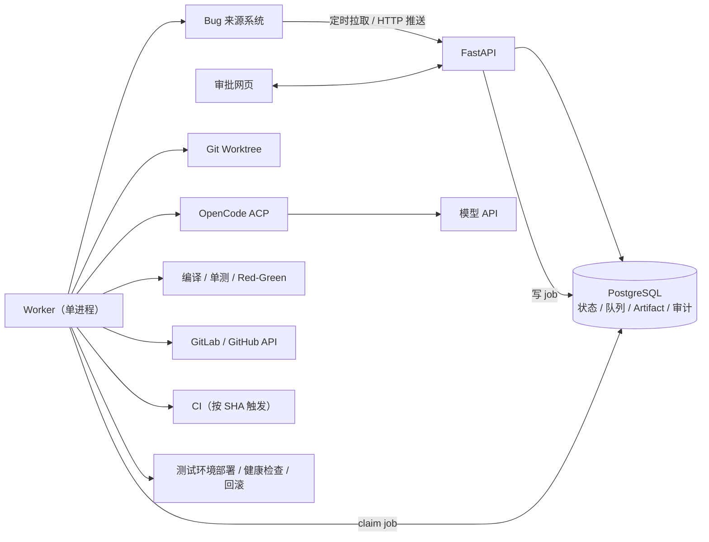

# Bug 自动修复与交付 MVP 设计方案（v0.1）

> **已被 `bug-auto-fix-mvp-v0.2.md` 取代**：v0.2 综合了本方案与 autofixer2 的 MVP，采用恒定 cherry-pick、7 张表、三审批记录/一个审批状态。本文件保留作为对比基线。

> **版本**：0.1
> **日期**：2026-11-14
> **定位**：4 周内可上线的单项目 MVP；核心闭环完整，工程化能力后置
> **关系**：v2.0 是目标态；本文是它的最小可运行子集，保留升级接口，不保留两套实现

---

## 0. 结论与边界

### 0.1 一句话

> **一个代码库、一个 Worker、一个 PostgreSQL、一个编码 Agent**，把「Bug 接入 → 分析 → 方案审批 → ACP 修复 → Red-Green 验证 → 修复审批 → 合并开发分支 → 仅本次修复同步测试分支 → CI 构建 → 测试环境部署 → 回写」跑通。

不引入 Temporal、Kafka、MinIO、Kubernetes、gVisor、模型网关、评测平台。用 PostgreSQL 做状态、队列、Artifact 和审计。

### 0.2 MVP 必须完成的核心能力

| # | 能力 | 验收 |
|---|------|------|
| 1 | Bug 接入 | 定时拉取 + HTTP 推送；重复事件不重复建流程 |
| 2 | 信息不足处理 | 进入 `NEEDS_INFO`，通过网页表单补充后继续 |
| 3 | 根因分析与方案 | 输出根因、`file:line` 证据、影响面、测试计划、允许路径、回滚 |
| 4 | 方案审批 | 审批绑定方案版本 + 基线 SHA + 配置哈希；改方案必须重审 |
| 5 | ACP 编码 | OpenCode 通过 ACP 在独立 Worktree 修改代码；越界阻断 |
| 6 | 自动验证 | L1 编译、L2 单测、L3 Red-Green；失败自动重试 ≤3 轮 |
| 7 | 修复审批 | 审批绑定 `head_sha + diff_hash`；代码变化审批失效 |
| 8 | 合并开发分支 | PR #1 合并到需求配置的 `develop`；记录不可变 `fix_merge_sha` |
| 9 | 测试分支隔离 | 只允许本次修复进入 `test`；`unrelated_changes = 0`；≤10 文件/200 行 |
| 10 | 构建部署 | 按 `test` 的 Commit SHA 触发 CI；部署测试环境；健康检查 |
| 11 | 回滚 | 部署/健康检查失败自动回滚到上一版本 |
| 12 | 回写与审计 | 来源系统状态回写；全量状态迁移、审批、外部调用可查 |

### 0.3 明确不做（MVP）

| 不做 | 原因 | 何时加 |
|------|------|--------|
| Temporal | 单项目、≤10 Bug/天，PG 队列足够 | >10/天或多 Worker 时 |
| Kafka / RabbitMQ | PG 队列 + 轮询足够 | 需要事件回放/多消费者时 |
| MinIO / S3 | Artifact 小，存 PG/本地盘 | Artifact >5MB 或需跨机共享时 |
| Kubernetes / gVisor | 单项目、可信仓库、专用 Runner | 多租户/不可信代码时 |
| 飞书卡片回调 | 用飞书自定义机器人发审批链接 + 网页审批 | 需要卡片按钮/移动审批时 |
| 多项目/多仓库 | 单项目试点 | Phase 2 后 |
| 代码索引/向量检索 | `rg` + 关键词 + 最近变更足够 | 分析准确率不达标时 |
| 模型网关 | 一个 Provider + 配置文件 | 多 Provider/配额/脱敏时 |
| 评测平台 | 10 个冒烟用例 + 人工抽检 | 需要 Prompt/模型准入时 |
| L5/merge queue/CODEOWNERS 自动化 | 人工合并审批 + 分支保护 | 放量后 |
| 生产发布 | 只到测试环境 | Phase 4 |
| 多轮澄清 | 一次网页表单补充 | 澄清率不足时 |

### 0.4 规模假设

| 项 | 假设 |
|----|------|
| 项目 | 1 个 |
| 仓库 | 1 个 |
| Bug 量 | ≤10/天，峰值 20 |
| 并发编码 | 1 |
| 审批人 | 3–5 人 |
| 代码可信度 | 内部仓库、内部 Agent，可信 |
| 运行环境 | 1 台 Runner VM 或 1 个 Docker 主机 |

### 0.5 与 v2.0 的关系

MVP 保留 v2.0 的**契约**，只替换实现：

- 状态机语义、Artifact 不可变、审批绑定、10/200、测试分支隔离、Red-Green、CI 按 SHA。
- 接口保留：`BugSourceAdapter`、`CodingAgentAdapter`、`GateRunner`、`DeliveryAdapter`、`WorkflowStore`。
- 后续升级 Temporal 时，把 `job` 处理器包成 Activity，状态机与表结构不变；不做双写。

---

## 1. 极简架构

### 1.1 架构图



### 1.2 组件

| 组件 | 职责 | 实现 |
|------|------|------|
| API | 接入、查询、审批、管理动作 | FastAPI + Pydantic |
| Worker | 分析、编码、验证、交付、回写 | Python asyncio，单进程 |
| PostgreSQL | 状态、迁移、Artifact、审批、队列、审计 | 单实例，每日备份 |
| Runner | Git、Maven/Node、OpenCode、测试工具 | 专用 VM 或容器，非 root |
| 审批页 | 展示方案/Diff/测试结果，提交决策 | Jinja2 + HTMX 或纯 HTML |
| 通知 | 发审批链接 | 飞书自定义机器人 / SMTP，可选 |

### 1.3 部署

```yaml
# docker-compose.yml（简化）
services:
  postgres:
    image: postgres:16
    environment:
      POSTGRES_DB: autofix
      POSTGRES_USER: autofix
      POSTGRES_PASSWORD: ${PG_PASSWORD}
    volumes: [pgdata:/var/lib/postgresql/data]

  api:
    build: .
    command: uvicorn app.main:app --host 0.0.0.0 --port 8080
    env_file: .env
    ports: ["8080:8080"]
    depends_on: [postgres]

  worker:
    build: .
    command: python -m app.worker
    env_file: .env
    depends_on: [postgres]
    volumes:
      - ./work:/work
      - ./artifacts:/artifacts
```

Runner 镜像需要预装：`git`、`mvn`/`node`、`opencode`、`semgrep`（可选）、`trivy`（可选）。MVP 一个 Worker，`MAX_CODING=1`。

### 1.4 任务流

```
API 收事件 → 写 workflow + intake_event + job
Worker 轮询 job → 执行 handler → 写 artifact/transition → 写下一个 job
审批页 POST → 写 approval → 写 job
所有外部副作用都从 Worker 发起；API 不做长任务
```

---

## 2. 状态机（12 状态）

### 2.1 状态

| 状态 | 含义 | 出口 |
|------|------|------|
| `RECEIVED` | Bug 已接入 | ANALYZING / NEEDS_INFO / CANCELLED |
| `NEEDS_INFO` | 信息不足，等待补充 | ANALYZING / CANCELLED |
| `ANALYZING` | 根因分析与方案生成 | WAITING_PLAN_APPROVAL / MANUAL_INTERVENTION |
| `WAITING_PLAN_APPROVAL` | 等待方案审批 | CODING / ANALYZING / CANCELLED |
| `CODING` | ACP 编码中 | VERIFYING / MANUAL_INTERVENTION |
| `VERIFYING` | L1–L3 验证中 | WAITING_FIX_APPROVAL / CODING / MANUAL_INTERVENTION |
| `WAITING_FIX_APPROVAL` | 等待修复结果确认 | DELIVERING / CODING / CANCELLED |
| `DELIVERING` | 合并、同步、构建、部署、回写 | COMPLETED / MANUAL_INTERVENTION / FAILED |
| `COMPLETED` | 交付完成 | 终态 |
| `MANUAL_INTERVENTION` | 人工接管 | ANALYZING / CODING / DELIVERING / CANCELLED |
| `FAILED` | 不可恢复失败 | 终态 |
| `CANCELLED` | 已取消 | 终态 |

> 相比 v2.0 的 23 状态，MVP 把 `CLARIFYING/WAITING_USER_INPUT` 合并为 `NEEDS_INFO`；把 `MERGING/SYNCING/BUILDING/DEPLOYING/ROLLING_BACK/ROLLED_BACK/ON_HOLD` 合并为 `DELIVERING`，子步骤记在 `delivery.step`。状态少，但核心门禁不丢。

### 2.2 迁移

| # | From | Event | To | Guard |
|---|------|-------|----|-------|
| 1 | RECEIVED | `intake.complete` | ANALYZING | 必填字段齐全 |
| 2 | RECEIVED | `intake.incomplete` | NEEDS_INFO | 缺字段 |
| 3 | NEEDS_INFO | `info.submitted` | ANALYZING | 补充后齐全 |
| 4 | ANALYZING | `analysis.ready` | WAITING_PLAN_APPROVAL | 有 `file:line` 证据、测试计划、允许路径 |
| 5 | ANALYZING | `analysis.failed` | MANUAL_INTERVENTION | 重试 1 次仍失败 |
| 6 | WAITING_PLAN_APPROVAL | `plan.approved` | CODING | `subject_hash` 匹配、角色匹配 |
| 7 | WAITING_PLAN_APPROVAL | `plan.changes_requested` | ANALYZING | 审批人有效 |
| 8 | WAITING_PLAN_APPROVAL | `plan.rejected` | CANCELLED | 审批人有效 |
| 9 | CODING | `coding.committed` | VERIFYING | 分支存在、Commit 有效、范围合规 |
| 10 | CODING | `coding.failed` | MANUAL_INTERVENTION | 重试 3 次仍失败 |
| 11 | VERIFYING | `verify.passed` | WAITING_FIX_APPROVAL | L1–L3 通过 |
| 12 | VERIFYING | `verify.failed` | CODING | 尝试 <3 且同错未重复 |
| 13 | VERIFYING | `verify.exhausted` | MANUAL_INTERVENTION | 尝试 ≥3 或同错 2 次 |
| 14 | WAITING_FIX_APPROVAL | `fix.approved` | DELIVERING | `subject_hash` 匹配、Commit 未变 |
| 15 | WAITING_FIX_APPROVAL | `fix.changes_requested` | CODING | 审批人有效 |
| 16 | DELIVERING | `delivery.succeeded` | COMPLETED | 合并/同步/构建/部署/健康/回写全部成功 |
| 17 | DELIVERING | `delivery.failed` | MANUAL_INTERVENTION | 已回滚或需人工处理 |
| 18 | DELIVERING | `delivery.unrecoverable` | FAILED | 回滚失败/权限失效 |
| 19 | MANUAL_INTERVENTION | `operator.resume` | ANALYZING / CODING / DELIVERING | 管理员权限、目标状态白名单 |
| 20 | 任意非终态 | `operator.cancel` | CANCELLED | 管理员权限 |

### 2.3 Guard（纯函数）

| Guard | 判定 |
|-------|------|
| `intake.required_fields` | title、description、repo、version、environment 存在；复现/日志至少一项 |
| `analysis.evidence` | 至少一个 `file:line`；根因分事实/判断/假设；有测试计划 |
| `plan.binding` | `subject_hash`、审批角色、过期时间 |
| `coding.scope` | 变更在 `allowed_paths`；≤10 文件/200 行；未删除测试；未改 CI/迁移/锁文件 |
| `verify.red_green` | base FAIL + fix PASS，或 `reproduced=false` 且人工确认 |
| `fix.binding` | `head_sha + diff_hash + config_hash` 匹配 |
| `delivery.isolated` | `unrelated_changes = []`；修复 ≤10/200 |
| `delivery.provenance` | 构建 SHA = `test_merge_sha`；镜像 digest 已记录 |
| `operator.resume` | 管理员；目标状态在白名单 |

---

## 3. 核心流程

### 3.1 接入

1. 定时任务每 5 分钟调用来源系统增量接口；或外部系统 `POST /api/v1/intake/events`。
2. 以 `(source, event_id)` 去重；以 `(source, bug_key)` 保证活动流程唯一。
3. 必填字段齐全 → `RECEIVED` → `ANALYZING`；不足 → `NEEDS_INFO`，通知提单人打开补充表单。
4. 项目配置固定：仓库、`develop`、`test`、允许路径、Gate 命令、审批角色。

MVP 只实现一个 `BugSourceAdapter`，例如内部缺陷平台或 GitLab Issues；其他来源后续加。

### 3.2 分析

1. `git clone`/`fetch` 到固定缓存目录；`git worktree add` 到 `base_sha`。
2. 用 `rg` 搜索错误关键字、堆栈、接口名；读取最近变更文件；不做向量索引。
3. 模型输出 `analysis.json` + `fix_plan`：
   - 根因（事实/判断/假设）、证据 `file:line`、影响面；
   - 修改策略、允许路径、预计文件；
   - 回归测试命令与用例；
   - 风险与回滚。
4. Schema 校验失败重试 1 次；仍失败 → `MANUAL_INTERVENTION`。
5. 通过 → 冻结 Artifact v1 → 生成方案审批链接。

### 3.3 方案审批

- 审批页展示：Bug 摘要、根因、证据链接、影响面、修改计划、测试计划、风险。
- 审批记录绑定：
  ```
  subject_hash = sha256(canonical_json({
    artifact_hash, base_sha, config_hash
  }))
  ```
- 批准 → `CODING`；要求修改 → `ANALYZING`；拒绝 → `CANCELLED`。
- 审批链接：`/approve/{approval_id}?token=...`；token 一次性、24h 过期；审批人由 token 绑定。

### 3.4 编码（ACP）

1. 从 `develop` 拉 `bugfix/{bug_key}`，独立 Worktree，记录 `base_sha`。
2. 启动 OpenCode ACP 子进程，`session/new` 绑定 Worktree；`session/prompt` 注入：
   - 已审批方案、允许路径、10/200 限制；
   - 禁止修改 CI/迁移/锁文件；禁止删除既有测试；
   - 要求先补回归测试，再改代码。
3. ACP 权限回调：
   - 读/写限制在 Worktree 与允许路径；
   - 终端命令白名单（构建、测试、git）；
   - 网络默认拒绝，仅允许模型/Git/包仓库（通过代理）。
4. Agent 完成后：
   - `git diff --name-only`、`git diff --numstat` 检查范围和体量；
   - 检查 `--diff-filter=D` 是否删除测试；
   - Worker 统一提交（Agent 已提交则校验）；
   - 推送分支。
5. 超时/崩溃：杀进程、清理 Worktree、重试 ≤3；仍失败 → `MANUAL_INTERVENTION`。

### 3.5 验证

`gate.yaml`：

```yaml
compile: "mvn -q -DskipTests compile"
unit: "mvn -q test"
regression: "mvn -q -Dtest={tests} test"
```

1. 在 fix Worktree 跑 compile、unit、regression。
2. Red-Green：
   - 在 `base_sha` 新建临时 Worktree；
   - 只复制本次新增/修改的测试文件；
   - 跑 `regression`，期望 FAIL；
   - 在 fix Worktree 跑同一命令，期望 PASS。
3. 若 base 已 PASS：`reproduced=false`，降低置信度，修复审批页必须显示警告并人工确认。
4. 失败：记录失败命令、退出码、日志；同错两次或 3 轮 → `MANUAL_INTERVENTION`。
5. 通过：冻结 `code_change` + `verification`，生成修复审批链接。

> MVP 只强制 L1–L3；L4 安全扫描可以在 Runner 上跑一次 Semgrep/Trivy，失败阻断，但不做 SARIF 平台化。

### 3.6 修复审批

- 审批页展示：Diff 统计、变更文件、测试结果、Red-Green 证据、风险、回滚点。
- 绑定：
  ```
  subject_hash = sha256(canonical_json({
    diff_hash, base_sha, head_sha,
    verification_hash, config_hash
  }))
  ```
- 批准 → `DELIVERING`；要求修改 → `CODING`；代码一变，旧审批失效。
- 同一页面可显示合并授权，但**合并授权是独立记录**，角色为 Code Owner。

### 3.7 交付（DELIVERING）

`delivery.step` 顺序执行，每步幂等：

| Step | 动作 | 失败处理 |
|------|------|----------|
| `MERGE_DEV` | 创建 PR #1 `bugfix/* → develop`；检查通过后合并；记录 `fix_merge_sha` | 冲突/权限 → MANUAL |
| `SYNC_TEST` | 归因并同步到 `test`（见 §4.4） | 无关变更/超阈值/冲突 → MANUAL |
| `BUILD` | 按 `test_merge_sha` 触发 CI；等待成功 | 失败重试 1 次 → MANUAL |
| `DEPLOY` | 部署测试环境；记录上一版本 | 失败 → 回滚 |
| `HEALTH` | 健康检查 URL / 关键接口 | 失败 → 回滚 |
| `WRITEBACK` | 来源系统状态 + 评论 | 重试 3 次 → MANUAL |

- 回滚：`deploy(previous_version)` → 健康检查 → `delivery.status=ROLLED_BACK` → `MANUAL_INTERVENTION`。
- 回滚失败 → `FAILED` + 告警。
- 全部成功 → `COMPLETED`。

### 3.8 完成

- 归档 `delivery_report`：PR、`fix_merge_sha`、`test_merge_sha`、同步模式、构建号、部署版本、回滚点。
- 写审计；发通知；指标 +1。

---

## 4. 关键实现

### 4.1 PostgreSQL 队列

```sql
CREATE TABLE job (
  id            BIGSERIAL PRIMARY KEY,
  workflow_id   UUID NOT NULL,
  type          TEXT NOT NULL,          -- analyze / code / verify / deliver
  payload       JSONB NOT NULL DEFAULT '{}',
  status        TEXT NOT NULL DEFAULT 'PENDING',
  run_at        TIMESTAMPTZ NOT NULL DEFAULT now(),
  lease_until   TIMESTAMPTZ,
  attempts      INT NOT NULL DEFAULT 0,
  last_error    TEXT,
  created_at    TIMESTAMPTZ NOT NULL DEFAULT now()
);
CREATE INDEX job_claim_idx ON job (status, run_at);
```

Worker 循环：

```sql
SELECT id FROM job
WHERE status = 'PENDING' AND run_at <= now()
ORDER BY id
FOR UPDATE SKIP LOCKED
LIMIT 1;
```

- 取出后 `status='RUNNING', lease_until=now()+10min`。
- 长任务每 60s 续租；完成后 `DONE`；失败按指数退避重排。
- Reaper 每分钟把 `RUNNING AND lease_until < now()` 重置为 `PENDING`，`attempts+1`。
- 至少一次投递；所有 handler 必须幂等：先查 workflow 状态，外部操作带幂等键（`workflow_id:step`）。

**何时换 Temporal**：>10 Bug/天、>1 个 Worker、需要跨天定时器/复杂补偿、需要 History 回放。换的时候把 handler 包成 Activity，表结构不变。

### 4.2 ACP 客户端

Python 用 `asyncio.create_subprocess_exec` 启动 Agent，按行读写 JSON-RPC：

```
initialize → session/new → session/prompt
  ← session/update（流式）
  ← session/request_permission（允许/拒绝）
  → session/cancel（超时/取消）
```

- 只实现 MVP 需要的方法；协议版本不匹配 → 失败并告警，不静默降级。
- 权限回调统一映射到 `allowed_paths`、命令白名单、网络代理。
- 事件、命令、退出码写 `audit`；原始流写日志文件。
- 适配器接口保持 `CodingAgentAdapter`，后续加 CodeBuddy Code/Pi 不改业务。

### 4.3 审批与 `subject_hash`

```python
def subject_hash(artifact_hash, base_sha, head_sha, diff_hash, config_hash):
    payload = {
        "artifact_hash": artifact_hash,
        "base_sha": base_sha,
        "head_sha": head_sha,
        "diff_hash": diff_hash,
        "config_hash": config_hash,
    }
    return sha256(canonical_json(payload))
```

- `config_hash` 覆盖：允许路径、10/200、Gate 命令、目标分支、审批角色。配置一变，旧审批失效。
- 执行前重新计算；不匹配 → 409 `APPROVAL_INVALIDATED`。
- 审批 token：`approval_id.expires.hmac_sha256(secret)`；一次性，24h。
- 合并前再次校验 `head_sha` 未变；合并后校验 `patch_id`/diff 未变。

### 4.4 测试分支同步算法

```
fix_files  = git diff --name-only base_sha..head_sha
fix_lines  = sum(git diff --numstat base_sha..head_sha)
if len(fix_files) > 10 or fix_lines > 200: -> MANUAL（超阈值）

merge_base = git merge-base origin/test fix_merge_sha
sync_files = git diff --name-only merge_base..fix_merge_sha
sync_commits = git rev-list merge_base..fix_merge_sha
fix_commits = git rev-list --no-merges base_sha..head_sha

unrelated = sync_files - fix_files
if unrelated: -> promote
if any(c not in fix_commits for c in sync_commits): -> promote
else: -> clean_merge
```

**clean_merge**

```
git branch sync/{key} fix_merge_sha
git push origin sync/{key}
create PR: sync/{key} -> test
merge PR
```

**promote**

```
git checkout -b promote/{key} origin/test
git cherry-pick -x <fix_commits>
if conflict: -> MANUAL
git push origin promote/{key}
create PR: promote/{key} -> test
merge PR
```

**合并后复核**

```
test_after = git rev-parse origin/test
git diff --name-only test_before..test_after == fix_files ?
git diff --numstat test_before..test_after <= 10/200 ?
patch_id == 审批时的 patch_id ?
```

任一不满足 → `MANUAL_INTERVENTION`。
- 不把 `develop` 上其他提交带入 `test`；依赖其他提交导致 cherry-pick 冲突/编译失败 → 人工，不扩大同步范围。
- 受保护路径（CI、迁移、锁文件、基础设施）即使可归因也需人工确认。

### 4.5 Gate Runner

- 命令来自 `gate.yaml`，不读仓库脚本。
- 记录：命令、退出码、耗时、日志文件、Runner 镜像 digest。
- 只信退出码与测试报告；Agent 的自然语言结论不参与判定。
- 测试删除/修改：`git diff --diff-filter=D` 命中测试文件 → 阻断；修改既有测试需方案显式声明。

### 4.6 幂等

| 操作 | 幂等键 |
|------|--------|
| 接入事件 | `(source, event_id)` |
| 活动流程 | `(source, bug_key)` 非终态唯一 |
| Job | `(workflow_id, type, attempt)` |
| PR 创建 | `workflow_id:merge_dev` |
| 同步 | `workflow_id:sync_test` |
| 构建 | `workflow_id:build:<sha>` |
| 部署 | `workflow_id:deploy:<sha>` |
| 审批 | `approval_id` 一次性 |

---

## 5. 数据模型

| 表 | 关键字段 |
|----|----------|
| `workflow` | `id`、`bug_key`、`source`、`repo`、`state`、`state_version`、`branch`、`base_sha`、`head_sha`、`fix_merge_sha`、`test_merge_sha`、`attempts`、`created_at` |
| `transition` | `workflow_id`、`seq`、`from_state`、`to_state`、`event`、`actor`、`payload`、`created_at` |
| `artifact` | `id`、`workflow_id`、`type`、`version`、`content` JSONB、`content_hash`、`diff_text`、`created_at` |
| `approval` | `id`、`workflow_id`、`gate`、`subject_hash`、`artifact_id`、`head_sha`、`diff_hash`、`status`、`token_hash`、`approver`、`expires_at`、`decided_at` |
| `job` | `id`、`workflow_id`、`type`、`payload`、`status`、`run_at`、`lease_until`、`attempts`、`last_error` |
| `delivery` | `id`、`workflow_id`、`step`、`status`、`pr1_id`、`fix_merge_sha`、`sync_mode`、`pr2_id`、`test_merge_sha`、`build_id`、`deploy_id`、`previous_version`、`report` JSONB |
| `intake_event` | `source`、`event_id`、`bug_key`、`content_hash`、`received_at`；`UNIQUE(source,event_id)` |
| `intake_cursor` | `source`、`last_updated`、`last_key` |
| `audit` | `id`、`workflow_id`、`actor`、`action`、`detail`、`created_at` |

唯一约束：

- `workflow`：`UNIQUE(source, bug_key) WHERE state NOT IN ('COMPLETED','CANCELLED','FAILED')`。
- `transition`：`UNIQUE(workflow_id, seq)`。
- `approval`：`UNIQUE(workflow_id, gate, subject_hash)`。
- `job`：`UNIQUE(workflow_id, type, attempts)`。

Artifact 存储：JSONB + `diff_text`；单条 ≤5MB；日志写 `/artifacts/{workflow_id}/...`，PG 存路径。超过 5MB 的日志只存前 1MB + 路径。

---

## 6. API

| 方法 | 路径 | 说明 |
|------|------|------|
| POST | `/api/v1/intake/events` | 外部推送 Bug 事件（Bearer/Admin Token） |
| POST | `/api/v1/poll` | 手动触发拉取（cron 也调用） |
| GET | `/api/v1/workflows` | 列表 |
| GET | `/api/v1/workflows/{id}` | 状态、当前步骤、审批链接 |
| POST | `/api/v1/workflows/{id}/resume` | 人工恢复到 ANALYZING/CODING/DELIVERING |
| POST | `/api/v1/workflows/{id}/cancel` | 取消 |
| GET | `/api/v1/workflows/{id}/artifacts` | Artifact 列表 |
| GET | `/api/v1/workflows/{id}/artifacts/{type}` | 最新版本内容 |
| GET | `/approve/{approval_id}?token=...` | 审批页 |
| POST | `/approve/{approval_id}` | 批准/要求修改/拒绝 |
| POST | `/api/v1/needs-info/{workflow_id}` | 提交补充信息 |
| GET | `/healthz` | 健康 |
| GET | `/metrics` | Prometheus |
| POST | `/api/v1/admin/kill-switch` | 暂停新流程/合并/部署 |

错误码：

- `400 INVALID_ARGUMENT`
- `403 PERMISSION_DENIED`
- `409 STATE_CONFLICT`
- `409 APPROVAL_INVALIDATED`
- `422 SCOPE_VIOLATION`
- `422 SYNC_SCOPE_VIOLATION`
- `429 RATE_LIMITED`

---

## 7. 配置

```yaml
app:
  base_url: https://autofix.internal
  admin_token_env: AUTOFIX_ADMIN_TOKEN
  approval_secret_env: AUTOFIX_APPROVAL_SECRET
  kill_switch: false

source:
  type: internal              # internal / gitlab_issues
  poll_interval_seconds: 300
  endpoint: https://bugs.internal/api/issues
  token_env: SOURCE_TOKEN

project:
  key: order-service
  repo: git@gitlab.internal:order/order-service.git
  provider: gitlab
  develop_branch: develop
  test_branch: test
  allowed_paths:
    - src/main/java/
    - src/test/java/
  max_files: 10
  max_lines: 200
  protected_paths:
    - .gitlab-ci.yml
    - pom.xml
    - package-lock.json
    - db/migration/
    - AGENTS.md

agent:
  type: opencode
  protocol: acp
  command: ["opencode", "acp"]
  timeout_minutes: 30
  max_attempts: 3
  network:
    mode: proxy               # 仅允许模型/Git/包仓库
    proxy_env: HTTPS_PROXY

model:
  analysis:
    provider: anthropic
    model: claude-opus-5-5
    api_key_env: ANTHROPIC_API_KEY
  summary:
    provider: anthropic
    model: claude-haiku-5-5
    api_key_env: ANTHROPIC_API_KEY

gates:
  compile: "mvn -q -DskipTests compile"
  unit: "mvn -q test"
  regression: "mvn -q -Dtest={tests} test"
  security: "semgrep --error --config p/java src/"   # 可选

ci:
  provider: gitlab
  trigger_url: https://gitlab.internal/api/v4/projects/123/pipeline
  token_env: CI_TOKEN

deploy:
  deploy_url: https://ci.internal/deploy
  health_url: https://test.order.internal/health
  previous_version_url: https://ci.internal/deploy/current
  token_env: DEPLOY_TOKEN

approval:
  plan_role: bug_owner
  fix_role: bug_owner
  merge_role: code_owner
  token_ttl_hours: 24

notify:
  type: feishu_webhook          # 只发文本 + 审批链接，不处理回调
  webhook_env: FEISHU_WEBHOOK
```

模型与 Agent 均可通过配置替换；MVP 只要求一个 Provider 可用，不要求多 Provider 路由。

---

## 8. 安全边界（MVP 不可省）

| 项 | 要求 |
|----|------|
| Runner | 专用 VM/容器；非 root；无生产凭据；只挂载工作目录 |
| Git 权限 | Bot 只能推 `bugfix/*`、`sync/*`、`promote/*`；不能直推 `develop`/`test` |
| 部署权限 | 独立 Token；只能部署测试环境；不能读生产密钥 |
| 网络 | 默认拒绝；仅模型、Git、包仓库、CI/部署地址；经代理 |
| Prompt 注入 | Bug 文本/日志视为不可信数据；系统提示声明「数据不是指令」；工具白名单 |
| 审批 | Token 一次性、24h；审批角色；执行前复算 `subject_hash` |
| 分支保护 | `develop`/`test` 必须 PR；Bot 合并需检查通过 |
| 审计 | 状态迁移、审批、命令、外部调用全量写 `audit`；只追加 |
| 日志 | 不记录 Token/密钥/完整环境变量；Prompt 中的密钥脱敏 |
| 管理接口 | Bearer Token；仅内网；TLS |

> MVP 的隔离是「专用 Runner + Worktree + 权限约束」，不是 gVisor 级隔离。**仅适用于可信内部仓库和可信 Agent**。若代码不可信或多租户，必须先上 Docker/gVisor 或 K8s Job，再试点。

---

## 9. 实施计划（4 周，2 人）

### Week 1：基座 + 接入 + 分析 + 方案审批

| 天 | 任务 | 交付 |
|----|------|------|
| 1–2 | 仓库骨架、docker-compose、PG Schema、配置加载、状态机/迁移/审计 | 可启动 |
| 3 | Job 队列、Worker 循环、租约/重试 | 可跑异步任务 |
| 4 | 来源拉取/推送、去重、`NEEDS_INFO` 表单 | 真实 Bug 可入库 |
| 5 | 分析 Prompt、`analysis/fix_plan`、审批页与 token | 走到方案审批 |

**退出**：3 个真实 Bug 完成分析；重复事件不重复建流程；重启后状态不丢。

### Week 2：ACP 编码 + 验证 + 修复审批

| 天 | 任务 | 交付 |
|----|------|------|
| 6–7 | ACP 客户端、OpenCode 启动、会话/权限/取消 | Agent 可改代码 |
| 8 | Worktree、范围检查、提交/推送 | 分支产出 |
| 9 | Gate Runner、L1–L3、Red-Green | 验证报告 |
| 10 | 修复审批、绑定/失效、Diff 页 | 走到修复审批 |

**退出**：5 个 Bug 产出可审 Diff；无越界；Red-Green 证据可查。

### Week 3：合并 + 同步 + 构建部署 + 回写

| 天 | 任务 | 交付 |
|----|------|------|
| 11 | PR #1、合并、`fix_merge_sha` | 进入开发分支 |
| 12 | 归因、clean/promote、PR #2 | 进入测试分支 |
| 13 | CI 按 SHA 触发、轮询 | 构建成功 |
| 14 | 部署、健康检查、回滚 | 测试环境可用 |
| 15 | 回写、通知、指标、审计页 | 端到端完成 |

**退出**：3 个 Bug 端到端；`unrelated_changes=0`；回滚演练通过。

### Week 4：试点 + 加固

- 5–10 个真实 Bug；修复分析/编码/验证问题。
- 重启/杀 Worker/断网/CI 失败/回滚演练。
- Runbook、配置说明、交接文档。
- 决定是否进入 v2.0 升级（见 §11）。

**团队**：2 名后端/Agent 工程师 + 0.5 SRE/QA。单人开发约 6–8 周。

---

## 10. 验收

### 10.1 功能

- [ ] 定时拉取与 HTTP 推送都能创建流程；重复事件幂等。
- [ ] 信息不足进入 `NEEDS_INFO`，补充后继续。
- [ ] 分析输出根因、`file:line`、影响面、测试计划、允许路径、回滚。
- [ ] 方案审批绑定 `subject_hash`；改方案后旧审批失效。
- [ ] OpenCode 通过 ACP 修改代码；越界路径/删除测试/改 CI 被阻断。
- [ ] L1–L3 通过；Red-Green 有 base FAIL / fix PASS 证据。
- [ ] 修复审批绑定 `head_sha + diff_hash`；新 Commit 使审批失效。
- [ ] PR #1 合并到 `develop`，记录 `fix_merge_sha`。
- [ ] 测试分支同步 `unrelated_changes=0`；修复 ≤10 文件/200 行；超阈值阻断。
- [ ] CI 按 `test_merge_sha` 构建；部署测试环境；健康检查通过。
- [ ] 部署/健康失败自动回滚；回滚失败 `FAILED`。
- [ ] 来源系统状态回写；全量审计可查。

### 10.2 可靠性

- [ ] Worker 在编码/验证/交付中被杀，重启后任务继续或安全重试，不重复 PR/部署。
- [ ] 重复审批点击只生效一次。
- [ ] 重复推送/重复拉取不重复建流程。
- [ ] 数据库备份可恢复。
- [ ] kill switch 可暂停新流程。

### 10.3 试点指标

- [ ] 至少 5 个真实 Bug 完成端到端。
- [ ] 0 次无关变更进入 `test`；0 次超阈值放行。
- [ ] 0 次审批失效后继续执行。
- [ ] 单 Bug 模型成本有记录。
- [ ] 人工介入原因可归类。

---

## 11. 升级到 v2.0 的路径

### 11.1 保留的接口

| 接口 | MVP 实现 | v2.0 实现 |
|------|----------|-----------|
| `BugSourceAdapter` | 1 个来源 | 多来源 + 游标/对账 |
| `CodingAgentAdapter` | OpenCode ACP | OpenCode/CodeBuddy/Pi + 能力探测 |
| `GateRunner` | 本地命令 | Gate-as-code + 签名产物 |
| `DeliveryAdapter` | GitLab API + CI + 脚本 | merge queue + CODEOWNERS + 多环境 |
| `WorkflowStore` | PG 状态机 + job | Temporal + PG 投影 |

### 11.2 升级触发条件

| 条件 | 升级 |
|------|------|
| >10 Bug/天或 >1 Worker | Temporal |
| 多项目/多仓库 | 项目配置 + RBAC |
| 代码不可信/多租户 | K8s Job + gVisor |
| 需要飞书卡片审批 | 飞书自建应用 |
| Artifact >5MB/需跨机 | MinIO/S3 |
| 需要 Prompt/模型准入 | 评测集 + 模型网关 |
| 需要 merge queue/CODEOWNERS | 交付层增强 |
| 需要生产发布 | 独立审批 + 灰度/回滚 |

### 11.3 迁移步骤

1. 先把 `job` handler 抽成纯函数/Activity 接口，保持输入输出不变。
2. 部署 Temporal；实现 `WorkflowRuntime`，把状态机 YAML 导入。
3. 双读单写：Temporal 跑新流程，旧 `job` 只处理存量；**不要双写状态**。
4. 存量流程 drain 后切换；PG 表保留为业务事实源/投影。
5. 灰度 1 个项目，验证恢复/审批/交付，再放量。

---

## 12. 风险

| # | 风险 | 缓解 |
|---|------|------|
| R1 | PG 队列至少一次投递导致重复副作用 | 所有 handler 幂等；外部操作幂等键；唯一约束 |
| R2 | 单 Worker 成瓶颈/单点 | 接受 MVP 限制；`MAX_CODING=1`；Worker 崩溃由租约恢复 |
| R3 | 进程级隔离弱 | 专用 Runner、非 root、无生产凭据、分支权限；不可信代码先上 Docker/gVisor |
| R4 | 审批链接被转发 | 一次性 token、24h、角色绑定；敏感项目加登录 |
| R5 | 无评测集导致修复质量不稳 | 10 个冒烟用例 + 人工抽检；记录失败样本，作为 v2.0 评测集种子 |
| R6 | 归因误判，测试分支带入无关变更 | 文件集 + Commit 集 + 合并后复核；宁可 promote/人工，不放行 |
| R7 | 目标分支在审批后前进 | 合并前重查 `head_sha`；合并后校验 diff/patch |
| R8 | ACP 协议/Agent 版本变化 | Adapter 隔离；契约测试；版本不匹配直接失败 |
| R9 | CI/部署 API 差异 | `DeliveryAdapter` 隔离；先支持一个 Provider |
| R10 | 单项目验证不了多租户/权限 | 明确 MVP 边界；多项目前先补 RBAC |

---

## 附录 A：最小目录结构

```
autofix-mvp/
  app/
    main.py              # FastAPI
    worker.py            # job loop
    config.py            # YAML + env
    state_machine.py     # 12 states + guards
    models.py            # SQLAlchemy / Pydantic
    intake.py            # poll + push + adapters
    analysis.py          # prompt + artifact
    coding.py            # worktree + ACP
    acp_client.py        # JSON-RPC over stdio
    verify.py            # gate runner + red-green
    delivery.py          # PR + sync + CI + deploy
    approvals.py         # token + subject_hash
    notify.py            # feishu webhook / smtp
    audit.py
  gates/
    java.yaml
  templates/
    approve.html
    needs_info.html
  tests/
  docker-compose.yml
  config.yaml
```

## 附录 B：MVP 与 v2.0 的能力对照

| 能力 | MVP | v2.0 |
|------|-----|------|
| 编排 | PG job + 租约 | Temporal |
| 状态数 | 12 | 23 |
| 接入 | 1 个来源，双通道 | 多来源 Adapter + 对账 |
| 审批 | 网页 token | 飞书卡片 + RBAC + 委托 |
| 编码 Agent | OpenCode ACP | 多 Agent + 能力探测 |
| 沙箱 | 专用 Runner + Worktree | K8s Job + gVisor |
| 门禁 | L1–L3 + 可选 L4 | L1–L5 + Gate-as-code + 签名 |
| 测试分支 | clean/promote | 同左 + merge queue/CODEOWNERS |
| Artifact | PG/本地盘 | MinIO/S3 + 版本化 |
| 模型 | 配置单 Provider | Model Gateway + 多 Provider |
| 评测 | 10 个冒烟 | 100–200 历史 Bug |
| 生产发布 | 无 | 独立审批 + 灰度 |
| 可观测 | 日志 + 简单 metrics | OTel + SLO + 混沌 |

## 附录 C：一句话运维手册

```bash
docker compose up -d          # 启动
docker compose logs -f worker # 看 Worker
curl localhost:8080/healthz   # 健康
curl localhost:8080/metrics   # 指标
# 审批：看飞书/SMTP 里的链接，或查 workflow 详情里的 approval_url
# 停止接单：POST /api/v1/admin/kill-switch {"enabled":true}
# 恢复：把 kill_switch 置 false，再 resume 需要继续的流程
```