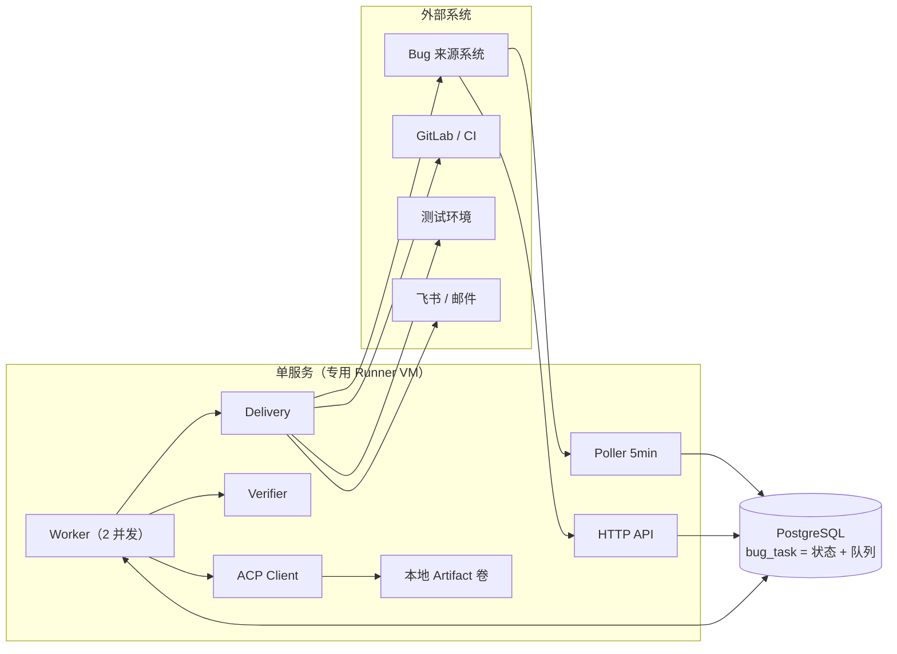
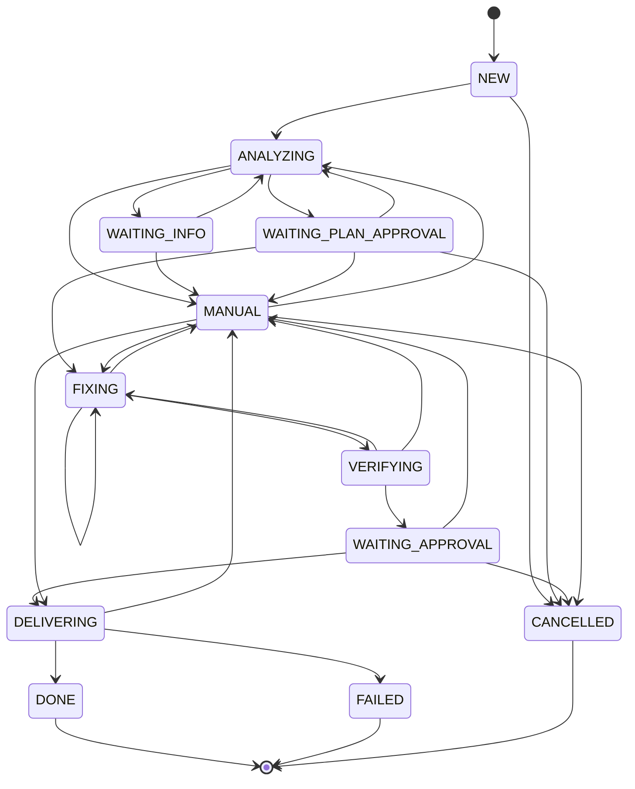

# Bug Auto-Fix MVP 设计方案（v0.2 综合版）

> **实施基线已更新**：技术栈已确定为 Python 3.12 + FastAPI，CI 暂缓；实施细节以 `bug-auto-fix-mvp-v0.3-implementation.md` 为准。本文件保留完整设计参考。

> **版本**：0.2
> **日期**：2026-11-14
> **定位**：4 周可试点的单项目 MVP；核心闭环完整，工程化能力后置
> **输入**
> - A：`autofixer/docs/prds/bug-auto-fix-mvp-v0.1.md`
> - B：`autofixer2/docs/prds/bug-auto-fix-mvp-design.md`
>
> **结论**：以 B 的**极简骨架**为主，吸收 A 的 **ACP、代码负责人合并授权、自动回滚、配置哈希**；拒绝 B 的 CLI Agent、仅执行人审批、无回滚、`docker.sock` 四项。最终是 **12 状态、7 张表、单服务、恒定 cherry-pick** 的 MVP。

---

## 0. 一页结论

### 0.1 核心能力（DoD）

> 给定一个来源系统中的 Bug，系统能完成「分析出方案 → Bug 执行人批准方案 → ACP 编码 → 测试证明修好 → 执行人确认结果 + 代码负责人授权合并 → 只把这一个修复 cherry-pick 到测试分支 → CI 构建 → 部署测试环境 → 健康检查 → 回写」，任一步失败都能停下来等人。

### 0.2 技术选型（5 个组件）

| 关注点 | 选型 | 说明 |
|--------|------|------|
| 运行时 | 单服务（FastAPI 或 Spring Boot 二选一） | API + Worker + Scheduler 同一进程；后续可拆 Worker，不改代码 |
| 状态与队列 | PostgreSQL 单库 | `bug_task` 既是状态机也是任务队列 |
| 分析 | 一次模型调用 + `rg` 检索 | 不建代码索引、不做多 Agent |
| 编码 | **ACP，首批 OpenCode** | 子进程 + JSON-RPC；**不用 CLI 文本模式作为 MVP 主路径** |
| Git/CI | 单一 GitLab 实例 | MR + Pipeline API；不做多 Provider 抽象 |
| 产物 | 本地数据卷 + DB 元数据 | 不引入 MinIO/S3 |

### 0.3 规模与排期

| 项 | 取值 |
|----|------|
| 仓库 | 1–2 个试点仓库 |
| Bug 量 | ≤20/天 |
| 并发修复 | 2 |
| 团队 | 2 人 |
| 排期 | 3 周跑通 + 1 周试点加固 = **4 周 / 30–34 人日** |

### 0.4 关键综合决策

| # | 决策 | 来源 | 理由 |
|---|------|------|------|
| D1 | PostgreSQL 任务表即队列 | A + B | 单库、`SKIP LOCKED`、租约恢复，足够 20/天 |
| D2 | **恒定 cherry-pick 到测试分支** | B | 隔离由构造保证，不需要三点差异归因，代码更少、更安全 |
| D3 | 编码走 **ACP** | A | 已确认硬约束；B 的 CLI 文本模式不满足多 Agent/权限/会话要求 |
| D4 | 审批三记录：`PLAN / RESULT / MERGE` | A + B | 保留执行人与代码负责人分离；状态仍只有一个 `WAITING_APPROVAL` |
| D5 | 7 张表 | B | 比 A 的 9 张少 `job/intake_event/intake_cursor`，用 `bug_task + sys_config` 覆盖 |
| D6 | 澄清走来源系统评论，最多 1 轮 | B | 不做额外表单/多轮对话，减少 UI 与状态 |
| D7 | L1–L3，不做独立 L4 | B | 安全扫描交给仓库既有流水线；MVP 只保证编译、单测、回归 |
| D8 | 自动回滚测试环境 + revert MR | A | B 只创建 revert MR，不恢复环境；MVP 应至少恢复上一版本 |
| D9 | 专用 Runner + Worktree，不用 `docker.sock` | A | B 的容器方案若通过 docker.sock 启动，等于把宿主机控制权交给应用 |
| D10 | 4 周 / 30–34 人日 | A + B | B 的 3 周 / 28 人日偏乐观；ACP 与审批分离需要额外时间 |

---

## 1. 两份 MVP 对比

### 1.1 相同点

- 都定义为「单项目、单仓库、PG 队列、单编码 Agent、本地产物、无 Temporal/Kafka/MinIO/K8s」。
- 都保留两次核心人工决策：方案审批、结果审批。
- 都用 `bug_task` 表做状态与队列，`FOR UPDATE SKIP LOCKED` + 租约恢复。
- 都强制 10 文件 / 200 行、路径白名单、Red-Green、测试分支只含本次修复。
- 都要求审批绑定对象哈希，对象变化审批失效。
- 都只做到测试环境，不做生产发布。

### 1.2 差异矩阵

| # | 维度 | A（v0.1） | B（autofixer2 MVP） | 裁决 |
|---|------|-----------|---------------------|------|
| 1 | 运行时 | API + Worker 两个容器 | 单进程（API + Worker + Scheduler） | **单服务**，代码分层，后续可拆 |
| 2 | 编码 Agent | ACP（OpenCode） | CLI 子进程（codex/claude/opencode run） | **ACP**；CLI 只作显式降级，不作主路径 |
| 3 | 分析 | 模型 + `rg` + 最近变更 | 一次模型调用 + `rg` 检索 10 个片段 | **B**，更少 |
| 4 | 澄清 | `NEEDS_INFO` 网页表单 | 分析输出 `need_info`，回写评论，等回复 1 轮 | **B**，与来源系统一致 |
| 5 | 审批 | 方案 / 修复 / 合并三次独立状态 | 方案 / 结果两次，均执行人 | **折中**：三记录、一个 `WAITING_APPROVAL` 状态 |
| 6 | 测试分支 | clean merge 或 `promote` 归因 | **恒定 cherry-pick 单提交** | **B**，隔离由构造保证 |
| 7 | 合并方式 | 允许 squash | 禁止 squash，必须 merge commit | **B**；否则无法按单提交搬运 |
| 8 | 验证 | L1–L3 + 可选 L4 | L1–L3 | **B**；L4 交给仓库流水线 |
| 9 | 回滚 | 自动回滚测试环境 | 只创建 revert MR，不自动恢复 | **A**，但补 revert MR |
| 10 | 数据表 | 9 张 | 7 张 | **B** |
| 11 | 接口 | 14 个 | 9–10 个 | **B**，保留必要管理接口 |
| 12 | 安全隔离 | 专用 Runner + Worktree | 容器，但靠 `docker.sock` 启动 | **A**；容器隔离另做 sandbox 服务 |
| 13 | 审批绑定 | `config_hash` 纳入 | `analysis_v` + `fix_sha` + `diff_sha256` | **合并**：两者都纳入 |
| 14 | 排期 | 4 周 / 2 人 | 3 周 / 28 人日 | **4 周 / 30–34 人日** |

### 1.3 各自真正的优势

**A 的优势（保留）**

- ACP 接入，满足已确认约束；会话、权限、取消可审计。
- 合并授权独立于修复确认，代码负责人有单独门禁。
- 部署/健康检查失败自动回滚，恢复测试环境。
- `config_hash` 纳入审批绑定，配置变化使旧审批失效。
- 4 周排期更现实。

**B 的优势（保留）**

- **恒定 cherry-pick**：不判断开发分支是否干净，永远只搬一个修复提交；隔离性由构造保证，删掉最危险的归因逻辑。
- **7 张表**：`bug_task` 同时是状态机和队列，没有 `job` 表。
- **一次分析 + 一次修复**：不做 6 类 Agent、不做多轮澄清、不做审查 Agent。
- **评论式澄清**：不增加网页表单，直接在来源系统追问。
- **L1–L3**：不做独立 SAST/覆盖率门禁，避免 MVP 被工具链拖住。
- **详细的 DDL、Prompt、任务拆解**：可直接开工。
- **4 条不变量**：把安全性从组件数量里剥离出来，这个思路应作为 MVP 的核心。

### 1.4 B 需要修正的四个问题

| 问题 | 为什么不能照搬 | v0.2 修正 |
|------|----------------|-----------|
| 编码用 CLI 文本模式 | 与已确认的 ACP 约束冲突；无标准会话/权限/取消 | 改为 ACP；`CodingAgentAdapter` 保留 |
| 结果审批只有执行人 | 执行人确认「修得对」不等于「可以合入」；缺少代码负责人门禁 | 增加 `MERGE` 审批，Code Owner |
| 健康检查失败只建 revert MR | 测试环境仍是坏版本，问题未被立即控制 | 先回滚到上一版本，再建 revert MR |
| `docker.sock` 启动沙箱 | 应用被攻破等于宿主机 Docker 被控制 | MVP 用专用 Runner + Worktree；要容器隔离就做独立 sandbox 服务 |

### 1.5 A 需要修正的三个问题

| 问题 | 修正 |
|------|------|
| clean merge + promote 归因 | 砍掉，统一恒定 cherry-pick；少 300–400 行，少一类误判 |
| 9 张表 / 14 个接口 | 收敛到 7 张表 / 10 个接口 |
| 过度抽象（5 个 Adapter） | MVP 只保留 `CodingAgentAdapter` 和 `GitProvider`；来源适配、GateRunner 先用函数，出现第二个实现再抽 |

---

## 2. MVP 边界

### 2.1 八阶段覆盖

| 阶段 | MVP 实现 | 完整度 |
|------|----------|--------|
| 1 接入 | 轮询（游标 + 指纹去重）+ 推送端点 | 够用 |
| 2 澄清 | 分析输出 `need_info` → 回写评论 → 等回复，最多 1 轮 | 单轮 |
| 3 分析 | 一次模型调用产出根因、证据、方案、测试计划 | 完整 |
| 4 编码 | ACP Agent 在 Worktree 内改代码并提交 | 完整 |
| 5 验证 | L1 编译 + L2 单测 + L3 Red-Green + Diff 硬约束 | 砍 L4/L5 |
| 6 审批 | 方案（执行人）+ 结果（执行人）+ 合并（Code Owner） | 完整，无委托/加签 |
| 7 交付 | 恒定 cherry-pick 单提交 → CI → 部署 → 健康检查 → 回滚 | 完整 |
| 8 沉淀 | 结构化总结落库 + 可选 Markdown 导出 | 不做向量检索 |

### 2.2 明确不做

- 多 Git Provider、多仓库联合分析、多租户。
- 审批委托、加签、quorum、多级审批链。
- Merge Queue、CODEOWNERS 自动解析、三点差异逐 hunk 归因。
- 生产发布、金丝雀、SLO 燃烧率回滚。
- 6 类 Agent、Agent 并行、Artifact 版本树与血缘。
- 向量知识库、历史 Bug 语义检索、大规模回归集。
- 评测平台；先用 10–20 条手工样本做冒烟。
- 独立 SAST/覆盖率门禁；交给仓库流水线。
- 每任务容器/gVisor；只做专用 Runner + Worktree。

### 2.3 五条不变量

| # | 不变量 | 实现 |
|---|--------|------|
| I1 | 变更不可越界 | Diff 解析：≤10 文件/200 行；路径白名单；禁止改 CI/依赖/迁移/既有测试 |
| I2 | 证据不可伪造 | L1–L3 由平台执行，退出码为准；Red-Green 由平台在 base/fix 两个 SHA 跑同一用例 |
| I3 | 隔离由构造保证 | 测试分支只接受**一个修复提交**的 cherry-pick；不做差异归因 |
| I4 | 人必须介入 | 无 `PLAN` 不建分支；无 `RESULT + MERGE` 不交付 |
| I5 | 对象变化即失效 | 审批绑定 `subject_hash`；分析版本、`fix_sha`、`diff_hash`、`config_hash` 任一变化即失效 |

---

## 3. 架构

### 3.1 组件图



### 3.2 模块

| 模块 | 职责 | 量级 |
|------|------|------|
| `Poller` | 拉取增量 Bug、检测评论回复、写任务 | ~200 行 |
| `Api` | Intake、查询、重试/取消、审批、Kill Switch | ~400 行 |
| `Worker` | 按 `state` 抢占任务、分发 handler、写回状态 | ~300 行 |
| `Analyzer` | 组装上下文、调模型、校验 `analysis.json` | ~250 行 |
| `AcpClient` | 启动 OpenCode、会话/权限/取消、收集事件 | ~350 行 |
| `GitOps` | 镜像、worktree、单提交、cherry-pick、patch-id | ~400 行 |
| `GitLabClient` | MR、Pipeline、评论回写 | ~250 行 |
| `Verifier` | L1–L3、Red-Green、Diff 约束 | ~350 行 |
| `Approval` | 令牌、页面、角色解析、哈希校验 | ~300 行 |
| `Store` | SQL、状态迁移、事件日志 | ~400 行 |

约 3,000–3,500 行有效代码。没有 MQ、对象存储、工作流框架。

### 3.3 六个关键简化

**S1：任务表即队列。** `bug_task` 按 `state + next_run_at` 抢占；`FOR UPDATE SKIP LOCKED`；`lease_until` 处理崩溃。没有 `job` 表。

**S2：一个时间字段代替定时器。** `next_run_at` 负责延迟重试、超时检查、等待回复轮询；`lease_until` 负责 Worker 崩溃恢复；每分钟 reaper。

**S3：状态即函数。** `switch (task.state)` 分发到 `handle_analyzing()` 等；每个 handler 执行到下一个稳定状态；没有事件总线、命令对象、SPI。

**S4：两次模型调用。** 分析一次、修复一次；不做澄清 Agent、审查 Agent、总结 Agent。

**S5：恒定 cherry-pick。** 不判断开发分支是否干净，永远只把 `fix_sha` 搬到 `promote/{key}`，再合入测试分支。

**S6：审批三记录、一套机制。** `PLAN / RESULT / MERGE` 共用 `approval` 表、令牌、渲染器；区别是 `gate` 与角色。

---

## 4. 状态机（12 状态）

### 4.1 状态

| 状态 | 含义 | 进入动作 | 超时 |
|------|------|----------|------|
| `NEW` | 已入库待处理 | 建任务、指纹锁 | 5 min 内领取 |
| `ANALYZING` | 分析中 | 装配上下文、调分析模型 | 20 min |
| `WAITING_INFO` | 信息不足等回复 | 回写评论 + 通知 | 72 h |
| `WAITING_PLAN_APPROVAL` | 等执行人批准方案 | 发 `PLAN` 审批 | 24 h |
| `FIXING` | ACP 编码中 | 建 worktree、调 Agent | 40 min |
| `VERIFYING` | L1–L3 + Diff 约束 | 跑门禁 | 30 min |
| `WAITING_APPROVAL` | 等结果确认 + 合并授权 | 发 `RESULT` 与 `MERGE` 审批 | 结果 48 h / 合并 8 h |
| `DELIVERING` | 合并、提升、CI、部署、回写 | 执行交付步骤 | 45 min |
| `DONE` | 已部署并回写 | 写总结、清理 | — |
| `MANUAL` | 人工接管 | 通知负责人、附现场 | — |
| `FAILED` | 不可恢复 | 告警 | — |
| `CANCELLED` | 取消 | 清理分支/worktree | — |

> `WAITING_APPROVAL` 同时承载两个门禁：`RESULT`（Bug 执行人）与 `MERGE`（Code Owner）。两个都通过才进入 `DELIVERING`；任一驳回/过期/失效 → `MANUAL`。这样状态数仍是 12，但权限不合并。

### 4.2 流转



| # | From | Event | Guard | To | Action |
|---|------|-------|-------|----|--------|
| 1 | NEW | `schedule` | 仓库在配置白名单 | ANALYZING | 拉仓库、装配上下文 |
| 2 | ANALYZING | `need_info` | `questions` 非空 | WAITING_INFO | 回写评论 + 通知 |
| 3 | ANALYZING | `analyzed` | 置信度 ≥0.5、有 `file:line`、有测试计划 | WAITING_PLAN_APPROVAL | 落 `analysis_v{n}`、发 PLAN |
| 4 | ANALYZING | `low_confidence` / `timeout` | — | MANUAL | 附报告/日志 |
| 5 | WAITING_INFO | `answered` | 评论数增加 | ANALYZING | 合并评论 |
| 6 | WAITING_INFO | `timeout` | >72h | MANUAL | 升级 |
| 7 | WAITING_PLAN_APPROVAL | `plan_approved` | 令牌有效、角色匹配、`analysis_v{n}` 与哈希未变 | FIXING | 建分支、把方案作为授权范围 |
| 8 | WAITING_PLAN_APPROVAL | `plan_rejected` | 驳回次数 <2 | ANALYZING | 带意见重分析，版本 +1 |
| 9 | WAITING_PLAN_APPROVAL | `plan_rejected` | 驳回次数 ≥2 / 超时 | MANUAL | 附方案与意见 |
| 10 | FIXING | `commit_created` | 退出码 0、有 commit、单提交、范围合规 | VERIFYING | 记 `fix_sha`、`patch_id`、推送分支 |
| 11 | FIXING | `failed` | 尝试 <3 且非重复错误 | FIXING | 退避重试，附失败摘要 |
| 12 | FIXING | `give_up` / `timeout` | 尝试 ≥3 或同错 2 次 | MANUAL | 附尝试记录 |
| 13 | VERIFYING | `passed` | L1–L3 通过 + Diff 合规 | WAITING_APPROVAL | 生成证据包、发 RESULT + MERGE |
| 14 | VERIFYING | `gate_failed` | 尝试 <3 | FIXING | 回传失败摘要 |
| 15 | VERIFYING | `blocked` | 越界/篡改/超阈值/NO_REPRO/同错 2 次 | MANUAL | 标记原因，禁止继续 |
| 16 | WAITING_APPROVAL | `both_approved` | RESULT 与 MERGE 均有效、`fix_sha` 未变、`analysis_v` 未变 | DELIVERING | 落审批记录 |
| 17 | WAITING_APPROVAL | `rejected` / `expired` / `stale` | — | MANUAL | 保留分支与现场 |
| 18 | DELIVERING | `deployed` | 健康检查通过、回写成功 | DONE | 写总结、清理 |
| 19 | DELIVERING | `failed` | 任一步失败，已回滚/已建 revert MR | MANUAL | 附 MR/流水线链接 |
| 20 | DELIVERING | `rollback_failed` | 回滚失败 | FAILED | 最高级告警 |
| 21 | MANUAL | `operator.resume` | 管理员、目标状态白名单 | ANALYZING / FIXING / DELIVERING | 记录原因 |
| 22 | 任意非终态 | `cancel` | 有权限 | CANCELLED | 清理 worktree/分支 |

### 4.3 调度

```sql
WITH picked AS (
  SELECT id FROM bug_task
   WHERE state = ANY($states)
     AND next_run_at <= now()
     AND (lease_until IS NULL OR lease_until < now())
   ORDER BY next_run_at
   LIMIT 1
   FOR UPDATE SKIP LOCKED
)
UPDATE bug_task t
   SET lease_until = now() + interval '50 minutes',
       version = version + 1
  FROM picked p
 WHERE t.id = p.id
RETURNING t.*;
```

- 单服务内 2 个 Worker 协程；同一任务串行。
- Handler 结束写新 `state`、清空 `lease_until`；异常写 `last_error`、按退避设 `next_run_at`。
- 崩溃恢复：租约到期自动回队列；handler 幂等（分支按 `task_id` 唯一，重跑先 reset）。

### 4.4 超时与重试

| 场景 | 策略 |
|------|------|
| 分析/修复 Agent | 硬超时 + 杀进程组；超时计一次失败 |
| 门禁命令 | 每命令 10 min 超时 |
| 重试 | 指数退避 2/4/8 分钟，最多 3 轮 |
| 同错熔断 | `check_id + failed_test + 首行堆栈` 连续 2 次相同即停 |
| 方案审批 | 24h；到期前 4h 提醒；到期 `MANUAL` |
| 结果审批 | 48h |
| 合并授权 | 8h |
| 外部依赖 | GitLab/CI 5xx 重试 3 次；4xx 直接 `MANUAL` |

### 4.5 幂等

- 任务：`(source, issue_key)` 活动唯一；重复拉取不新建。
- 分支：`bugfix/{issue_key}`、`promote/{issue_key}-{n}` 唯一；重跑先 `git reset --hard`。
- 交付：`delivery(task_id, step)` 唯一；重入先查状态，成功跳过。
- 审批：token 一次性；`used_at`；重放 409。
- 外部：MR 合并前查 `state == merged`；cherry-pick 前查 patch-id/`--grep`。

---

## 5. 核心流程

### 5.1 接入

- **轮询（主）**：每 5 分钟按 `updated_at > cursor` 拉 Issue；游标存 `sys_config`；本地按 `fingerprint = sha256(title + 首个堆栈/模块名)` 去重。
- **推送（辅）**：`POST /api/intake`；同一指纹去重。
- **回复检测**：`WAITING_INFO` 任务由 Poller 顺带检查评论数变化，不额外起定时器。

### 5.2 分析

输入：Issue 正文 + 最近 3 条评论 + `git ls-files` 过滤后的前 3,000 个路径 + `rg` 检索出的 10 个候选文件片段。

输出 `analysis.json`：

```json
{
  "need_info": false,
  "questions": [],
  "root_cause": "空指针：order.getItems() 在取消订单分支未判空",
  "confidence": 0.82,
  "evidence": [
    "src/main/java/com/x/order/OrderService.java:142"
  ],
  "candidate_files": [
    "src/main/java/com/x/order/OrderService.java"
  ],
  "plan": [
    "在 cancel() 中对 items 判空",
    "补一条取消空订单的用例"
  ],
  "test_plan": "OrderServiceTest#cancelWithEmptyItems",
  "test_command": "./mvnw -q -Dtest=OrderServiceTest#cancelWithEmptyItems test",
  "risk": "LOW",
  "rollback": "回滚本次提交即可"
}
```

- `confidence < 0.5`、无 `file:line`、无测试命令 → `MANUAL`，不硬猜。
- `need_info=true` → `WAITING_INFO`，回写评论，最多 1 轮。
- 通过 → 冻结 `analysis_v{n}` → `WAITING_PLAN_APPROVAL`。

### 5.3 方案审批

- 审批人：Bug 执行人（来源系统 assignee 映射；缺失回落白名单）。
- 页面展示：根因、证据、候选文件、修改计划、测试计划、风险、预计改动量。
- 绑定：
  ```
  plan_subject = SHA256(canonical_json({
    analysis_hash, analysis_version, base_sha, config_hash
  }))
  ```
- 批准 → `FIXING`；驳回 → 重分析，版本 +1，最多 2 次；超时 → `MANUAL`。
- **未批准前不建分支、不调编码 Agent。**

### 5.4 编码（ACP）

1. 从 `origin/develop` 建 `bugfix/{issue_key}` 与独立 Worktree，记录 `base_sha`。
2. 启动 OpenCode ACP 子进程；`session/new` 绑定 Worktree；`session/prompt` 注入已批准方案、允许路径、10/200、测试要求。
3. ACP 权限回调：
   - 读写限制在 Worktree 与允许路径；
   - 终端命令白名单（编译/测试/git）；
   - 网络默认拒绝，仅模型/Git/包仓库（代理）。
4. Agent 完成后：
   - 若产生多个 commit，平台压成**一个** `fix_sha`（保证后续只搬一个提交）；
   - 检查 `git diff base_sha..fix_sha`：文件数、行数、路径、删除测试、改 CI/依赖；
   - `git diff --diff-filter=D` 命中测试/受保护路径 → `MANUAL`；
   - 推送 `bugfix/*`。
5. 超时/崩溃：杀进程组、清理 Worktree、重试 ≤3；仍失败 → `MANUAL`。

> 不为 MVP 实现 CLI 文本模式。ACP 不可用或协议版本不匹配 → 失败并告警，不静默降级。

### 5.5 验证

| 层 | 命令 | 通过 |
|----|------|------|
| L1 | 项目 compile 命令 | 退出码 0 |
| L2 | 相关测试（失败则全量单测） | 退出码 0，无新增 failure |
| L3 | Red-Green：`base_sha` FAIL、`fix_sha` PASS | 两者都满足 |
| 约束 | Diff 解析 | ≤10 文件/200 行、路径白名单、未改测试/CI/依赖 |

**Red-Green**

```
git worktree add /tmp/rg-base {base_sha}
cp {new_test_file} /tmp/rg-base/{same_path}
在 /tmp/rg-base 执行 {test_command} → 期望非 0
在 fix worktree 执行 {test_command} → 期望 0
```

- Agent 未新增测试文件 → `MANUAL`。
- 测试在 base 编译不过（依赖新代码）→ 无效证据，`MANUAL`。
- base 已 PASS → `NO_REPRO`，`MANUAL`，不出审批。
- 同错 2 次或 3 轮 → `MANUAL`。

### 5.6 结果 + 合并审批

同一 `WAITING_APPROVAL` 状态，两个独立记录：

| Gate | 审批人 | 绑定 | 通过后 |
|------|--------|------|--------|
| `RESULT` | Bug 执行人 | `fix_sha + diff_hash + analysis_version + config_hash` | 等待 MERGE |
| `MERGE` | Code Owner | `fix_sha + diff_hash + target_branches + config_hash` | 两者都通过 → DELIVERING |

- 页面展示：Diff、行数、L1–L3 证据、Red-Green 两次输出、风险、回滚点、方案批准人/时间。
- 任一人驳回 → `MANUAL`；过期 → `MANUAL`。
- `fix_sha` 变化、`analysis_v` 变化、配置变化 → 旧审批失效（`APPROVAL_STALE`）。
- 执行人与 Code Owner 是同一人时，仍需两条记录；UI 可一次展示两个按钮。

### 5.7 交付（恒定 cherry-pick）

```
RESULT + MERGE 都通过
 → 校验 fix_sha == 当前分支 HEAD，patch-id 未变
 → 推送 bugfix/{key}
 → 建 MR #1: bugfix/{key} → develop（squash=false，必须 merge commit）
 → 等 MR 流水线通过 → 合并（保留 fix_sha）
 → git fetch origin test
 → git worktree add promote/{key}-{n} origin/test
 → git cherry-pick -x {fix_sha}
      ├─ 冲突 → MANUAL
      └─ 成功 → 校验 patch-id 与 fix_sha 一致
 → 推送 promote 分支 → 建 MR #2: promote → test（squash=false）
 → 等 MR 流水线通过 → 合并
 → 在 test 分支触发流水线（含 deploy-test）
 → 轮询流水线 → 部署成功
 → 健康检查 GET {health_url}，3 次重试，120s 内 200
 → 回写来源系统 + 通知 + 总结
```

**为什么不是直接 `bugfix → test`**

方案审批和测试通过，只能证明「在 bugfix 分支的 ancestry 上」这个修复是对的；它们不改变 Git 的合并语义。直接把 `bugfix` 合并到 `test`，带过去的是 **merge-base 之后 bugfix 的全部提交**，不是「只有这次修复的 diff」。

```
develop:  D0 ─ D1 ─ D2 ─ F        （D1/D2 是别人的提交）
                 \
bugfix:           F
test:     T0 ─ H1                  （H1 是测试分支自己的 hotfix）

git merge bugfix 到 test
  → 带入 F，也可能带入 D1/D2（取决于 merge-base）
  → 不是「只带 F」
```

只有在以下条件同时成立时，直接 merge 才等价于「只带修复」：

1. `bugfix` 的父提交已经是 `test` 的祖先（即 `git merge-base test bugfix` == `bugfix` 的父提交）；
2. `bugfix` 上只有一个修复提交；
3. `test` 的独有改动与修复不冲突（冲突则仍需人工）。

真实团队里，`test` 经常有自己的 hotfix，`develop` 又不断前进，这三个条件很难稳定成立。一旦不成立，直接 merge 就会把无关变更带进测试分支，10/200 的隔离也失去意义。

**如果不想用 cherry-pick，等价做法只有三种**：

| 做法 | 本质 | 问题 |
|------|------|------|
| `git rebase --onto test <base> bugfix` | 把修复提交重放到 test | 就是批量 cherry-pick；冲突同样要人工 |
| `git merge --squash bugfix` 到从 test 拉出的分支 | 把净 diff 压成一个提交 | 丢失原提交身份；仍需 patch-id 校验 |
| 从 `test` 拉 bugfix 再合并回去 | 祖先就是 test | 违反「从 develop 拉修复分支」，且可能缺 develop 依赖 |

所以 v0.2 不是「偏爱 cherry-pick」，而是**用最直白的方式表达「只搬一个提交」**。如果组织接受「test 完全跟随 develop、允许带入所有 develop 变更」，那可以直接 merge `develop → test`；但这就不是「不允许带入其他变更」的模型了，10/200 也不再是隔离阈值。

**可选安全快路径（MVP 默认不开）**

如果团队能保证 `test` 是 `develop` 的严格下游（`test` 没有独立提交），可以加一个受控快路径，但必须同时满足：

```bash
git merge-base --is-ancestor "$bugfix_base" test   # 修复基线已在 test 中
test "$(git rev-list --count test..bugfix)" -eq 1   # 只有一个修复提交
git merge --no-ff bugfix                            # 无冲突
```

任一条件不满足，回退到 cherry-pick。这个快路径省掉一次 cherry-pick，但多了一套分支状态判断；MVP 第一版不建议开，等确认 `test` 的维护规则稳定后再加。

**硬规则**

- **只搬一个提交**：`fix_sha` 是唯一修复提交；多 commit 在推送前压成一个。
- **禁止 squash**：`allow_squash=false`；仓库强制 squash 时停用自动交付。
- **不判断 develop 是否干净**：即使 develop 有 20 个别人的提交，测试分支只多这一个修复。
- **patch-id 断言**：cherry-pick 后 `git patch-id` 必须与 `fix_sha` 一致，否则 `MANUAL`。
- **合并后复核**：`git diff --name-only test_before..test_after` 必须等于修复文件集，行数 ≤10/200。
- **依赖其他提交**：cherry-pick 成功但 promote 分支编译/测试失败 → `MANUAL`，不把依赖提交带入 test。
- **受保护路径**：CI、依赖锁、迁移、基础设施，即使可归因也阻断。

### 5.8 回滚

- 部署 job 失败：流水线停止；平台通知并转 `MANUAL`（未部署，无需回滚）。
- 健康检查失败：
  1. 调用部署接口恢复 `previous_version`；
  2. 健康检查通过 → `delivery.ROLLBACK=OK`；
  3. 在 `test` 创建 revert MR（**不自动合并**）；
  4. 转 `MANUAL`，附版本、revert MR、证据。
- 回滚失败 → `FAILED` + 最高级告警。
- 不自动回滚 `develop`；develop 的修复由人工决定 revert。

---

## 6. Agent 契约

### 6.1 两次调用

| 调用 | 输入 | 输出 | 权限 |
|------|------|------|------|
| 分析 | Issue + 文件清单 + `rg` 片段 | `analysis.json` | 只读仓库，可 `rg/ls` |
| 修复 | 已批准方案 + 失败摘要（如有） | 一个 commit + `result.json` | Worktree 读写、编译/测试、git commit；**无 push** |

分析走模型 API；修复走 ACP。Agent 不决定下一步，不输出「已修复/可合并」。

### 6.2 ACP 生命周期

```
initialize → session/new → session/prompt
  ← session/update（流式/工具调用）
  ← session/request_permission（允许/拒绝）
  → session/cancel（超时/取消）
```

- 只实现 MVP 需要的方法；协议版本不匹配 → 失败并告警。
- 权限映射：文件限 Worktree/允许路径；终端白名单；网络默认拒绝。
- 事件、命令、退出码写 `event_log`；原始流写日志文件。

### 6.3 `result.json`

```json
{
  "status": "fixed",
  "summary": "cancel 分支增加判空并返回成功",
  "commit": "a1b2c3d",
  "changed_files": [
    "src/main/java/com/x/order/OrderService.java",
    "src/test/java/com/x/order/OrderServiceTest.java"
  ],
  "test_added": "src/test/java/com/x/order/OrderServiceTest.java",
  "self_check": "mvn -q -Dtest=OrderServiceTest#cancelWithEmptyItems test 通过"
}
```

校验：字段缺失、`changed_files` 与实际 diff 不一致、`status != fixed` → 失败。

### 6.4 Prompt 与成本

- Prompt 放仓库 `prompts/`，改动走 PR。
- 单 Bug 典型 token：分析 120k–200k，修复 500k–1M（含 3 轮），合计 0.7M–1.2M；按 $3.5/1M 约 $2.5–4.5。
- 单任务预算 `max_usd_per_task`，超限终止 → `MANUAL`。

---

## 7. 门禁

### 7.1 L1–L3

| 层 | 目的 | 失败后 |
|----|------|--------|
| L1 编译 | 能构建 | 回 `FIXING`，附编译错误 |
| L2 单测 | 不破坏既有行为 | 回 `FIXING`，附失败用例 |
| L3 回归 | 证明修的是这个 Bug | 回 `FIXING`，附未复现说明 |

不做独立 SAST/依赖扫描/覆盖率阈值/接口兼容；交给仓库既有流水线。

### 7.2 Diff 硬约束

| 检查 | 规则 | 违规 |
|------|------|------|
| 文件数 | ≤10 | `POLICY_VIOLATION` |
| 行数 | 新增 + 删除 ≤200（不含空白） | `POLICY_VIOLATION` |
| 路径 | 在 `allowed_paths` | `POLICY_VIOLATION` |
| 依赖 | 改 `pom.xml`/`build.gradle`/`package-lock.json` | 阻断 |
| CI/部署 | 改 `.gitlab-ci.yml`、`ci/`、`deploy/`、`Dockerfile` | 阻断 |
| 测试 | 删除既有测试、批量 skip、删断言 | 阻断 |
| 二进制 | 新增二进制/大文件 | 阻断 |

阻断 → `MANUAL`，不重试。

### 7.3 判定

| 情况 | 判定 | 下一步 |
|------|------|--------|
| L1–L3 通过 + 约束通过 | PASS | WAITING_APPROVAL |
| 编译/测试失败，attempt<3，错误签名新 | RETRY | FIXING |
| 同错 2 次或 attempt≥3 | ESCALATE | MANUAL |
| 越界/改测试/改 CI | VIOLATION | MANUAL + 通知 |
| base 已 PASS | NO_REPRO | MANUAL |
| 环境/命令跑不起来 | INFRA | 重跑 1 次，不计 attempt |

---

## 8. 审批与权限

### 8.1 角色

| 角色 | 来源 | 权限 |
|------|------|------|
| Bug 执行人 | 来源系统 assignee → `user_map`；缺失回落白名单 | `PLAN`、`RESULT` |
| Code Owner | 项目配置 `code_owners` 或仓库 CODEOWNERS 手工映射 | `MERGE` |
| 管理员 | 配置 | 重试、取消、恢复、Kill Switch、代批（需原因） |

### 8.2 绑定

```
plan_subject = H(analysis_hash, analysis_version, base_sha, config_hash)
result_subject = H(fix_sha, diff_hash, analysis_version, config_hash)
merge_subject = H(fix_sha, diff_hash, target_branches, config_hash)
```

`config_hash` 覆盖：允许路径、10/200、Gate 命令、目标分支、审批角色映射、合并方式。配置变化 → 旧审批失效。

### 8.3 通道

- 默认：签名链接 `/a/{token}`，token = `HMAC(task_id|approval_id|exp)`，一次性，记录 IP/UA。
- 可选：飞书自建应用卡片，回调带 `open_id`；MVP 只实现一种。
- 两种通道共用 `approval` 表与页面渲染器。

### 8.4 审批页

| 区域 | PLAN | RESULT / MERGE |
|------|------|----------------|
| 头部 | Bug、来源、仓库、执行人 | 同上 + `fix_sha` 前 8 位 |
| 主体 | 根因、证据、候选文件、计划、测试、风险 | Diff、文件/行数、L1–L3、Red-Green、成本 |
| 页脚 | 批准/驳回 + 意见 | 批准/驳回 + 意见；显示方案批准人/时间 |

提交后只读；重复 409；过期 410；对象变化 `APPROVAL_STALE`。

---

## 9. 数据模型（7 张表）

### 9.1 `bug_task`

```sql
create table bug_task (
  id                uuid primary key default gen_random_uuid(),
  source            text not null,
  issue_key         text not null,
  fingerprint       text not null,
  title             text not null,
  body              text not null,
  repo              text not null,
  base_branch       text not null default 'develop',
  test_branch       text not null default 'test',
  state             text not null,
  attempt           int  not null default 0,
  version           int  not null default 0,
  branch            text,
  base_sha          text,
  plan_version      int  not null default 0,
  plan_reject_count int  not null default 0,
  fix_sha           text,
  patch_id          text,
  fix_merge_sha     text,
  test_merge_sha    text,
  last_error        text,
  next_run_at       timestamptz not null default now(),
  lease_until       timestamptz,
  created_at        timestamptz not null default now(),
  updated_at        timestamptz not null default now()
);
create unique index bug_task_active_idx
  on bug_task (source, issue_key)
  where state not in ('DONE','CANCELLED','FAILED');
create index bug_task_pick_idx on bug_task (state, next_run_at);
```

### 9.2 `agent_run`

```sql
create table agent_run (
  id          bigserial primary key,
  task_id     uuid not null references bug_task(id),
  phase       text not null,            -- ANALYZE / FIX
  attempt     int  not null,
  provider    text,
  model       text,
  prompt_sha  text,
  tokens_in   int,
  tokens_out  int,
  cost_usd    numeric(10,4),
  exit_code   int,
  result      jsonb,
  log_path    text,
  started_at  timestamptz,
  ended_at    timestamptz
);
create index agent_run_task_idx on agent_run (task_id, attempt);
```

### 9.3 `artifact`

```sql
create table artifact (
  id         bigserial primary key,
  task_id    uuid not null references bug_task(id),
  type       text not null,             -- ANALYSIS / PLAN / DIFF / EVIDENCE / SUMMARY
  version    int  not null,
  path       text not null,
  sha256     text not null,
  size       bigint,
  created_at timestamptz not null default now(),
  unique (task_id, type, version)
);
```

### 9.4 `approval`

```sql
create table approval (
  id               bigserial primary key,
  task_id          uuid not null references bug_task(id),
  gate             text not null,       -- PLAN / RESULT / MERGE
  role             text not null,       -- BUG_OWNER / CODE_OWNER
  subject_ref      text not null,       -- analysis_v2 / fix_sha / fix_sha+branches
  subject_hash     text not null,
  analysis_version int,
  fix_sha          text,
  channel          text not null,       -- LINK / LARK
  token_hash       text not null,
  expires_at       timestamptz not null,
  used_at          timestamptz,
  decision         text,                -- APPROVED / REJECTED
  decided_by       text,
  decided_at       timestamptz,
  comment          text,
  ip               text,
  ua               text
);
create unique index approval_token_idx on approval (token_hash);
create unique index approval_subject_idx on approval (task_id, gate, subject_hash);
create index approval_task_gate_idx on approval (task_id, gate);
```

### 9.5 `delivery`

```sql
create table delivery (
  id         bigserial primary key,
  task_id    uuid not null references bug_task(id),
  step       text not null,
  status     text not null,             -- PENDING / OK / FAILED / SKIPPED
  ref        text,                      -- mr iid / pipeline id / sha
  detail     jsonb,
  attempts   int not null default 0,
  updated_at timestamptz not null default now(),
  unique (task_id, step)
);
```

步骤：`MR1 / MERGE1 / PROMOTE / MR2 / MERGE2 / PIPELINE / DEPLOY / HEALTH / ROLLBACK / WRITEBACK`。

### 9.6 `event_log`

```sql
create table event_log (
  id         bigserial primary key,
  task_id    uuid not null,
  from_state text,
  to_state   text,
  event      text,
  actor      text,
  payload    jsonb,
  created_at timestamptz not null default now()
);
create index event_log_task_idx on event_log (task_id, id);
```

### 9.7 `sys_config`

```sql
create table sys_config (
  key        text primary key,
  value      jsonb not null,
  updated_at timestamptz not null default now()
);
```

存：拉取游标、Kill Switch、当前项目配置摘要（`config_hash` 输入）、已发送提醒。

### 9.8 产物

- 路径：`data/artifacts/{task_id}/{type}-v{version}.json|diff`。
- `sha256` 用于审批/审计；Diff 同时文本存一份供页面渲染。
- 备份：每日 `pg_dump` + `data/` rsync。

---

## 10. 接口（10 个）

| 方法 | 路径 | 用途 |
|------|------|------|
| POST | `/api/intake` | 外部推送 Bug |
| GET | `/api/tasks` | 按状态分页 |
| GET | `/api/tasks/{id}` | 详情 + 证据链接 + 审批状态 |
| POST | `/api/tasks/{id}/retry` | 从 `MANUAL` 重新入队 |
| POST | `/api/tasks/{id}/cancel` | 取消 |
| GET | `/a/{token}` | 审批页 |
| POST | `/a/{token}` | 提交决策 |
| POST | `/api/admin/pause` | Kill Switch |
| GET | `/healthz` | 健康 |
| GET | `/metrics` | Prometheus |

错误码：`TASK_NOT_FOUND`、`STATE_CONFLICT`、`APPROVAL_INVALID`、`APPROVAL_FORBIDDEN`、`APPROVAL_STALE`、`POLICY_VIOLATION`、`GIT_CONFLICT`、`CI_FAILED`、`HEALTH_CHECK_FAILED`。

---

## 11. 部署与运维

### 11.1 Docker Compose（3 个容器）

```yaml
services:
  app:
    image: registry.internal/bugfix/app:0.2
    environment:
      DB_URL: postgres://bugfix:***@db:5432/bugfix
      AGENT_CMD: "opencode acp"
      GITLAB_URL: https://gitlab.internal
      KILL_SWITCH: "false"
    volumes:
      - ./data:/app/data
      - ./repos:/app/repos
    ports: ["8080:8080"]
    restart: unless-stopped
  db:
    image: postgres:16
    volumes: ["pgdata:/var/lib/postgresql/data"]
    restart: unless-stopped
  backup:
    image: postgres:16
    command: >
      sh -c "while true; do
        pg_dump ... > /backup/db-$(date +%F).sql;
        sleep 86400;
      done"
    volumes: ["./backup:/backup"]
```

- `app` 镜像预装 JDK/Node、git、OpenCode、测试工具；**不挂 docker.sock**。
- 单服务内 2 个 Worker 协程；后续可拆 `worker` 容器，不改代码。
- 专用 Runner VM，非 root；只挂载当前 worktree 与数据卷。

### 11.2 资源

| 项 | 试点 |
|----|------|
| app | 4c8g |
| db | 2c4g，50GB |
| 并发修复 | 2 × 4c8g |
| 仓库镜像 | <2GB/仓库 |
| 合计 | 单台 16c32g 足够 |

### 11.3 指标与告警

指标：`tasks_by_state`、`e2e_success_total/e2e_total`、`task_duration_seconds`、`task_cost_usd`、`plan_reject_total/plan_total`、`stuck_tasks`。

告警：
- `stuck_tasks > 0` 持续 15 min；
- 连续 10 个任务 `e2e_success_total` 为 0；
- 部署/回滚失败（最高级）。

### 11.4 安全基线

- 专用 Runner；非 root；无生产凭据；只挂 worktree/数据卷。
- 模型密钥仅注入 Agent 进程；不进 Prompt、不写 worktree。
- Git 推送凭据只给平台；Agent 无 push 权限。
- 网络默认拒绝；仅模型、Git、包仓库、CI/部署地址（代理）。
- 审批 token 单次、24h、只存哈希。
- 日志脱敏：`--token`、`api_key`、`password`。
- 分支保护：`develop`/`test` 必须 MR；Bot 只推 `bugfix/*`、`promote/*`。

> MVP 的隔离是「专用 Runner + Worktree + 权限约束」，不是每任务容器。**仅适用于可信内部仓库与可信 Agent。** 若代码不可信/多租户，先加独立 sandbox 服务或 K8s Job + gVisor，再试点。

---

## 12. 排期（4 周 / 2 人）

| 周 | 任务 | 人日 |
|----|------|------|
| 1 | PG Schema、任务队列、Worker/状态 handler、Poller、Intake、指纹去重 | 5 |
| 1 | 分析 Prompt、`rg` 上下文、`analysis.json`、方案审批页 | 4 |
| 2 | ACP Client、OpenCode 会话/权限/取消、Worktree、单提交 | 5 |
| 2 | Verifier L1–L3、Red-Green、Diff 约束、结果/合并审批 | 5 |
| 3 | GitLab MR #1、恒定 cherry-pick、patch-id、MR #2 | 4 |
| 3 | CI、部署、健康检查、回滚、revert MR、回写 | 4 |
| 3 | 观测、Kill Switch、备份、部署脚本 | 2 |
| 4 | 10 个真实 Bug、缺陷修复、文档、演练 | 5 |
| — | 合计 | **34 人日** |

里程碑：

| 里程碑 | 时间 | 判定 |
|--------|------|------|
| M1 能跑通 | 第 1 周末 | 手工 Issue 完成方案审批，走到 `FIXING` 并产出 commit |
| M2 能验收 | 第 2 周末 | 真实 Bug 走到 `WAITING_APPROVAL`，证据包完整 |
| M3 能交付 | 第 3 周中 | 端到端合入 test 并部署成功 |
| M4 可试点 | 第 4 周末 | 10 个 Bug 跑完，成功率/成本有数 |

---

## 13. 验收

### 13.1 功能

- [ ] 轮询与推送都能建任务；重复投递不重复建。
- [ ] 分析、方案审批、修复、验证、结果+合并审批、交付均有 `event_log` 时间线。
- [ ] 方案未批准不建分支、不调编码 Agent。
- [ ] 非执行人审批 `PLAN/RESULT` 返回 `APPROVAL_FORBIDDEN`；非 Code Owner 审批 `MERGE` 同理。
- [ ] 方案驳回后重新分析，`analysis_v` 递增，旧 `PLAN` 失效。
- [ ] 结果审批前改代码 → `RESULT`/`MERGE` 失效（`APPROVAL_STALE`）。
- [ ] 每个进入 `FIXING` 的任务有 `PLAN`；每个进入 `DELIVERING` 的任务有 `RESULT + MERGE`。
- [ ] 编码通过 ACP 执行；未使用 CLI 文本模式。
- [ ] 测试分支只含一个修复提交；patch-id 一致；无其他变更。
- [ ] 修复 ≤10 文件/200 行；超阈值 100% 停在 `MANUAL`。
- [ ] 服务重启后从原状态继续，不重复建分支。
- [ ] Kill Switch 后 60s 内不领取新任务、不合并。

### 13.2 质量与安全

- [ ] 10 个试点 Bug 的 test 分支变更 100% 只有本次修复（逐个人工核对 diff）。
- [ ] 每个合入修复都有 Red-Green 证据（base FAIL、fix PASS）。
- [ ] 无越界；越界 100% `MANUAL`。
- [ ] 回滚演练 1 次：健康检查失败能恢复上一版本并创建 revert MR。
- [ ] 审批重放 409；过期 410；对象变化 `APPROVAL_STALE`。
- [ ] Runner 无生产凭据；Agent 无 push 权限。

### 13.3 指标（试点 2 周）

| 指标 | 目标 |
|------|------|
| 端到端成功率 | ≥40%（10 个里至少 4 个合入 test 并部署） |
| 单 Bug P95 时长 | ≤60 min |
| 单 Bug 成本 | ≤$5 |
| 卡死任务 | 0 |
| 方案一次通过率 | ≥60% |
| 人工干预率 | ≤60% |

未达标不阻断上线，但需给出原因分类：定位失败 / 修复失败 / 门禁过严 / 环境问题 / 审批超时。

---

## 14. 风险与演进

### 14.1 风险

| # | 风险 | 缓解 |
|---|------|------|
| R1 | Agent 修复质量不足 | 先选单文件、有明确堆栈的 Bug；失败样本进 Prompt 迭代 |
| R2 | cherry-pick 冲突 | 冲突即 `MANUAL`，不自动解决；统计冲突率 |
| R3 | ACP 协议/Agent 版本变化 | Adapter 隔离；契约测试；版本不匹配直接失败 |
| R4 | 单服务单点 | Compose 重启 + 任务表持久化；后续拆 Worker |
| R5 | 审批链接泄露 | 单次 token + 24h + IP/UA + 角色；有飞书应用改卡片 |
| R6 | Code Owner 不响应 | 8h 提醒、到期 `MANUAL`、白名单兜底 |
| R7 | Diff 约束误杀 | 阈值可配置；连续 3 次误杀评审 |
| R8 | 单库压力 | ≤20/天无压力；>50/天再拆队列/MQ |
| R9 | 进程级隔离弱 | 可信仓库限定；不可信代码前加 sandbox 服务 |
| R10 | 配置漂移 | 配置进 Git；`config_hash` 绑定审批 |

### 14.2 演进触发条件

| 触发 | 补什么 |
|------|--------|
| 来源 ≥3 个 | 抽 `BugSourceAdapter` + 游标/限流 |
| 仓库 ≥3 个/多 Provider | 抽 `GitProvider` |
| Bug >50/天或需事件重放 | Outbox + MQ；任务表退化为状态存储 |
| 需要多级审批/合规留痕 | Artifact 版本树 + 审批链 + 审计哈希链 |
| 交付冲突率 >15% | 评估 `AUTO`/`MERGE_ONLY` 与三点差异归因 |
| 多团队/多租户 | 项目维度 RBAC 与资源隔离 |
| 活跃实例 >50 或转移 >10k/天 | Temporal（按 `WorkflowRuntime` 语义重写调度层） |
| 需要生产发布 | 灰度 + SLO 燃烧率回滚 + 独立发布审批 |
| 代码不可信 | 独立 sandbox 服务 / K8s Job + gVisor |

**升级原则：先加不变量，再加组件。任何时候都不为了「架构完整」牺牲「一次只搬一个 commit」和「无审批不合入」。**

---

## 附录 A：项目配置

```yaml
project:
  id: order-system
  repo: group/order-service
  gitlab_url: https://gitlab.internal
  source:
    type: gitlab_issues
    project: group/order-service
    labels: ["bug", "auto-fix"]
    poll_interval_seconds: 300
  branches:
    base: develop
    test: test
    allow_squash: false          # 必须 false；否则停用自动交付
  gates:
    compile: "./mvnw -q -DskipTests compile"
    unit: "./mvnw -q -Dtest='!*IT' test"
    regression: "./mvnw -q -Dtest={test_class} test"
    timeout_seconds: 600
  limits:
    max_files: 10
    max_lines: 200
    allowed_paths: ["src/main/**", "src/test/**"]
    forbidden_paths:
      - "pom.xml"
      - "build.gradle"
      - "package-lock.json"
      - ".gitlab-ci.yml"
      - "ci/**"
      - "deploy/**"
      - "db/migration/**"
  deploy:
    pipeline_ref: test
    deploy_job: deploy-test
    health_url: "https://test-order.internal/healthz"
    previous_version_url: "https://ci.internal/deploy/current"
  approval:
    channel: link                # link | lark
    user_map: { "zhangsan": "ou_xxx" }
    code_owners: ["lisi", "ou_yyy"]
    gates:
      plan:
        approver: assignee
        fallback: ["ou_xxx"]
        ttl_hours: 24
        max_reject: 2
      result:
        approver: assignee
        fallback: ["ou_xxx"]
        ttl_hours: 48
      merge:
        approver: code_owner
        fallback: ["ou_yyy"]
        ttl_hours: 8
  budget:
    max_usd_per_task: 8
    max_usd_per_day: 200
  agent:
    type: opencode
    protocol: acp
    command: ["opencode", "acp"]
    timeout_minutes: 40
    max_attempts: 3
    network:
      mode: proxy
      proxy_env: HTTPS_PROXY
```

## 附录 B：Agent Prompt 骨架

**分析**

```
你是资深工程师。仓库已在当前目录。
Bug：{title}
描述：{body}
评论：{comments}
候选文件（rg 检索）：{snippets}

要求：
1. 只读代码，不要修改。
2. 输出 JSON：need_info/questions/root_cause/confidence/evidence/candidate_files/plan/test_plan/test_command/risk/rollback。
3. confidence 表示根因判断把握，低于 0.5 请如实给低分。
4. 必须给出至少一个 file:line 证据和可执行的回归测试命令。
```

**修复**

```
在上一步结论基础上修改代码。
根因：{root_cause}
计划：{plan}
约束：
- 只改 {candidate_files} 及其直接相关文件，总数 ≤10，行数 ≤200。
- 不得修改 pom.xml、CI 配置、既有测试断言。
- 方案已由执行人批准，不得扩大范围。
- 必须新增回归测试：{test_plan}，且修复前必须失败。
- 完成后执行 {compile} 与 {regression}。
- 用 git commit 提交，输出 result.json。
上次失败摘要（如有）：{last_failure}
```

## 附录 C：v0.2 与两份 MVP 的取舍

| 维度 | A v0.1 | B MVP | v0.2 |
|------|--------|-------|------|
| 状态数 | 12 | 12 | 12 |
| 数据表 | 9 | 7 | 7 |
| 运行时 | API+Worker 容器 | 单进程 | 单服务（内部 2 Worker） |
| 编码 | ACP | CLI | **ACP** |
| 交付 | clean/promote | 恒定 cherry-pick | **恒定 cherry-pick** |
| 审批 | 3 状态 | 2 审批 | **3 记录 / 1 状态** |
| 澄清 | 网页表单 | 评论 1 轮 | **评论 1 轮** |
| 验证 | L1–L3 + 可选 L4 | L1–L3 | **L1–L3** |
| 回滚 | 自动 | revert MR | **自动恢复 + revert MR** |
| 隔离 | 专用 Runner | 容器/docker.sock | **专用 Runner，不用 docker.sock** |
| 排期 | 4 周 | 3 周 | **4 周 / 34 人日** |

**一句话**：B 的骨架更简单，A 的安全边界更完整；v0.2 用 B 的「恒定 cherry-pick + 7 张表」换掉 A 的归因复杂度，用 A 的「ACP + Code Owner + 自动回滚」补上 B 的安全缺口。最终不是折中，而是各取所长。

## 附录 D：技术栈与待决策清单

### D.1 技术栈

| 层 | 选型 | 状态 |
|----|------|------|
| 控制面语言 | Python 3.12 + FastAPI **或** Java 21 + Spring Boot 3 | **待决策**（二选一，不混用） |
| Web/API | FastAPI + Uvicorn **或** Spring Boot Web | 随语言 |
| 数据访问 | SQLAlchemy/asyncpg + Alembic **或** JPA/JDBC + Flyway | 随语言 |
| 数据库 | PostgreSQL 16 | 固定 |
| 队列 | `bug_task` + `FOR UPDATE SKIP LOCKED` + 租约 | 固定 |
| 调度 | 进程内 asyncio 循环 **或** Spring `@Scheduled` | 随语言 |
| 分析模型 | 任一 Provider 的 SDK/HTTP，按配置切换 | Provider 待决策 |
| 编码 Agent | OpenCode + ACP（JSON-RPC over stdio） | 固定，版本待验证 |
| ACP 客户端 | Python asyncio 子进程 **或** Java Process/JSON-RPC | 随语言 |
| Git | GitLab REST API（单一实例） | Provider 待决策 |
| CI | GitLab Pipeline API（按 SHA 触发） | 待确认具体项目/Job |
| 部署 | 现有部署 Job/Webhook + 健康检查 URL + 上一版本查询 | 待确认接口 |
| 审批 | 签名链接 `/a/{token}`；可选飞书卡片 | 默认链接，渠道待决策 |
| 产物 | 本地数据卷 + PG 元数据 | 固定 |
| 运行时 | Docker Compose：app + db + backup；单台 16c32g | 固定 |
| 沙箱 | 专用 Runner VM + Worktree + 非 root + 网络代理 | 固定；容器隔离待决策 |
| 可观测 | 结构化日志 + Prometheus `/metrics`；Grafana 可选 | 固定 |
| 密钥 | 环境变量注入；Vault/KMS 可选 | 待决策 |
| 备份 | 每日 `pg_dump` + `data/` rsync | 固定 |

### D.2 待决策清单

| # | 决策 | 选项 | 建议 | 影响 |
|---|------|------|------|------|
| Q1 | 控制面语言 | Python/FastAPI vs Java/Spring Boot | 团队主力语言；若长期演进到 v2.0 Java，则直接用 Java，避免重写 | 全部代码、招聘、交接 |
| Q2 | OpenCode ACP 可用性 | 当前版本是否支持 ACP；协议版本；会话/权限/取消能力 | Phase 0 做 1 天 Spike；不通过则换 CodeBuddy/Pi 或暂停 | 编码主链路 |
| Q3 | Git Provider | GitLab vs GitHub | 选现有仓库所在平台；MVP 只做一个 | MR/CI/分支保护 |
| Q4 | 合并方式 | merge commit vs squash | 必须 merge commit；若仓库强制 squash，MVP 停用自动交付或改用 squash SHA | 恒定 cherry-pick 是否成立 |
| Q5 | 首个来源系统 | 内部缺陷平台 / 禅道 / GitLab Issues | 选 API 最稳定、能写评论、有 assignee 的一个 | 接入、澄清、回写 |
| Q6 | 审批通道 | 签名链接 vs 飞书卡片 | MVP 用签名链接；飞书只发通知 | 审批实现量 |
| Q7 | 审批人映射 | assignee → Bug Owner；CODEOWNERS/配置 → Code Owner | 明确 `user_map` 与 `code_owners`；缺失回落白名单 | 权限与门禁 |
| Q8 | 隔离级别 | 专用 Runner + Worktree vs 每任务容器 | 可信内部仓库用 Runner；不可信代码先做独立 sandbox 服务 | 安全边界 |
| Q9 | CI 契约 | 如何在指定 SHA 触发、如何取结果、如何部署 | 确认 Pipeline API、deploy job、artifact/tag | 交付链路 |
| Q10 | 回滚契约 | 如何查上一版本、如何重新部署、健康检查 | 确认 `previous_version_url`、部署接口、健康 URL | 失败恢复 |
| Q11 | 模型 Provider | 外部 API vs 私有化网关 | 按合规选；一个 Provider 即可；按阶段配模型 | 成本、数据边界 |
| Q12 | 数据库部署 | 单机 PG vs 托管 PG | MVP 单机 + 每日备份；有托管则用托管 | 备份/RPO |
| Q13 | 产物保留 | 天数、单文件上限、是否异地备份 | 30–90 天；单文件 ≤5MB；每日备份 | 审计与磁盘 |
| Q14 | 可观测 | 仅日志 vs Prometheus/Grafana | MVP 日志 + `/metrics`；有现成 Grafana 就接 | 运维 |
| Q15 | 是否加快路径 | 永远 cherry-pick vs `MERGE_IF_ANCESTOR` | MVP 默认不开；test 严格下游稳定后再加 | 交付复杂度 |
| Q16 | 试点仓库 | 1–2 个仓库 | 选单模块、测试基础好、Bug 有堆栈的仓库 | 成功率 |
| Q17 | 预算 | 单任务/单日上限 | 单任务 $8、单日 $200 起，按试点调 | 成本控制 |
| Q18 | 审批 SLA | 方案 24h、结果 48h、合并 8h | 先按此执行；P0/P1 缩短 | 吞吐 |

### D.3 建议默认组合

**如果团队以 Python/AI 为主：**

```
Python 3.12 + FastAPI + Pydantic + SQLAlchemy/asyncpg + Alembic
+ pytest + httpx + PostgreSQL 16
+ OpenCode ACP + GitLab API + GitLab CI
+ 签名链接审批 + 专用 Runner + Docker Compose
```

**如果团队以 Java/Spring 为主：**

```
Java 21 + Spring Boot 3 + JPA/JDBC + Flyway
+ JUnit 5 + Maven + PostgreSQL 16
+ OpenCode ACP + GitLab API + GitLab CI
+ 签名链接审批 + 专用 Runner + Docker Compose
```

两者都不要混用；状态机、表结构、API、审批绑定、cherry-pick 规则完全一致，切换语言不影响设计。

### D.4 决策截止时间

| 时间 | 必须拍板 |
|------|----------|
| Week 1 前 | Q1 语言、Q3 Git Provider、Q4 合并方式、Q5 来源系统、Q6 审批通道、Q12 数据库部署 |
| Week 2 前 | Q2 ACP/OpenCode、Q7 审批人映射、Q8 隔离级别、Q11 模型 Provider、Q17 预算 |
| Week 3 前 | Q9 CI 契约、Q10 回滚契约、Q16 试点仓库、Q18 审批 SLA |
| 试点后 | Q13 产物保留、Q14 可观测、Q15 快路径 |