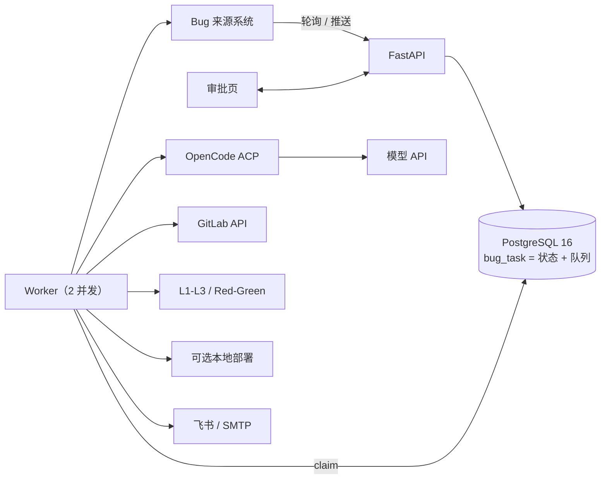

# Bug Auto-Fix MVP 实施方案（v0.3，Python / 无 CI）

> **版本**：0.3
> **日期**：2026-11-14
> **定位**：v0.2 设计基线的实施版；技术栈已定，CI 暂缓
> **已确认技术栈**：Python 3.12 + FastAPI + Pydantic + SQLAlchemy/asyncpg + Alembic + pytest + httpx + PostgreSQL 16 + OpenCode ACP + GitLab API + 签名链接审批 + 专用 Runner + Docker Compose
> **已确认范围调整**：MVP 不接 CI、不自动构建、不自动部署、不回写来源系统；交付到「已合入 test 分支」为止，部署由现有流程或可选本地脚本完成。
>
> **v0.3.1 变更（2026-11-16）**：已移除来源系统回写步骤；DONE 仅表示已合入 test。文中涉及回写的段落视为后续可选能力。

---

## 0. 结论与变更

### 0.1 一句话

> 用 Python 单服务把「Bug 接入 → 分析 → 方案审批 → ACP 修复 → L1–L3 + Red-Green → 结果审批 + 合并授权 → 恒定 cherry-pick 到 test → 回写」跑通；CI 与自动部署后续补。

### 0.2 与 v0.2 的差异

| 项 | v0.2 | v0.3 |
|----|------|------|
| 控制面语言 | Python 或 Java 二选一 | **Python 3.12 + FastAPI** |
| CI | GitLab Pipeline 按 SHA 触发 | **不做**，后续补 |
| 自动部署 | CI deploy job + 健康检查 + 回滚 | **不做**；可选本地 `deploy_command` |
| 交付终点 | 部署成功 + 健康检查 | **合入 test 分支**（或本地部署成功，若启用 hook） |
| 回滚 | 恢复上一版本 + revert MR | **无自动回滚**；建 revert MR，人工处理 |
| 排期 | 4 周 / 34 人日 | **3–4 周 / 28–32 人日**，取决于 ACP Spike |
| 数据表 | 7 张 | **7 张**，`delivery.step` 减少 |
| 状态数 | 12 | **12**，状态不变 |

### 0.3 范围例外（必须明确）

> 「不接 CI」指本系统**不触发、不解析、不等待** CI；GitLab 仓库本身仍可能自动运行既有流水线。系统只判断 MR 是否 `mergeable`，不解析 Pipeline 结果。

MVP **暂不满足**以下原定能力，不能对外宣称已满足：

- CI 按 Commit SHA 触发并回传结构化结果。
- 构建产物/镜像 digest 的 provenance。
- 自动部署测试环境与部署后健康检查。
- 部署失败自动回滚。

**补偿控制**：

- 所有 L1–L3 在 Runner 本地执行，退出码 + 日志留档。
- 记录 `test_merge_sha`，交付报告明确 `deployed=false`。
- `DONE` 的语义是「已合入 test 分支」，不是「已部署」。
- 回写来源系统时使用「已修复，待部署」而不是「已解决」（可配置）。
- CI 补齐前，不进入生产发布讨论。

### 0.4 核心 DoD（修订）

> 给定一个 Bug，系统完成「分析 → 方案审批 → ACP 修复 → L1–L3 + Red-Green → 结果审批 + 合并授权 → 只把这一个修复 cherry-pick 到 test → 回写」，全程可审计；任一步失败停在 `MANUAL`。

部署是否发生，由 `delivery.deploy_mode` 决定：

| 模式 | 行为 | `DONE` 含义 |
|------|------|-------------|
| `MERGE_ONLY`（默认） | 只合入 test，不部署 | 已合入 test，等待现有发布流程 |
| `LOCAL_DEPLOY`（可选） | 合入 test 后执行 `deploy_command` + 健康检查 | 已合入 test 且本地部署成功 |

---

## 1. 技术栈（已定）

### 1.1 运行时与框架

| 层 | 选型 | 说明 |
|----|------|------|
| 语言 | **Python 3.12** | 不用 3.13，避免依赖兼容性 |
| Web | **FastAPI + Uvicorn** | API、审批页、健康检查 |
| 配置 | **pydantic-settings + PyYAML** | 环境变量覆盖 YAML |
| 校验 | **Pydantic v2** | API、Agent 输出、配置 |
| ORM/DB | **SQLAlchemy 2.0 async + asyncpg** | 异步、连接池 |
| 迁移 | **Alembic** | 单库迁移 |
| 数据库 | **PostgreSQL 16** | 状态、队列、审批、审计 |
| 依赖管理 | **uv + pyproject.toml** | 锁定依赖、快速安装 |
| 日志 | **structlog**（JSON） | 结构化、可检索 |
| 指标 | **prometheus-client** | `/metrics` |
| 模板 | **Jinja2** | 审批页、补充信息页 |
| HTTP 客户端 | **httpx** | GitLab API、模型 API、通知 |
| GitLab | **python-gitlab** | MR、评论、分支；不碰 Pipeline |
| 重试 | **tenacity** | 外部调用退避 |
| 测试 | **pytest + pytest-asyncio + respx + testcontainers[postgres]** | 单测、HTTP mock、真实 PG |
| 代码质量 | **ruff + mypy（可选）** | lint/类型检查 |
| 容器 | **Docker Compose** | app + db + backup |

### 1.2 编码 Agent

| 项 | 选型 |
|----|------|
| Agent | **OpenCode** |
| 协议 | **ACP（JSON-RPC over stdio）** |
| 客户端 | Python `asyncio.create_subprocess_exec` + 行分隔 JSON-RPC |
| 会话 | `initialize → session/new → session/prompt → session/update → request_permission → cancel` |
| 权限 | Worktree/允许路径、命令白名单、网络代理 |
| 降级 | **不降级到 CLI 文本模式**；协议不匹配直接失败并告警 |

**已验证（2026-11-15，OpenCode 1.19.5）**：`initialize`、`session/new`、`session/prompt`、`session/update`、`session/request_permission` 可用；`allow_once` 可写入，`reject_once` 不写入。注意：

- 默认 `opencode.json` 不会触发权限请求；Runner 必须配置 `permission.edit=ask`、`permission.bash=ask`。
- **ACP 权限不是安全边界**：Worker 仍必须做 Diff/路径/命令校验，Runner 仍必须限制文件系统与网络。
- `session/new` 会返回默认模型；生产必须显式设置模型并记录实际值。
- 复测脚本：`scripts/verify_acp.py`。

### 1.3 外部系统

| 系统 | 接口 | 用途 |
|------|------|------|
| 来源系统 | REST/增量查询 + 评论 + 状态回写 | 接入、澄清、回写 |
| GitLab | REST API（`python-gitlab`） | 分支、MR、评论、合并 |
| 模型 | Provider SDK/HTTP | 分析；编码模型由 OpenCode 管理 |
| 通知 | 飞书自定义机器人 / SMTP | 发审批链接 |
| 部署（可选） | 本地 `deploy_command` + `health_url` | 仅 `LOCAL_DEPLOY` 模式 |

### 1.4 明确不用

- Temporal、Kafka/RabbitMQ、MinIO、Kubernetes、gVisor。
- CI/Pipeline API、构建产物仓库、镜像 digest。
- 模型网关、评测平台、向量数据库。
- 多 Agent 编排、多 Git Provider、多租户。

---

## 2. 架构

### 2.1 组件图



### 2.2 模块

```
app/
  main.py            # FastAPI
  worker.py          # worker loop + handlers
  config.py          # YAML + env
  state_machine.py   # 12 states + guards
  models.py          # SQLAlchemy models
  schemas.py         # Pydantic
  intake.py          # poll + push + adapter
  analyzer.py        # context + model call
  acp_client.py      # OpenCode ACP JSON-RPC
  coding.py          # worktree + fix + scope checks
  verifier.py        # L1-L3 + Red-Green + diff checks
  gitlab_ops.py      # MR / branch / comment
  delivery.py        # cherry-pick + merge + optional deploy
  approvals.py       # token + subject_hash + page
  notify.py          # Feishu webhook / SMTP
  audit.py
  metrics.py
gates/
  java.yaml
prompts/
  analyze.md
  fix.md
templates/
  approve.html
  needs_info.html
tests/
docker-compose.yml
config.yaml
```

### 2.3 进程模型

- **单服务**：API + 2 个 Worker 协程 + Poller 协程，同一个 app 容器。
- 编码/测试通过 `asyncio.create_subprocess_exec` 跑子进程，不阻塞事件循环。
- 后续要拆 Worker：把 `worker.py` 作为独立 entrypoint，复用同一镜像，不改业务代码。

---

## 3. 状态机（12 状态，不变）

| 状态 | 含义 | 超时 |
|------|------|------|
| `NEW` | 已入库待处理 | 5 min |
| `ANALYZING` | 分析中 | 20 min |
| `WAITING_INFO` | 信息不足等回复 | 72 h |
| `WAITING_PLAN_APPROVAL` | 等 Bug 执行人批准方案 | 24 h |
| `FIXING` | ACP 编码中 | 40 min |
| `VERIFYING` | L1–L3 + Diff 约束 | 30 min |
| `WAITING_APPROVAL` | 等 RESULT + MERGE | 48 h / 8 h |
| `DELIVERING` | 合并、提升、可选部署、回写 | 30 min |
| `DONE` | 已合入 test（或本地部署成功） | — |
| `MANUAL` | 人工接管 | — |
| `FAILED` | 不可恢复 | — |
| `CANCELLED` | 取消 | — |

### 3.1 与 v0.2 相同的部分

- 流转、Guard、审批绑定、幂等键、重试策略不变。
- `WAITING_APPROVAL` 同时承载 `RESULT`（Bug 执行人）与 `MERGE`（Code Owner）。
- 方案未批准不建分支；结果+合并未通过不交付。

### 3.2 与 v0.2 不同的部分

`DELIVERING` 的步骤从：

```
MR1 → MERGE1 → PROMOTE → MR2 → MERGE2 → PIPELINE → DEPLOY → HEALTH → ROLLBACK → WRITEBACK
```

改为：

```
MR1 → MERGE1 → PROMOTE → MR2 → MERGE2 → [DEPLOY_LOCAL] → [HEALTH] → WRITEBACK
```

- `[DEPLOY_LOCAL]` / `[HEALTH]` 仅在 `deploy_mode=LOCAL_DEPLOY` 时执行。
- 无 `PIPELINE`、无 `BUILD`、无 CI 构建号、无镜像 digest。
- 失败处理：
  - `MR1/MERGE1` 失败 → `MANUAL`（develop 未合入）。
  - `PROMOTE/MR2/MERGE2` 失败 → `MANUAL`（develop 已合入，test 未合入）。
  - `DEPLOY_LOCAL/HEALTH` 失败 → 执行 `rollback_command`（若配置）→ `MANUAL`；回滚失败 → `FAILED`。
  - `WRITEBACK` 失败 → 重试 3 次 → `MANUAL`。

---

## 4. 交付流程（无 CI）

### 4.1 步骤

```
RESULT + MERGE 都通过
 → 校验 fix_sha == 当前分支 HEAD，patch-id 未变
 → 推送 bugfix/{key}
 → 建 MR #1: bugfix/{key} → develop（squash=false，merge commit）
 → 等 MR 可合并（分支保护/审批）→ 合并（保留 fix_sha）
 → git fetch origin test
 → git worktree add promote/{key}-{n} origin/test
 → git cherry-pick -x {fix_sha}
      ├─ 冲突 → MANUAL
      └─ 成功 → patch-id 与 fix_sha 一致
 → 推送 promote 分支 → 建 MR #2: promote → test（squash=false）
 → 等 MR 可合并 → 合并
 → 记录 test_merge_sha
 → [可选] 执行 deploy_command + 健康检查
 → 回写来源系统 + 通知 + 总结
```

### 4.2 无 CI 时如何“等 MR 可合并”

先跑只读预检：`scripts/verify_gitlab_preflight.py`，确认 `merge_method=merge`、`squash_option!=always`、分支保护与权限。任一不满足，自动交付不可用。

没有 CI，就没有 Pipeline 状态可等。MVP 使用：

1. **GitLab MR 状态**：`merge_status == can_be_merged`；
2. **分支保护**：必需审批数、CODEOWNERS（若启用）；
3. **本地验证**：L1–L3 已在 `VERIFYING` 阶段跑过，结果作为证据附件写入 MR 描述/评论；
4. **可选**：仓库已有外部流水线（不由本系统触发），MR 页面显示其状态；本系统不解析，只做人工确认。

> 如果仓库分支保护要求“流水线必须成功”，而 MVP 又不接 CI，则自动合并会被 GitLab 拒绝。此时有两个选择：
> - 给 Bot 临时绕过权限（不推荐）；
> - `delivery.merge_mode=CREATE_MR_ONLY`：只创建 MR，不自动合并，由人合并；合并后 Poller 检测到 `test` 分支变化，继续回写。
>
> MVP 默认 `AUTO_MERGE_IF_ALLOWED`；被分支保护拒绝时自动降级为 `CREATE_MR_ONLY` 并转 `MANUAL`，不绕过保护。

### 4.3 可选本地部署

```yaml
deploy:
  mode: MERGE_ONLY            # MERGE_ONLY | LOCAL_DEPLOY
  command: "./deploy-test.sh {sha}"
  health_url: "https://test-order.internal/healthz"
  rollback_command: "./rollback-test.sh"
  timeout_seconds: 600
```

- `LOCAL_DEPLOY` 时，在专用 Runner 上执行 `command`；退出码 0 + 健康检查 200 才算成功。
- 记录命令、退出码、耗时、日志；不生成镜像 digest。
- 健康检查失败 → 执行 `rollback_command`；回滚成功 → `MANUAL`；回滚失败 → `FAILED`。
- `MERGE_ONLY` 时，`DONE` 明确标记 `deployed=false`。

### 4.4 回写语义

| 模式 | 回写状态 | 评论 |
|------|----------|------|
| `MERGE_ONLY` | `FIXED_WAITING_DEPLOY`（可配置） | 已合入 test，等待部署 |
| `LOCAL_DEPLOY` 成功 | `RESOLVED` | 已合入 test 并部署测试环境 |
| `LOCAL_DEPLOY` 失败 | `FIXED_WAITING_DEPLOY` | 已合入 test，部署失败，已回滚/待处理 |

不要把 `MERGE_ONLY` 回写成 `RESOLVED`，否则来源系统会误以为已上线。

---

## 5. 数据模型调整

仍为 7 张表；只调整 `delivery` 的步骤与 `detail` 内容。

### 5.1 `delivery.step` 取值

```
MR1 / MERGE1 / PROMOTE / MR2 / MERGE2 / DEPLOY_LOCAL / HEALTH / ROLLBACK / WRITEBACK
```

- `PIPELINE`、`BUILD`、`DEPLOY` 暂不使用；后续接 CI 时再加，不需要改表结构。
- `detail` JSONB 示例：

```json
{
  "mr_iid": 812,
  "mr_url": "https://gitlab.../merge_requests/812",
  "source_sha": "def789",
  "target_sha": "aaa111",
  "patch_id": "p_...",
  "deploy_mode": "MERGE_ONLY",
  "deployed": false,
  "command": null,
  "exit_code": null,
  "health": null
}
```

### 5.2 `bug_task` 字段

保留 v0.2 的字段；增加：

| 字段 | 用途 |
|------|------|
| `test_merge_sha` | test 分支合并后的 SHA |
| `delivery_mode` | `MERGE_ONLY` / `LOCAL_DEPLOY` |
| `deployed` | 是否实际部署 |
| `writeback_status` | 回写来源系统的状态 |

### 5.3 `artifact`

不变：`ANALYSIS / PLAN / DIFF / EVIDENCE / SUMMARY`，本地路径 + sha256。

---

## 6. API（不变，少量调整）

| 方法 | 路径 | 用途 |
|------|------|------|
| POST | `/api/intake` | 外部推送 Bug |
| GET | `/api/tasks` | 列表 |
| GET | `/api/tasks/{id}` | 详情 + 审批/交付状态 |
| POST | `/api/tasks/{id}/retry` | 从 `MANUAL` 重新入队 |
| POST | `/api/tasks/{id}/cancel` | 取消 |
| GET | `/a/{token}` | 审批页 |
| POST | `/a/{token}` | 提交决策 |
| POST | `/api/admin/pause` | Kill Switch |
| GET | `/healthz` | 健康 |
| GET | `/metrics` | Prometheus |

`GET /api/tasks/{id}` 的响应增加：

```json
{
  "state": "DONE",
  "fix_sha": "def789",
  "test_merge_sha": "bbb222",
  "delivery_mode": "MERGE_ONLY",
  "deployed": false,
  "writeback_status": "FIXED_WAITING_DEPLOY"
}
```

---

## 7. 配置（无 CI）

```yaml
app:
  base_url: https://autofix.internal
  admin_token_env: AUTOFIX_ADMIN_TOKEN
  approval_secret_env: AUTOFIX_APPROVAL_SECRET

source:
  type: gitlab_issues
  project: group/order-service
  labels: ["bug", "auto-fix"]
  poll_interval_seconds: 300

project:
  repo: group/order-service
  gitlab_url: https://gitlab.internal
  branches:
    base: develop
    test: test
    allow_squash: false
  limits:
    max_files: 10
    max_lines: 200
    allowed_paths: ["src/main/**", "src/test/**"]
    forbidden_paths:
      - "pom.xml"
      - "build.gradle"
      - "package-lock.json"
      - ".gitlab-ci.yml"
      - "ci/**"
      - "deploy/**"
      - "db/migration/**"

gates:
  compile: "./mvnw -q -DskipTests compile"
  unit: "./mvnw -q -Dtest='!*IT' test"
  regression: "./mvnw -q -Dtest={test_class} test"
  timeout_seconds: 600

delivery:
  merge_mode: AUTO_MERGE_IF_ALLOWED   # AUTO_MERGE_IF_ALLOWED | CREATE_MR_ONLY
  deploy:
    mode: MERGE_ONLY                  # MERGE_ONLY | LOCAL_DEPLOY
    command: null
    health_url: null
    rollback_command: null

approval:
  channel: link
  user_map: { "zhangsan": "ou_xxx" }
  code_owners: ["lisi", "ou_yyy"]
  gates:
    plan:   { approver: assignee, fallback: ["ou_xxx"], ttl_hours: 24, max_reject: 2 }
    result: { approver: assignee, fallback: ["ou_xxx"], ttl_hours: 48 }
    merge:  { approver: code_owner, fallback: ["ou_yyy"], ttl_hours: 8 }

agent:
  type: opencode
  protocol: acp
  command: ["opencode", "acp"]
  timeout_minutes: 40
  max_attempts: 3
  network:
    mode: proxy
    proxy_env: HTTPS_PROXY

model:
  analysis:
    provider: anthropic
    model: claude-opus-5-5
    api_key_env: ANTHROPIC_API_KEY

budget:
  max_usd_per_task: 8
  max_usd_per_day: 200
```

---

## 8. 排期（3–4 周 / 28–32 人日）

| 周 | 任务 | 人日 |
|----|------|------|
| 1 | PG Schema、`bug_task` 队列、Worker 协程、状态 handler、Poller/Intake、指纹去重 | 5 |
| 1 | 分析 Prompt、`rg` 上下文、`analysis.json`、方案审批页 | 4 |
| 2 | ACP Client、OpenCode 会话/权限/取消、Worktree、单提交 | 5 |
| 2 | Verifier L1–L3、Red-Green、Diff 约束、结果/合并审批 | 5 |
| 3 | GitLab MR #1、恒定 cherry-pick、patch-id、MR #2 | 4 |
| 3 | 回写、通知、Kill Switch、备份、可选本地部署 | 3 |
| 4 | 10 个真实 Bug、缺陷修复、文档、演练 | 4 |
| — | 合计 | **30 人日** |

- 如果 ACP Spike 一次通过、仓库 merge commit 可用，3 周可完成核心；第 4 周用于试点。
- 如果 ACP 不可用或分支保护要求 CI，自动合并会被阻断，需要 `CREATE_MR_ONLY` 降级，交付仍可跑通但需人工点合并。

---

## 9. 验收（修订）

### 9.1 功能

- [ ] 轮询与推送都能建任务；重复投递不重复建。
- [ ] 方案未批准不建分支、不调编码 Agent。
- [ ] 非执行人审批 `PLAN/RESULT` 返回 `APPROVAL_FORBIDDEN`；非 Code Owner 审批 `MERGE` 同理。
- [ ] 方案驳回后重新分析，`analysis_v` 递增，旧 `PLAN` 失效。
- [ ] 结果审批前改代码 → `RESULT`/`MERGE` 失效（`APPROVAL_STALE`）。
- [ ] 编码通过 ACP 执行；未使用 CLI 文本模式。
- [ ] 测试分支只含一个修复提交；patch-id 一致；无其他变更。
- [ ] 修复 ≤10 文件/200 行；超阈值 100% 停在 `MANUAL`。
- [ ] `test_merge_sha` 记录正确；`deployed=false` 明确可见。
- [ ] 服务重启后从原状态继续，不重复建分支。
- [ ] Kill Switch 后 60s 内不领取新任务、不合并。

### 9.2 质量与安全

- [ ] 10 个试点 Bug 的 test 分支变更 100% 只有本次修复（逐个人工核对 diff）。
- [ ] 每个合入修复都有 Red-Green 证据（base FAIL、fix PASS）。
- [ ] 无越界；越界 100% `MANUAL`。
- [ ] 审批重放 409；过期 410；对象变化 `APPROVAL_STALE`。
- [ ] Runner 无生产凭据；Agent 无 push 权限。
- [ ] 分支保护未被绕过；自动合并被拒绝时降级为 `CREATE_MR_ONLY` 并转 `MANUAL`。

### 9.3 指标（试点 2 周）

| 指标 | 目标 |
|------|------|
| 合入 test 成功率 | ≥40%（10 个里至少 4 个） |
| 单 Bug P95 时长 | ≤60 min |
| 单 Bug 成本 | ≤$5 |
| 卡死任务 | 0 |
| 方案一次通过率 | ≥60% |
| 人工干预率 | ≤60% |
| 部署成功率 | 仅 `LOCAL_DEPLOY` 统计，不纳入 MVP 主指标 |

---

## 10. CI 后续补齐

### 10.1 需要补的接口

```python
class CIPipelineAdapter(Protocol):
    async def trigger(self, ref: str, sha: str) -> str: ...
    async def wait(self, pipeline_id: str, timeout: int) -> PipelineResult: ...
```

### 10.2 需要加回的步骤

```
MR2 → MERGE2 → PIPELINE → DEPLOY → HEALTH → ROLLBACK → WRITEBACK
```

- `delivery.step` 增加 `PIPELINE`、`BUILD`、`DEPLOY`；表结构不变。
- `delivery.detail` 增加 `pipeline_id`、`build_id`、`artifact_digest`。
- `DONE` 语义从「已合入 test」升级为「已部署测试环境」。
- 增加 `deployed=true` 的回写与指标。
- 增加部署失败自动回滚。

### 10.3 CI 补齐前不要做的事

- 不要对外宣称「自动交付到测试环境」。
- 不要把 `MERGE_ONLY` 的 `DONE` 当作「已部署」。
- 不要在 CI 缺失时自动绕过分支保护。

---

## 11. 风险

| # | 风险 | 缓解 |
|---|------|------|
| R1 | 无 CI，MR 可能因分支保护无法自动合并 | `AUTO_MERGE_IF_ALLOWED` → 拒绝时 `CREATE_MR_ONLY` + `MANUAL` |
| R2 | `DONE` 被误解为已部署 | 状态/报告/回写都区分 `deployed=false` |
| R3 | 本地测试环境与生产不一致 | L1–L3 在 Runner 跑；部署若启用，健康检查必须通过 |
| R4 | OpenCode ACP 不可用 | Phase 0 Spike；不通过换 Agent 或暂停 |
| R5 | cherry-pick 冲突 | 冲突即 `MANUAL`；统计冲突率 |
| R6 | 单服务单点 | Compose 重启 + PG 队列恢复 |
| R7 | 专用 Runner 隔离弱 | 仅可信仓库；不可信代码前加 sandbox |
| R8 | 无构建 provenance | 记录 test SHA + 本地命令/日志；CI 补齐后补 digest |
| R9 | 审批链接泄露 | 单次 token + 24h + 角色 + IP/UA |
| R10 | Code Owner 不响应 | 8h 提醒、到期 `MANUAL`、白名单兜底 |

---

## 12. 仍需拍板的事项

| # | 事项 | 建议 |
|---|------|------|
| 1 | GitLab 还是 GitHub | 选现有仓库平台；MVP 只做一个 |
| 2 | 首个来源系统 | 选有增量 API + 评论 + assignee 的一个 |
| 3 | OpenCode ACP 版本 | Phase 0 做 1 天 Spike |
| 4 | 仓库是否允许 merge commit | 必须允许；否则 `CREATE_MR_ONLY` 或停用自动交付 |
| 5 | Bug 执行人 / Code Owner 映射 | 明确 `user_map` 与 `code_owners` |
| 6 | 是否启用 `LOCAL_DEPLOY` | 有部署脚本则启用；否则 `MERGE_ONLY` |
| 7 | 模型 Provider / 合规 | 外部 API 或私有化网关 |
| 8 | 试点仓库 | 单模块、测试基础好、Bug 有堆栈 |
| 9 | 审批 SLA | 方案 24h、结果 48h、合并 8h |
| 10 | 回写状态字典 | `FIXED_WAITING_DEPLOY` / `RESOLVED` 与来源系统对齐 |

## 附录 E：MySQL 8.0+ 适配（备选，不采用）

> **已决策：当前实现保留 PostgreSQL 16，不换 MySQL。** 本附录仅作为未来备选参考，不进入 v0.3 实施范围。

**结论：可以换，但必须是 MySQL 8.0.21+（建议 8.4 LTS），不能用 5.7。** 本方案没有深依赖 PostgreSQL 的能力，7 张表足够简单；需要改的是队列抢占、部分唯一索引、JSON 类型、时间类型和迁移方式。预计 **1.5–2 人日**。

### E.1 必须改的 8 处

| # | PostgreSQL | MySQL 8.0+ | 说明 |
|---|------------|------------|------|
| 1 | `asyncpg` | `asyncmy` | SQLAlchemy URL：`mysql+asyncmy://` |
| 2 | `SELECT ... FOR UPDATE SKIP LOCKED` + `UPDATE ... RETURNING` | 同左支持 `SKIP LOCKED`，但**不支持 `UPDATE ... RETURNING`** | 改为「事务内 SELECT 锁定 ID → UPDATE → COMMIT → 再读行」 |
| 3 | 部分唯一索引 `WHERE state NOT IN (...)` | **不支持部分索引** | 用生成列 `active_key` + 唯一索引；终态置 NULL，MySQL 唯一索引允许多个 NULL |
| 4 | `JSONB` + GIN | `JSON` | 无 GIN；MVP 不按 JSON 内部字段检索，够用 |
| 5 | `gen_random_uuid()` | 无 | 应用侧生成 UUID，存 `CHAR(36)` |
| 6 | `TIMESTAMPTZ` | `DATETIME(6)` + UTC | 连接 `time_zone='+00:00'`，比较用 `UTC_TIMESTAMP(6)` |
| 7 | `TEXT` 无长度限制 | `TEXT` 最大 64KB | `body`/`diff` 用 `LONGTEXT` |
| 8 | `ON CONFLICT` | `ON DUPLICATE KEY UPDATE` | 用于 `sys_config` upsert、幂等插入 |

### E.2 队列表

```sql
create table bug_task (
  id                char(36) primary key,
  source            varchar(32) not null,
  issue_key         varchar(64) not null,
  fingerprint       char(64) not null,
  title             varchar(512) not null,
  body              longtext not null,
  repo              varchar(255) not null,
  base_branch       varchar(64) not null default 'develop',
  test_branch       varchar(64) not null default 'test',
  state             varchar(32) not null,
  attempt           int not null default 0,
  version           int not null default 0,
  branch            varchar(255),
  base_sha          char(40),
  plan_version      int not null default 0,
  plan_reject_count int not null default 0,
  fix_sha           char(40),
  patch_id          varchar(128),
  fix_merge_sha     char(40),
  test_merge_sha    char(40),
  delivery_mode     varchar(32) not null default 'MERGE_ONLY',
  deployed          tinyint(1) not null default 0,
  writeback_status  varchar(64),
  last_error        text,
  next_run_at       datetime(6) not null default current_timestamp(6),
  lease_until       datetime(6),
  created_at        datetime(6) not null default current_timestamp(6),
  updated_at        datetime(6) not null default current_timestamp(6)
    on update current_timestamp(6),
  active_key char(64)
    generated always as (
      case when state in ('DONE','CANCELLED','FAILED') then null
           else sha2(concat(source, ':', issue_key), 256) end
    ) stored,
  unique key bug_task_active_uq (active_key),
  key bug_task_pick_idx (state, next_run_at)
) engine=InnoDB default charset=utf8mb4;
```

> MySQL 唯一索引允许多个 NULL，所以终态任务的 `active_key` 为 NULL，不会互相冲突。`sha2` 是确定性函数，可用于生成列。

### E.3 队列抢占

```sql
START TRANSACTION;

SELECT id INTO @picked_id
FROM bug_task
WHERE state IN ('NEW','ANALYZING','WAITING_INFO','WAITING_PLAN_APPROVAL',
                'FIXING','VERIFYING','WAITING_APPROVAL','DELIVERING')
  AND next_run_at <= UTC_TIMESTAMP(6)
  AND (lease_until IS NULL OR lease_until < UTC_TIMESTAMP(6))
ORDER BY next_run_at
LIMIT 1
FOR UPDATE SKIP LOCKED;

UPDATE bug_task
SET lease_until = DATE_ADD(UTC_TIMESTAMP(6), INTERVAL 50 MINUTE),
    version = version + 1
WHERE id = @picked_id;

COMMIT;
```

- 第二次 `SELECT` 读取刚锁定的行；事务提交后开始处理。
- 若 `@picked_id` 为 NULL，直接提交并等待。
- 不能用 `UPDATE ... RETURNING`；不要用 `SELECT ... FOR UPDATE` 后直接返回旧行，必须在同一事务内更新。

### E.4 其他调整

- `artifact`：`path` 用 `varchar(512)`，`sha256 char(64)`，`size bigint`。
- `agent_run`：`result JSON`，`cost_usd decimal(10,4)`。
- `approval`：`subject_hash char(64)`，`token_hash char(64)`，`ip varchar(45)`。
- `delivery`：`detail JSON`，`unique(task_id, step)`。
- `event_log`：`payload JSON`。
- `sys_config`：`value JSON`；upsert 用 `INSERT ... ON DUPLICATE KEY UPDATE value=VALUES(value)`。
- 迁移：Alembic 可用 `pymysql` 同步连接跑迁移，应用用 `asyncmy`；MySQL DDL **不是事务性的**，迁移失败不能自动回滚，必须先备份、先在 staging 跑。
- 备份：`mysqldump --single-transaction` + binlog（若需要 PITR）；托管 MySQL 用自动备份。
- 测试：`testcontainers[mysql]`，镜像 `mysql:8.4`。
- 时区：连接初始化 `SET time_zone = '+00:00'`；所有时间写 UTC，展示层转换。

### E.5 风险

| 风险 | 缓解 |
|------|------|
| 生成列/唯一索引行为与 PG 不同 | 单测覆盖「活动任务唯一、终态可重开、并发建任务」 |
| 无 `UPDATE ... RETURNING`，抢占非原子 | 事务内 SELECT + UPDATE；唯一约束 + 版本号兜底 |
| `TEXT` 截断 | `body`/`diff` 用 `LONGTEXT`；单文件上限 5MB |
| 时区错乱 | 全链路 UTC；连接时区固定；测试跨时区 |
| DDL 不可回滚 | 迁移前备份；staging 先跑；破坏性变更拆步 |
| MySQL 5.7 不支持 `SKIP LOCKED` | 明确要求 8.0.21+，5.7 直接拒绝 |

### E.6 建议

- 组织已有 MySQL 8.0+、DBA、备份体系 → **可以换**，按 E.1–E.4 改，成本 1.5–2 人日。
- 没有既定标准 → **保留 PostgreSQL**：部分唯一索引、JSONB、`UPDATE ... RETURNING` 让队列表和幂等更直接，少写兼容代码。
- 不要用 MySQL 5.7；不要在没有测试的情况下换 MariaDB（`RETURNING` 与 MySQL 行为不同）。